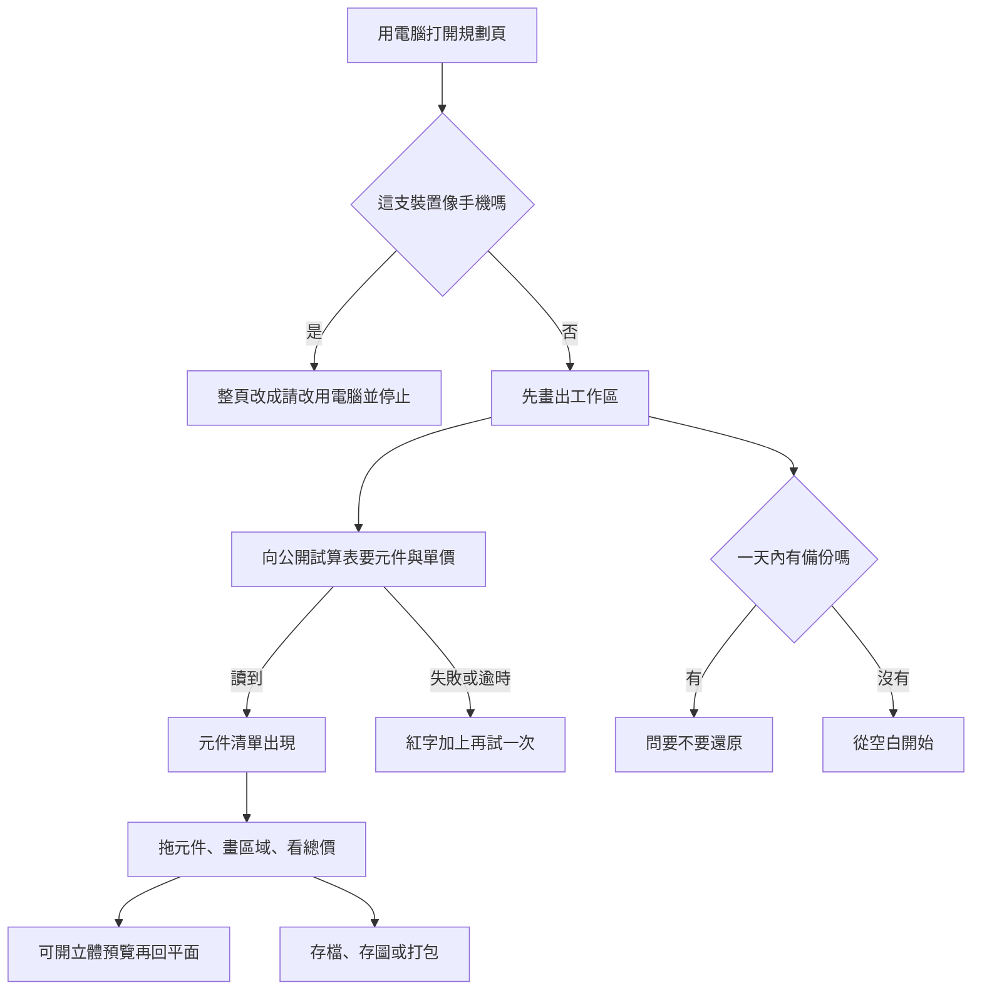

# 互動式室內設計規劃工具 (LayoutPlanner) 技術規格書

> **編號**：04  
> **版本**：2.2（2026-11-22 對照現行程式；2.0 合併舊檔，2.1 補報價與分類圖層）  
> **最後對照程式**：2026-11-22（Asia/Taipei）  
> **隸屬**：[CODING 全量系統全景圖](./07_全量系統全景圖.md) 之設計引擎模組  
> **對應程式**：`modules/InteriorDesigned/LP_LayoutPlanner.html` + `LP_LayoutPlanner.js` + `LP_core.js`  
> **立體預覽細節**：同目錄 `SPEC_LAYOUT_PLANNER_3D.md`（網格高度、開門挖洞）。本檔寫人怎麼走，不整份複製。  
> **後端**：沒有對應的 Google Apps Script。不進會計、不進打卡。  
> **關聯工具**：`LP_LayoutSheetViewer.html`（僅檢視／編輯試算表預覽，不寫回 Sheet）

---

## 1. 產品定位與目標使用者

- **定位**：CODING 核心設計引擎；單頁式室內平面**互動排版**，結合 Google 試算表驅動之**元件庫與單價**，產出**視覺平面圖**與**粗估報價**（含免責聲明）。主程式 `LP_LayoutPlanner.js` 為大型幾何／計價模組（Canvas 2D 空間配置與動態決策）。
- **目標使用者**：需快速在平面底圖上配置櫃体／家具、標註工程項、圈選天花／地板施工區並試算費用之內部或客戶端使用情境。
- **明確非目標**：非專業 CAD／非即時協作編輯、非經正式簽核之工程契約報價。圖面不會自動變成請款或合約。

### 1.1 人怎麼走

1. 用電腦開規劃頁（手機只看到「請改用電腦」，後面的程式不跑）。
2. 畫面先出現工作區。同時向公開試算表要元件與單價；失敗會紅字並可再試，不會把已經載入的清單清成空白。
3. 若這台瀏覽器在 24 小時內有備份，會先問要不要還原。
4. 拖元件、畫天花／地板／牆、看右欄總價。施工面積那一格只是備註，不會改總價。
5. 需要看空間時按「3D 檢視」：可鳥瞰，或進到室內走動。回到平面不會改已畫的內容。
6. 可存成 JSON、另存圖片，或打包成 ZIP（圖＋JSON＋預算表）。約每分鐘會把現況寫進這台瀏覽器。

**程式對照表**

| 白話（圖上寫的） | 程式對照（開發用） |
|------------------|-------------------|
| 用電腦打開規劃頁 | `LP_LayoutPlanner.html` 載入 `LP_LayoutPlanner.js` |
| 這支裝置像手機嗎／整頁改成請改用電腦 | `window.onload` 與頁尾腳本看 User-Agent 是否含 `Mobi`；是則顯示 `#mobile-warning` 並 return |
| 先畫出工作區 | `initWorkspaceAndUiFromStorage`、`#design-canvas` |
| 向公開試算表要元件與單價 | `loadFromSheets`（gviz，約 10 秒逾時） |
| 紅字加上再試一次 | `showComponentSheetLoadError_`；已有清單時不清 `cabinetCategories` |
| 一天內有備份嗎／問要不要還原 | `checkAndRestoreBackup`、`localStorage` 鍵 `layoutPlanner_autosave_v1` |
| 拖元件、畫區域、看總價 | `placedCabinets`、`drawnAreas`、`updateQuotation` |
| 可開立體預覽再回平面 | `#toggle-3d-view-btn`、`ensureLp3dViewer`、`closeLayoutPlanner3D` |
| 存檔、存圖或打包 | `saveLayout`、`saveCanvasAsImage`、`downloadDesignFilesAsZip` |

---

## 2. 執行環境與技術架構

### 2.1 執行環境

- **建議**：以本機或網站 **HTTP(S) 伺服器**開啟；**不建議**以 `file://` 直接開啟（ES `import`、部分 API 行為可能異常）。
- **模組**：`LP_LayoutPlanner.html` 以 `<script type="module" src="./LP_LayoutPlanner.js">` 載入，依賴同目錄之 `LP_core.js`（通知、SVG 消毒、幾何／碰撞輔助函式等）。
- **行動裝置**：以 **User-Agent 含 `Mobi`** 判斷為行動裝置時，顯示全畫面提示並**中止主程式初始化**（避免小螢幕操作）；曾修正 iframe 內寬度誤判，改以 UA 為主。

### 2.2 前端技術棧（CDN）

- **Tailwind CSS**（`cdn.tailwindcss.com`）
- **html2canvas**：畫布匯出 PNG、ZIP 內截圖
- **JSZip**：打包 PNG + JSON + CSV
- **已移除**：先前曾載入 **OpenCV.js** 但未於本工具呼叫；已自 `LP_LayoutPlanner.html` 移除以減少體積。

### 2.3 遠端資料來源

- **Google Sheets**：透過 **gviz** 公開 JSON（`tqx=out:json&gid=0`）讀取元件清單。
- **載入失敗**：不可把空白清單當成「沒有元件」。設定頁「分類圖層」與「元件」頁籤須人話＋「再試一次」；成功前不清空已載入的分類。逾時約 10 秒。
- **試算表 ID**（寫死於 `LP_LayoutPlanner.js`）：`1y8iD3Pe8AvYxDYFGYVOZ0afsdW10j1GSnDXqUCyEh-Q`
- **LP_LayoutSheetViewer** 使用相同 ID 與 `gid=0`，僅供預覽／編輯 I 欄文字，**不寫回** Sheet。

### 2.4 座標、渲染與核心引擎

**三級座標**

1. **畫布座標 (Canvas space)**：滑鼠事件觸發的直接位置。
2. **世界座標 (World space)**：考慮 `viewScale`（畫布縮放比）後的相對座標；所有 Drag／Click 須除以 `viewScale` 還原真實座標。
3. **物理尺寸 (Physical space)**：透過 `pixelsPerMeter` 換算實際單位；`1 尺 = 30 cm`，計價無條件進位至 **0.5 尺**。

**三層渲染**

1. **Drawn Areas Layer (SVG)**：地板、天花板、牆體填充；`fill-rule: evenodd` 內孔扣除。
2. **Placed Cabinets (DOM)**：家具以 DOM 包覆 SVG，用 CSS `transform` 處理旋轉與鏡像。
3. **Drawing Preview／Interaction Layer**：頂點控點、選取框。

**碰撞與牆體（`LP_core.js`）**

- **SAT**：分離軸定理，支援旋轉矩形；**MTV** 最小推離位移實現硬碰撞與貼齊；**AllowOverlap** 可由 Sheet M 欄豁免（地攤、標註等）。
- **牆壁引擎**：`offsetPolygon` 外擴路徑；`evenodd` 組合內外圈模擬厚度；**Ortho Snap**（Shift／Alt）正交鎖定。
- **牆體鎖定**：分離「繪圖鎖定」與「牆體鎖定」，佈置家具時不誤觸結構。
- **SVG 校正**：`autoFixSvgGeometry` 偵測 StrokeWidth 向內縮進，避免裁切；載入時經 `normalizeSheetSvg`（消毒 + 校正）。

> [!IMPORTANT]
> 修改渲染或互動時，務必確保 `viewScale` 全域變數同步更新，以免滑鼠選取偏位。

---

## 3. 功能規格（現況行為）

### 3.1 工作區與檢視

- **畫布邊長**：預設 **2000×2000**（圖上 1px＝1cm）。設定頁可選 2000／2400／2600／3000／3500，記住在這台瀏覽器。程式另接受 800～5600（例如舊檔帶了選單沒有的邊長）；太小當 2000、太大收到 5600。改邊長**不搬**已擺好的物件。
- **網格**：50px 間距（`#grid-layer`），可關。關掉只藏格線，拖曳吸附仍在；按住 Shift 可暫時不吸。拖曳步距可選 2／5／10 cm，預設 2。
- **縮放**：`viewScale`；**Ctrl + 滾輪**、縮放按鈕、重置；套用於 `#design-canvas` transform。
- **捲動**：`#canvas-wrapper` 捲動；載入後嘗試捲至畫布中心。

### 3.2 底圖（平面圖）

- **上傳**：本機圖檔 → `data:` URL 顯示於 `#bg-img`。
- **底圖調整模式**：勾選後可調整縮放；未勾選時控制區 `opacity-50 pointer-events-none`。
- **底圖變換**：獨立 `bgScale`／`bgPosition`，支援平移縮放「照圖描繪」。
- **比例**：建議搭配「比例尺 90CM」元件與門寬比對；屬操作指引，非自動校正。

### 3.3 元件庫（櫃体／家具等）

- **載入**：自 Sheet 依 **群組（J 欄）** 分類，渲染於「元件」頁籤。讀取中顯示「正在載入…」；失敗見 §2.3，不可維持「載入元件後顯示分類」讓人以為還沒開始。
- **拖放**：拖入畫布建立 `placedCabinets`（位置、旋轉、寬深、透明度、備註、才數、鏡像、副屬性等）。
- **互動**：點選、拖曳、四向縮放、**R** 旋轉、**M** 鏡像、**[`]** 圖層、方向鍵微移、**D／Delete** 刪除、**Ctrl+D** 複製。
- **碰撞**：SAT 對 OBB 重疊偵測；拖曳以 MTV 推開；邊緣貼齊不視為碰撞（見 §5）。
- **手動改寬深**：`applyCabinetVisualUpdate` 僅更新單一 DOM，避免整批重繪失焦。
- **圖像來源**：I 欄為內嵌 SVG 或 http(s) URL；經 `sanitizeSvgString`、`normalizeSheetSvg`、`processSvgStr` 處理。

### 3.4 區域繪製（天花板／地板／牆壁）

- **模式**：按鈕進入；**點擊**加頂點；**Enter** 完成；**Esc** 取消。
- **天花／地板**：多邊形面積 → 坪數（面積 ÷ 30000 再 `Math.ceil` 為 `areaInPing`）。
- **地板損耗**：`calculateFloorAreaWithLoss`：×1.2 後進位至 **0.5 坪**。
- **連結元件**：完成後連結 Sheet「平釘天花板」「超耐磨木地板」列（若存在），否則程式內建預設。
- **牆壁**：至少 3 點；`calculateWallPath` 厚度偏移；**牆壁不列入 `calculateFullQuotation`**（`type === 'wall'` return）。
- **圖層開關**：可切換天花／地板／牆壁顯示；可鎖定牆壁／繪圖。
- **分類圖層**（2026-07-14）：工具箱「工程標註」區依 Sheet **J 欄群組**（如水電、櫃體、木作）列出勾選；取消勾選則隱藏該群組之**平面上的**元件、工程標註、天花／地板區域（牆壁仍用「顯示牆壁結構」獨立控制）。狀態寫入佈局 JSON `layerVisibility`。**不改報價、也不讓 3D 跟著藏**（見已知問題）。

### 3.5 工程標註

- **新增**：畫布中央建立文字方塊 + 指示點（預設如「隱藏門」）。
- **計價**：可走主項目 + 副屬性；`source === 'annotation'` 且 `customAddons[0]` 可覆寫單價／數量／單位。

### 3.6 預算與報價

- **總價**：`updateQuotation` → `getQuotationForDisplay`（含手動覆寫）之 `grandTotal`。
- **明細 Modal**：依工程分組插入標題列；副屬性列（`└`）視覺縮排、淺灰字。
- **合併列規則**（`calculateFullQuotation`、`quotationAssignSpatialClusterKeys`）：
  - **櫃體／標註**：每個實例獨立一列（合併鍵含 `id`）；副屬性緊跟該主項目下方，排序時不與他處同類副屬性併排。
  - **天花／地板區域**：帳面條件相同時，仍依 **spatialCluster**（邊到邊距離 ≤ **55**）決定是否合併列。
  - **帳面條件**：群組、名稱、單價、單位、`pricingType`、備註、副屬性指紋等；**不以**櫃寬高或區塊坪數決定櫃體是否分列。
  - **規格**欄：多種規格以「、」串接。
- **手動編輯**（2026-07-14）：Modal「編輯報價」可改項目、單位、數量、總價、備註；可隱藏列；「還原自動計算」清除覆寫。覆寫存於 `quotationManualOverrides`，隨佈局 JSON／自動備份；列印／CSV／ZIP 採用覆寫後內容。
- **分組排序**：`LP_GROUP_DISPLAY_ORDER`；實際群組取決於 Sheet／標註資料。
- **匯出**：列印／PDF（`@media print` + `#budget-modal`）、CSV、ZIP 內 CSV。
- **免責聲明**：Modal 內建僅供參考文字。

### 3.7 輸出與檔案

| 動作 | 內容 |
|------|------|
| **另存圖片 (PNG)** | 先取消選取，再把很淡的「添心設計」浮水印打開，用 html2canvas 截 `#design-canvas`。不是可選；說明書寫「乾淨的設計圖」與程式不一致（見已知問題）。截圖失敗目前沒有失敗句，浮水印可能留在畫面上 |
| **儲存佈局 (.json)** | 見 §4。不檢查瀏覽器是否真的下載完成 |
| **載入佈局 (.json)** | 任何能解析的 JSON 都會換掉目前圖面，並顯示成功。不會先確認是不是平面檔（見已知問題） |
| **下載 ZIP** | PNG + JSON + 預算 CSV（UTF-8 BOM）。失敗會出紅字。下載後跳出寄信說明（收件信箱寫在頁面上） |

### 3.8 復原／重做與自動備份

- **歷史**：`history`／`historyIndex`，最多約 **50** 步（`MAX_HISTORY_STATES`）；**Ctrl+Z**／**Ctrl+Y**／**Ctrl+Shift+Z**。改邊長、改施工面積、改報價覆寫都會進這疊。
- **自動儲存**：每 **60 秒** 寫入 `localStorage`（`layoutPlanner_autosave_v1`），成功才跳出約 1 秒的「進度已自動備份」。改畫布邊長會立刻再寫一次，且不跳出那句。啟動時 24 小時內有備份則 `confirm` 詢問還原；超過 24 小時就當作沒有。測試預覽網址（網址帶預覽參數）**不**做自動備份。
- **寫不進去時**：只在主控台留字，畫面不說。底圖是整張圖放進同一包，空間不夠時常見（見已知問題）。
- **按取消不還原**：對話寫「忽略此備份」。約一分鐘後（或立刻改邊長時）會把**現在的畫面**寫上去，空白也會蓋掉剛才那份（見已知問題）。

### 3.9 聯絡與行銷

- **LINE**：官方連結、複製 LINE ID。
- **Email**：`tanxintainan002@gmail.com`（客戶寄件參考）。

---

## 4. 資料模型

### 4.1 佈局 JSON（`version: '2.0'`）

- `placedCabinets`、`drawnAreas`（`ceiling` | `floor` | `wall`）、`placedAnnotations`
- `background`：`position`、`scale`、`src`
- `constructionArea`：設定頁 `#construction-area`，備註／匯出用，**不連動計價**
- `quotationManualOverrides`：報價單手動覆寫（可選）
- `layerVisibility`：分類圖層顯示開關（可選；`false` = 隱藏該群組）
- `timestamp`／`prettyTime`：自動備份用
- `workspaceSize`：畫布邊長（cm）。沒有或超出 800～5600 時，載入後回到 2000
- 元件上可有 `model3dKind`：立體裡要當門、窗還是櫃。沒填就依名稱與群組猜

### 4.2 Google Sheet 欄位（`gid=0`，資料自第二列）

| 索引 | 欄位 | 用途 |
|------|------|------|
| 0 (A) | 名稱 | 元件名稱 |
| 1–2 (B–C) | 寬／深 | cm |
| 3 (D) | 單價 | 整數 |
| 4 (E) | 計價型別 | `fixed`、`width`、`depth`、`area`、`cai`、`cm`、`none` 等 |
| 5–8 (F–I) | 可調整、深度選項、透明度、圖示 | SVG 或 URL |
| 9 (J) | 群組 | 分類／報價群組 |
| 10 (K) | 預設備註 | |
| 12 (M) | 允許重疊 | `=== true` |
| 13–21 | 副屬性 1～3 | 名稱、單位、單價 |

---

## 5. 計價與碰撞（摘要）

**計價**

- `calculatePrice`：`width`／`depth` 線性、`area`／`cai` 面積、`fixed` 固定；副屬性經 `addonsConfig` 擴展。
- `cmToFeet`：1 尺 = 30 cm，進位 0.5 尺。
- `calculateFullQuotation`：彙總元件、區域、標註後依 §3.6 合併；**總價為 0 不列入**。

**碰撞**

- SAT 四頂點；`overlap` 嚴格大於 + epsilon，邊貼邊不算碰撞。
- 拖曳以 MTV 修正；卡住顯示 `collision-warning`。
- `mirrored`：`getVertices` 交換局部四角再旋轉，與 SAT 一致。
- 拉邊縮放若 `checkCollision` 為真則還原縮放前尺寸。

---

## 5.1 立體預覽（3D）

人在底列按「3D 檢視」。第一次會再載入立體模組；按鈕先停用，避免連點開兩次。打得開就全螢幕蓋住平面：可鳥瞰（左鍵轉、右鍵移、滾輪縮放），或按「室內」用鍵盤走動（眼睛約 160cm）。「返回 2D」或再按底列，回到平面，**不改**已畫的牆與櫃。

平面有改動且立體還開著時，約 0.2 秒後重建。第一次打開失敗會講「載入失敗，平面仍可用」；若是顯卡不支援，改講無法建立預覽。**已經開著之後重建失敗，只在主控台留警告**，舊的立體模型可能已經先被拿掉（見已知問題）。

正式畫面上**沒有**「儲存 3D 圖片」與預設視角。那些鈕只在測試預覽網址出現。高度、門窗挖洞、分類規則見 `modules/InteriorDesigned/SPEC_LAYOUT_PLANNER_3D.md`。

關掉分類圖層**不會**讓立體跟著消失。

## 5.2 報價明細草稿（尚未對正式使用者開放）

預算視窗裡另有一顆「匯出報價明細」。正式頁面把它藏起來（定價規則未定）。只有測試預覽網址看得到。按了會在這台瀏覽器組一份草稿（區段、品項、數量、總價），可再下載 JSON 或 CSV。**不寫雲端、不當合約**。總價以各列加總為準，不採用畫面上可能不一致的另一個總數。

## 5.3 風險與等待

| 操作 | 人等得見嗎 | 等級 |
|------|------------|------|
| 打開頁面 | 工作區先出來，不等元件表 | 低 |
| 元件表 | 有「正在載入」；約 10 秒沒回應就停並可再試。失敗不清已載入的清單 | 中 |
| 另存圖片／打包 ZIP | 有「正在產生…」，約 5 秒那句會消失，大工作區可能還在算。圖片這條沒有失敗處理、也沒有再試鈕 | 中 |
| 立體第一次打開 | 按鈕停用直到成功或失敗。複雜牆與門洞會再算一次，沒有「重建中」 | 中 |
| 自動備份 | 成功才閃一句。寫失敗沒有句子 | 低（但失敗時人不知道） |

交叉風險摘要：取消還原或載入錯檔之後，下一輪自動備份會把那份現況寫成唯一備份。分類圖層只藏平面。施工面積不進總價；總價是 0 時右欄仍顯示 `$0`，那是沒有可計價項目，不是讀取失敗。

---

## 6. 已知問題與後續改進

### 6.1 已處理（摘錄）

| 項目 | 說明 |
|------|------|
| OpenCV | 已自 HTML 移除 |
| 手機偵測 | UA `Mobi` 遮罩 |
| 改寬深失焦 | `applyCabinetVisualUpdate` |
| `constructionArea` | 設定頁、JSON、ZIP、復原皆帶欄；不連動保護工程計價 |
| 鍵盤復原 | Ctrl+Z／Y 已綁定 |
| 元件表失敗 | 逾時約 10 秒、人話、再試；已有清單不清空 |
| 立體第一次打開失敗 | 有錯誤句，平面仍可編 |

### 6.2 尚未當正確行為（2026-11-22 對照程式）

這些是現行程式的缺口，**不要**當成規格要求照做。

| 人怎麼踩到 | 現在會怎樣 | 應有的樣子 |
|------------|------------|------------|
| 開頁問要不要還原，按取消 | 對話寫忽略。約一分鐘內（或一改邊長）空白或新畫面蓋掉那份備份，沒有再問 | 按取消要再確認才覆蓋；沒改過不要寫入 |
| 載入不是平面檔的 JSON | 圖面被換成空的或殘缺的，並出現「已成功還原備份」與「佈局已成功載入」兩句。接著自動備份也變成這份 | 先認格式；不像平面檔就拒絕，並留下現況 |
| 底圖很大，或瀏覽器空間滿了 | 自動備份丟例外，只有主控台有字。人以為每分鐘都有存 | 要講這次沒備份上 |
| 另存圖片時截圖失敗 | 沒有失敗句。很淡的浮水印留在畫面上，選取也被清掉 | 失敗要講，並把浮水印與選取放回去 |
| 立體已開著，接著改平面且重建失敗 | 只在主控台警告。舊模型可能已先移除，人仍停在立體畫面 | 要講重建失敗，並留得住上一版或回到平面 |
| 說明書寫「另存圖片＝乾淨的設計圖」 | 程式一律加上很淡的「添心設計」，沒有開關 | 文案改成會加淡浮水印，或做成可選 |
| 取消某個分類的勾選 | 平面上不見了，總價不變，立體仍畫出來。面板沒說明 | 旁註「只藏平面」；若立體也要藏，要另做 |

### 6.3 排程內改進（四項）

1. **SVG 消毒**（已導入）：`sanitizeSvgString`、`normalizeSheetSvg`
2. **大量元件效能**（部分）：`.placed-cabinet` `contain: layout`
3. **單元測試**（已導入）：`LP_core.test.js`，`npm run test:unit`
4. **Playwright**（部分）：`e2e/LP_layout-planner.spec.cjs` 4 項；拖元件、ZIP 等待擴充

---

## 7. 驗收測試（摘錄）

- `npm test` = `test:unit` + `test:e2e`
- Playwright：載入、復原、重做、預算 Modal（見 `e2e/LP_layout-planner.spec.cjs`）
- 手動：Sheet 載入、拖放碰撞、繪製區域、ZIP／JSON、行動裝置遮罩

---

## 8. 修訂紀錄

| 版本 | 日期 | 說明 |
|------|------|------|
| 1.0–1.9 | 2026-04-18～25 | 初版至報價合併規則 §3.6（原 LayoutPlanner 獨立檔） |
| **2.0** | **2026-06-18** | **合併**原 `LayoutPlanner室內設計規劃工具規格書.md`、`06_2D空間設計與自動報價系統規格書.md` 為本檔唯一主規格；章節重編為 1–8 |
| **2.1** | **2026-07-14** | 報價：櫃體逐列、副屬性跟隨、手動編輯；分類圖層顯示（`layerVisibility`） |
| **2.2** | **2026-11-22** | 對照現行程式：畫布邊長、立體預覽、備份風險、分類圖層不改報價與立體、報價草稿僅預覽網址。已知缺口改列 §6.2，不寫成正確行為 |
