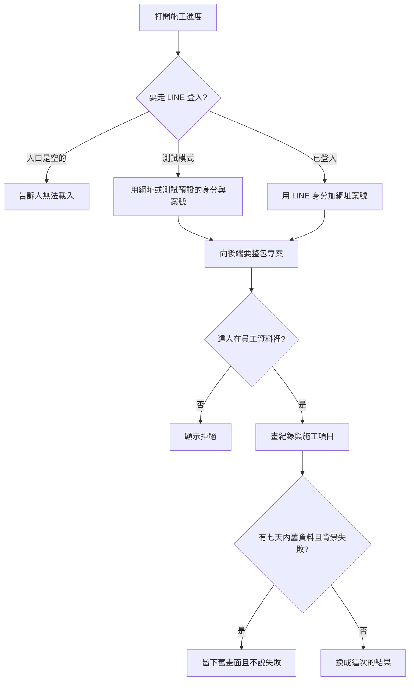

# 客戶施工進度頁（現行行為）

最後對照程式：2026-11-11（Asia/Taipei）

後端讀取契約：`Backend_GAS/project-console/SPEC/客戶施工進度讀取_SPEC.md`  
客人與案號的對照表（收款／選材／簽約在用，**這頁沒用**）：見 `SPEC/專有名詞白話對照.md` 的「客人與案號對照表」。

本檔舊版（約 v2.6）把「尚未做出的綁定介面」寫成本期規格，並假設大圖選單有一格施工進度。那些句子**作廢**，不要再照著實作。後來的產品決定是：大圖選單不掛施工進度；對照表可以一人多案，而且已用在別的客人頁。本頁仍是另一條路。

## 一句話

這是給屋主看施工紀錄的唯讀頁，畫面上不能改、不能留言。**現在客人還走不進來**：客戶用的 LINE 入口是空的；後端只接受「員工資料裡找得到的人」，而且相信網址帶來的身分與案號。

## 人怎麼走（現行程式）

1. 打開施工進度頁。標題固定是「施工進度」，副標是案號，不顯示案名、地址、電話、團隊。
2. 正式開啟時應走 LINE 登入。入口編號目前是空字串，所以會直接顯示「尚未設定客戶用 LINE 入口」，不會載入紀錄。
3. 網址帶本地測試旗標，或人在本機，就**不走 LINE**。測試預設仍開著：沒帶案號、沒帶身分時會用程式裡的測試值。規格不寫那些測試值。
4. 有身分與案號後，向專案後端要「整包專案」（跟內部工作區同一支）。對方不是員工就拒絕，畫面顯示錯誤。
5. 若這台在 7 天內看過同一人、同一案，先畫舊資料，並顯示「正在背景更新」。更新失敗時舊資料留著，提示消失，**不說更新失敗**。
6. 紀錄只留狀態是「已發布」或**空白**的。其他狀態（例如草稿）不畫。沒有任何則時寫「尚無已發布之施工紀錄」。
7. 施工項目預設摺疊。展開後是完成數、總數、比例，以及分區的工項名稱與完成度。資料來自分開讀取的報價節點；讀不到就用摘要數字或顯示尚無同步資料。不畫單價。
8. 照片可點開燈箱。沒有編輯、刪除、發布。

## 流程

### 程式對照表

| 白話（圖上寫的） | 程式對照（開發用） |
|------------------|-------------------|
| 打開施工進度 | `modules/projects/client-construction-progress.html` |
| 入口是空的 | `CLIENT_PROGRESS_LIFF_ID` 空白；`resolveUserId` |
| 測試模式不走 LINE | `?local=1` 或本機；`__DEV_CLIENT_DEFAULTS.ENABLED` 仍為 true |
| 向後端要整包專案 | GET `page=project`，參數 `id`、`userId`（`client-progress-main.js` `fetchProject`） |
| 這人在員工資料裡 | 後端 `_handleProjectPageRequest_` → `_getUserProfileById_` |
| 只畫已發布或空白狀態 | `filterPublishedLogs` |
| 施工項目 | `quotations/` 底下該案號；`sanitizeItem` 只留名稱、區域、完成度 |
| 七天舊資料 | `localStorage` 前綴 `client_progress:gas:`／`client_progress:fb_audit:` |
| 背景失敗仍留舊畫面 | `main` 的 catch：有快取就 return，不呼叫 `showError` |

## 這頁實際拿到、但沒畫出來的

後端成功時會把案場整列（含地址、電話、業主、進場備註）、排程、通知紀錄一起放進回應。畫面沒用這些欄位，資料已經進瀏覽器，也會進 7 天本機快取。

日誌若讀取失敗，後端仍回成功，並另附錯誤說明欄位；清單是空的。這頁**不看**那個錯誤欄位，會顯示「尚無已發布之施工紀錄」。

## 已知問題（不要當成正確行為）

1. 沒有「這位客人綁了哪一案」的檢查。網址上的案號就是要看的案。只要 `userId` 對得到員工，就能看任一案的整包。沒有核對是不是本人登入。
2. 客人（不在員工資料裡的 LINE）會被拒絕。這頁目前不能當正式對客入口。
3. 進行中的案，後端日誌有濾「已發布」。已結案改掃封存，**沒有**這層濾；這頁又把空白狀態當成可顯示。未標狀態的封存稿可能出現。
4. 日誌失敗被說成「沒有紀錄」。更新失敗時，舊畫面看起來像最新。
5. 施工項目直接讀報價節點。畫面不顯示金額，但瀏覽器拿得到該節點。外人能不能讀，取決於雲端規則，本輪標**不明**。
6. 測試開關在正式站只要網址帶本地旗標就生效。

## 風險與等待

- 交叉：身分可被網址換成任一員工（未防）；失敗當沒有紀錄（未防）；舊資料冒充最新（未防）；空白狀態當已發布（未防，已結案封存更明顯）；非員工被拒絕（已防，但也表示客人進不來）。
- 等待：第一次打開要等整包專案（排程、通知、日誌）。進行中的日誌多半走快取。已結案會逐張翻近年封存，可能明顯變慢。這頁沒有逾時，也沒有「再試一次」按鈕；錯誤只有紅框。

## 還沒做（舊稿曾寫成必做，程式裡沒有）

- 專用的客戶進度讀取動作、只回傳對客欄位。
- 用客人與案號對照表決定能看哪一案。
- 大圖選單上的「施工進度」格（名詞表已改為不掛這一格）。
- 主控台裡專給這頁的綁定／撤銷。綁定畫面若出現，是別的功能（收款／選材），不是這頁。
