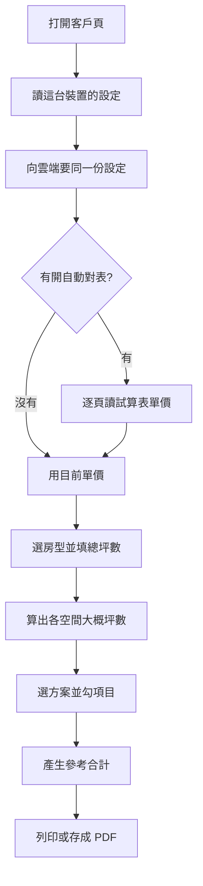

# 室內裝修快速報價 — 現行行為

> **編號**：14  
> **最後對照程式**：2026-11-24（Asia/Taipei）  
> **狀態**：現行以客戶頁＋管理頁為準。舊版「三步驟清單、設計費、稅、把報價存成一筆」**程式沒有做**，見文末附錄，不要當成現況。

給設計師在現場用「房型＋總坪數」粗估一張參考報價。不畫圖。金額只在這一頁產生，不寫進報價審核、也不進 Google Apps Script。

與圖面規劃工具分開：那邊靠圖上尺寸計價；這邊靠房型模板把總坪數拆成各空間，再依方案帶出數量。

---

## 人怎麼走

### 客戶頁（現場試算）

1. 打開快速報價頁。頁面先讀這台裝置存過的設定；雲端若有同一份設定，會再蓋過這台。
2. 若設定裡開著自動對表（出廠是開的），接著逐個工作頁去讀公司試算表的單價。上方會出現「正在讀取」。
3. 選房型、填不含公設的總坪數，案名可空。按「下一步：計算空間」。若對表還沒結束，按鈕會停在「計算中」，等對表結束才往下。
4. 畫面列出各空間大概坪數與長寬。客廚占剩餘坪數的比例，每次計算會在管理員設的上下限之間重抽一次，所以同一坪數連按兩次，數字可能不同。
5. 選一個方案（出廠為精簡、收納導向、造型導向），按「帶出項目」。
6. 勾要列入的項目、可改數量（離開輸入框會收到 0.5 的倍數）。按「產生報價摘要」。
7. 看到參考合計後，可列印或存成 PDF。頁尾寫明僅供參考。這張報價不會存進系統。

坪數小於或等於 0：輸入框變紅，不進入下一步。一項都沒勾：停在明細，並說明要先勾選，不會秀出 0 元成功摘要。

### 管理頁（價本與方案）

1. 從客戶頁進「管理員設定」，或直接開管理頁。沒有密碼、也沒有登入檢查。
2. 一次只做一塊：品項與對表、方案與規則、係數與系統。
3. 改完按「儲存設定」。先寫進這台裝置；雲端連得上會再上傳。上傳成功是綠字「本機與雲端」；雲端失敗是黃字，並說明已寫本機。
4. 本機快照只留在這台裝置（最多約 25 筆）。載入快照會蓋掉目前主檔，不會自動上傳；畫面有說明之後要再按儲存或上傳。
5. 「還原全預設」或「只還原方案」會立刻寫入並嘗試上傳。匯入 JSON 也會。

---

## 流程圖

### 程式對照表

| 白話（圖上寫的） | 程式對照（開發用） |
|------------------|-------------------|
| 打開客戶頁 | `tools/QuickRenovationQuote_v2.html` |
| 讀這台裝置的設定 | `loadSettings`；鍵 `qr_estimator_settings_v2`（`qr-config-state.js`、`qr-persist-scheme-menu.js`） |
| 向雲端要同一份設定 | `qrFbPullOnce`；路徑 `quickRenovationQuote/settingsV2` |
| 有開自動對表 | `priceSheetAutoOnOpen`；開頁後 `syncPricesFromGviz({ silent: true })` |
| 逐頁讀試算表單價 | `fetchGvizUrl`／`buildTabGvizUrl`；範圍約到 D2000；一頁接一頁 |
| 用目前單價 | 對表失敗時沿用已在設定裡的單價 |
| 選房型並填總坪數 | 客戶頁步驟①；`c_template`、`c_totalPing`、`c_title` |
| 算出各空間大概坪數 | `runClientStep1Alloc` → `computeAllocation`；結果在 `state.lastAlloc` |
| 選方案並勾項目 | 步驟②③；`fillSchemeRadios`、`buildItemRows`、`getQtyForDisplayRow` |
| 產生參考合計 | `renderQuote` → `collectQuoteLines` |
| 列印或存成 PDF | `c_printBtn` → `window.print` |
| 管理頁儲存 | `tools/QuickRenovationQuote_v2_admin.html`；`saveSettings` 先本機再 `qrFbPushCurrentSettings({ silent: true })` |

旁支 `tools/QuickRenovationQuote_v1.html` 是舊的「自己填空間、逐項勾」試作，不讀這份主檔，也不是現在的客戶流程。

---

## 設定長什麼樣

兩層故意分開：同一份單價可配多套「數量怎麼算」。

| 層 | 裡面有什麼 | 存在哪 |
|----|------------|--------|
| 品項 | 客戶看到的名稱、單位、單價、對哪一個試算表工作頁與品名、客戶備註、預設是否勾選 | 設定裡的品項清單 |
| 方案 | 方案名稱，以及每個品項的數量規則 | 設定裡的方案清單 |

整包還有：試算表 ID、要不要開頁自動對表、地坪損耗與進位、收邊百分比、細清定額、水電點數、陽台／浴廁／臥室倍率、長寬比。出廠結構版號為 7。

- **這台裝置**：主檔一個鍵；工作頁名稱另外一個鍵（還原全預設不會清掉工作頁清單）；快照再一個鍵。
- **雲端**：整包設定（含品項、方案、係數）一個路徑。匿名登入後讀寫。這條路徑的雲端規則不在本倉庫，外人能不能寫要另對正式規則。
- **試算表**：表須可匿名讀。對到的列會改單位與單價。先全名相同；沒有才用「名稱互相包含」的第一筆，徽章仍寫「對到」。
- **收邊**：有勾、且標成木作／系統的項目，小計加總後乘百分比，單獨一列。
- **細清**：一筆定額，不跟單價欄走。
- **參考合計**：勾選列的小計加總（含收邊、細清、有勾的子品項）。沒有設計費、工程服務費、稅。

房型出廠三種：二房一廳一衛、三房二廳、四房二廳。浴廁坪數依衛浴間數取設定列表的前幾筆。總坪數扣掉陽台與浴廁後，餘額再分客廚與臥室；加總對不齊時，差額灌進客廚。

數量規則的型別以 `qr-persist-scheme-menu.js` 的 `computeQtyFromRule` 為準（定量、邊長比例、分空間地坪、客臥坪合計、水電點數、嵌燈、收邊佔位、細清佔位等）。次臥且規則沒指定哪一間時，每一間各列一筆。

---

## 風險與等待

- 客戶頁與管理頁共用雲端那一包。這台讀雲端失敗時，仍可能把這台的設定上傳蓋掉公司價本。見已知問題。
- 開頁自動對表會逐頁讀試算表，每頁範圍很大，沒有逾時。人按「計算空間」會一直停在「計算中」，直到讀完或瀏覽器自己放棄。
- 管理頁按「取得工作頁」會同時試很多個預定頁名，同樣沒有逾時。
- 報價本身不算進系統，重新整理就沒了。要留底只能列印、存 PDF，或自己另存。
- 客廚比例每次重抽。對客戶解釋時要說這是參考分配，不是竣工圖。

---

## 已知問題

下列是程式現況，**不是**正確規格。修之前不要寫成「系統就是這樣設計」。

1. **讀不到雲端仍可能上傳出廠或這台的舊設定。** 開頁會先讀雲端；失敗時沿用這台（這台沒有舊檔就是出廠設定）。自動對表若走完，仍把整包上傳。公司價本可能被蓋掉。
2. **雲端沒同步的本機修改，下次開頁會被舊雲端蓋掉。** 儲存時雲端失敗會用黃字講「已寫本機」。但下次只要雲端讀得到，不論這台是不是較新，都會用雲端蓋掉。程式註解寫「本機已有主檔就不要用雲端硬蓋」，實際沒有這道判斷。
3. **對表沒更新到仍說已同步。** 某個工作頁失敗、或一筆都沒對上，客戶頁仍用一般語氣寫「單價已同步」，並照樣上傳。整段讀取丟出例外時才會改紅字、且不上傳。
4. **計算空間沒有逾時。** 試算表一直不回應時，按鈕維持計算中，不能改按再試。
5. **開頁立刻按計算，空間與稍後的設定可能不是同一份。** 雲端結果還沒回來就按，空間用按下當下的係數；雲端稍後蓋上設定，已算出的空間不會重算。
6. **管理頁沒有把人擋在外面。** 設定裡有一組預設管理密碼欄，畫面不檢查；整包上傳時這欄會跟著走。知道管理頁網址就能改價並儲存。雲端規則是否另有限制，本倉庫看不到。
7. **舊主檔會被整包換成內建。** 版號低於 4，或缺少「分空間地坪」與「收邊」這兩筆時，品項與方案改回出廠，再寫回這台。接著若自動對表成功，可能把這包上傳。
8. **模糊對到的徽章寫「對到」。** 名稱只是互相包含時，仍用綠色「對到」，不說明不是全名。

---

## 與其他文件

- 名詞：`SPEC/專有名詞白話對照.md`（快速報價、定量、變量）。
- 圖面報價是另一條：`SPEC/04_互動式室內設計規劃工具規格書.md`。
- 報價送審、主控台確認是另一條：`SPEC/12_報價單審核與主控台整合規格書.md`。本工具不寫那裡。
- 後端倉庫沒有這支功能，不要到 Checkin／主控台／會計找對應 action。

---

## 附錄｜尚未落地的清單式草案（不要當成現況）

2026-05-26 以前這份規格還寫過另一套產品：自己加空間、兩層分類工項、設計費、工程服務費、稅、草稿／定稿、複製報價、匯出試算表、接到專案編號。**現行程式都沒有這些畫面與欄位。** 若以後要做，請另開需求，並把欄位名送進 `專案全域資料字典.md` 再寫程式；不要沿用本附錄的暫定英文名當正式欄位。

那時設想、現在沒有的能力：

| 設想 | 現在 |
|------|------|
| 步驟是「空間 → 選工項 → 費用與存檔」 | 實際是「房型坪數 → 方案 → 勾項 → 參考合計」 |
| 設計費、工程服務費、稅、報價總額公式 | 只有勾選列加總 |
| 報價存檔、列表、複製、價本快照 | 只在這一頁產生，重整即失 |
| 權限分編輯者／價本管理員／唯讀，並接 LINE 登入 | 管理頁無檢查 |
| 後端自選試算表或 Apps Script | 只有瀏覽器儲存、雲端即時庫、可公開讀的試算表 |
