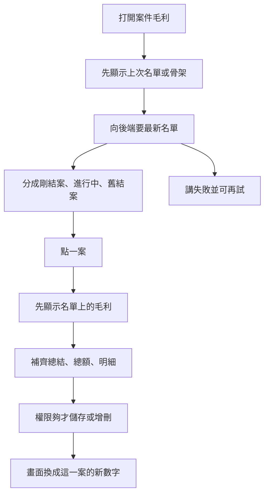

# 案件毛利頁（現行）

最後對照程式：2026-11-18（Asia/Taipei）

給主管以上的人看每一案賺多少、花多少。記帳有案號會自動進來；這一頁也能手動加一筆只記在毛利、改案件總額、勾本案廠商，結案後可產生獎金草稿。

擴充計劃與公式細節仍見 [`21.案件毛利擴充與薪資連動.MD`](21.案件毛利擴充與薪資連動.MD)。後端契約見 Backend_GAS `accounting-gas/SPEC/PROJECT_MARGIN_PAGE_SPEC.md`。

## 人怎麼走

1. 會計選單點「案件毛利」（權限至少 3）。
2. 先看到上次留下的名單（若有），同時向後端要最新名單。約 4 秒還沒好，會寫還在載。
3. 名單分成剛結案（180 天內）、進行中、舊結案（預設收合）。可搜案號或客戶。
4. 點一案：先顯示名單上的毛利，再補齊收支總結、總額、工期、廠商、明細。
5. 權限 4 以上可儲存總額、本案廠商、獎金比例，或手動加／改／刪明細。權限 3 看得到這些按鈕，按下去會被拒絕。
6. 手動選「收入」不會直接寫進毛利，會送一筆客戶收款去審。選「支出」只寫這一案的毛利，不寫收支明細。
7. 已結案才看得到「申請獎金」。產生的是草稿，不會直接發薪。
8. 失敗時留下人話、可再試、可複製回報。有舊名單就不要清成空白。

### 程式對照表

| 白話（圖上寫的） | 程式對照（開發用） |
|------------------|-------------------|
| 打開案件毛利 | `modules/accounting/project_margin.html`；選單 `index.html` 卡片；進門 `AccountingBoot` 門檻 `SUPERVISOR_MIN_PERMISSION`（3） |
| 先顯示上次名單或骨架 | `AccountingListCache.peek` 鍵 `project_margin`；沒有則 `showListSkeleton` |
| 向後端要最新名單 | `AccountingApi.marginListOverview` → `margin_list_overview`（逾時 120 秒）；每次進頁都重抓 |
| 分成剛結案、進行中、舊結案 | `classifyOverviewItem`：已結案且結案日 180 天內＝剛結案；已結案但沒結案日或更久＝舊結案；其餘含狀態空白＝進行中 |
| 講失敗並可再試 | `renderErrorBox`；失敗不寫進快取；已畫出名單就留著 |
| 點一案 | `openDetail` |
| 先顯示名單上的毛利 | `setDetailEarnSummary` 用列表那一列 |
| 補齊總結、總額、明細 | `margin_get_detail`（預設逾時 60 秒）；慢了約 4 秒改寫「詳情更新中」 |
| 權限夠才儲存或增刪 | 儲存類按鈕照常顯示；後端寫入要權限 ≥ 4。總額 `margin_save_contract_amount`、廠商 `margin_save_vendors`、比例 `margin_save_bonus_allocations`、獎金 `margin_apply_bonus`、增刪改 `margin_add_line`／`margin_update_line`／`margin_delete_line` |
| 畫面換成這一案的新數字 | 回傳整包就 `renderDetailPanels`；同時 `patchOverviewItemFromDetail` 改名單上那一列 |

## 誰能看、誰能改

| 做什麼 | 門檻 |
|--------|------|
| 開頁、看名單、看一案 | 權限 ≥ 3 |
| 儲存總額、廠商、獎金、手動增刪改、一次補齊結案狀態 | 權限 ≥ 4 |
| 只帶員工編號、沒有有效登入票 | 後端預設仍放行（與其他會計寫入同一道閘）。見已知問題 |

會計選單標的是「主管 ≥ 3」。舊規格寫「誰能看／改都要 ≥ 4」或「權限 3 看不到」，與程式不符。

## 名單怎麼分

| 區塊 | 條件 |
|------|------|
| 剛結案 | 專案狀態是「已結案」，而且結案日在 180 天內（新的在上） |
| 進行中 | 還不是已結案。**狀態空白也放這裡** |
| 舊結案 | 已結案，但沒有結案日，或結案超過 180 天。預設收合 |

狀態空白時，前端會請後端把缺的結案狀態補上。這一步要權限 ≥ 4；權限 3 失敗時不說明，名單維持原樣。

## 打開一案時系統會改什麼

這不是純查詢。打開一案會：

- 有開工日就重算「基本費用」，寫成明細裡一筆系統支出（未結案用今天當結束日，金額會隨天數變）。
- 用這一案目前的明細，重算總覽的收入、支出、毛利。
- 把案場的專案狀態、結案日寫回總覽這一列。
- 若還沒手動鎖總額，會用驗收表總額蓋上採用總額。

工期這一頁只顯示，不能改。開始日依序：毛利裡手動指定、案場專案起始日、第一則符合的已發布施工紀錄。結束日是結案日；沒結案就用今天，並註明是試算。

來源有三種：`自動`（記帳進來，不能刪、不能改金額）、`手動`、`系統`（基本費用；畫面上可以刪，下次打開又會補回）。

## 手動新增

| 選收支 | 實際發生的事 |
|--------|----------------|
| 支出 | 只在本案毛利加一列，來源標手動。不寫收支明細 |
| 收入 | 建立一筆待審的客戶收款，不直接寫毛利列。成功訊息是已送審、財務核准後才推客戶確認 |

支出、改、刪成功後，後端會把整案詳情一起回來，畫面不再另外開一次詳情。

## 風險與等待

- **名單**：先顯示舊名單或骨架，約 4 秒改寫還在載，最長等 120 秒。失敗可再試，有舊名單就留著。
- **打開一案**：會向外讀驗收表，並掃廠商與請款來對「有沒有付完」。預設只等 60 秒。有「詳情更新中」與再試。
- **打開一案會寫表**（基本費用、總覽數字、結案狀態）。和記帳同時發生時，總覽可能被較早讀到的明細蓋回舊數字，再打開一次才會對上。
- **刪除用的是試算表列號**，不是一筆固定的編號。見已知問題。

## 已知問題／風險

| 問題 | 人會看到什麼 | 不要當成正確規格 |
|------|----------------|------------------|
| 刪除或修改用列號，做完還重算整包 | 超過約 60 秒畫面當失敗。同一筆再刪一次，可能刪到同一案往上移的下一筆手動或系統列。別案的列會被拒絕 | 失敗再試應重做同一筆，不能改刪別筆 |
| 手動新增沒有「這筆只算一次」 | 逾時後再按，支出會多一列，收入會多一張待審收款 | 應先確認有沒有已經寫上 |
| 狀態空白放進進行中 | 還沒寫回結案狀態的已結案，會先出現在進行中。權限 3 的整表補齊失敗不說明 | 分區應跟案場狀態一致，補不了要講 |
| 追加減或收款讀取拋錯 | 這一案仍顯示成功，三角核對整段不出現，像沒有這塊 | 讀失敗要跟「真的沒有」分開 |
| 權限 3 看得到儲存鈕 | 按了才說要權限 4。但打開一案仍會改基本費用與總覽 | 只看的人不該改數字；若保留「打開即重算」，按鈕不要假裝能存 |
| 只帶員工編號 | 後端預設仍可讀寫毛利（與請款、名冊同一道閘，尚未改成拒絕） | 沒有有效登入票應拒絕 |

## 可改進（尚未做）

- 權限 3 隱藏儲存、新增、刪除。
- 刪除改認那一列的內容或編號，不要只認列號；新增支出加「同一內容短時間不重複」。
- 打開一案的逾時改長，或先回「已刪／已新增」再慢慢補詳情，避免人以為沒成功。
- 三角核對讀失敗時留一句，不要整段消失。
