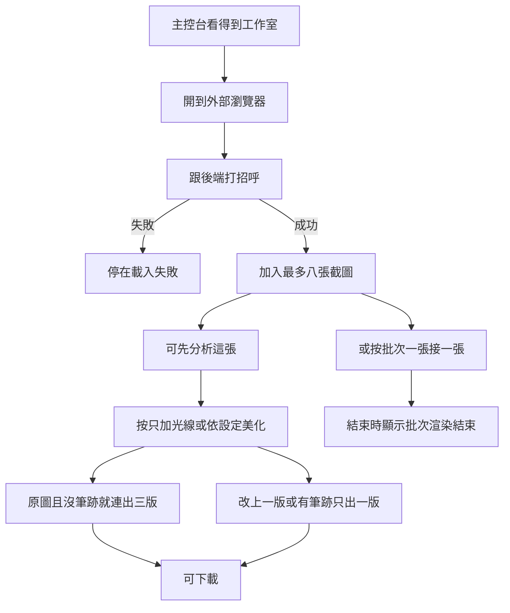

# SketchUp 渲染工作室

最後對照程式：2026-11-26（Asia/Taipei）

給權限夠的設計師：把 SketchUp 截圖交給模型，出寫實室內效果圖。可以先分析、標燈光與顏色、畫筆點要改的地方，再出圖或下載。

現行畫面以本 repo `tools/sketchup-render-studio/` 為準（主控台卡片在 `spa/Dashboard.js`）。後端契約在 Backend_GAS `accounting-gas/SPEC/SKETCHUP_RENDER_STUDIO_SPEC.md`。Backend_GAS 裡同名的 `tools/sketchup-render-studio/` 是較舊複本，批次鈕接的是另一支接口，不要當成現況。

本輪沒有改程式、沒有部署。

---

## 人怎麼走

1. 主控台要權限至少 2 才看得到這張卡片。按「開啟網站」會到外部瀏覽器，網址帶上這位員工的編號。複製連結也是同一條。
2. 頁面先跟後端打招呼。失敗就停在「載入失敗」，不會進工作室。成功後若後端有回名字，上方改顯示名字。
3. 加入圖片，最多 8 張。左邊原圖、右邊結果；下方小圖換角度，同一張可以有多個版本。
4. 可先按「分析這張圖」。空間、光線、燈光標籤會被建議填上。選的是保真時，不會自動改風格欄。若有渲染建議，原本打的補充說明會整段換成建議。
5. 選保真、風格美化或自由發揮，並勾「這些不要動」。可加允許的燈種、指定某處顏色、櫃體與門片材質，也可用畫筆標要改的位置。
6. 「只加光線質感」或「依下方設定美化」：送原圖且沒有筆跡時，會連出 3 個版本；送的是某一版結果或畫了筆跡時，只出 1 版。同一張、同一套設定若已經有版本，再按不會再呼叫模型。
7. 「批次渲染全部」是一張接一張叫單張渲染，出一張就顯示一張。全部跑完，底部改成綠色「批次渲染結束」。
8. 有結果就能下載這一張，或下載此圖全部版本。重新整理後圖與版本會消失，要重新加入。

---

## 流程

### 程式對照表

| 白話（圖上寫的） | 程式對照（開發用） |
|------------------|-------------------|
| 主控台看得到工作室 | `spa/Dashboard.js` 卡片，`permission >= 2` 才顯示 |
| 開到外部瀏覽器 | 同一檔 `openSketchupRenderStudio`；網址帶員工編號 |
| 跟後端打招呼 | `tools/sketchup-render-studio/app.js` 的 `sketchup_render_ping` |
| 停在載入失敗 | 同檔 `boot` 的失敗文字，不打開主畫面 |
| 加入最多八張截圖 | 同檔 `addFiles`，上限 8 |
| 可先分析這張 | 同檔 `analyzeCurrent` → `sketchup_render_analyze` |
| 按只加光線或依設定美化 | 「只加光線質感」固定走保真；「依下方設定美化」走畫面上選的模式。兩者都進 `renderCurrent` → `sketchup_render` |
| 原圖且沒筆跡就連出三版 | `SINGLE_VERSION_COUNT = 3` |
| 改上一版或有筆跡只出一版 | 送出來源是已渲染的版本，或畫筆有筆跡，只叫一次 |
| 或按批次一張接一張 | 按鈕接 `renderAll`，每張各叫一次 `sketchup_render`。沒有接 `sketchup_render_batch` |
| 可下載 | `downloadActiveRender`、下載全部版本 |
| 結束時顯示批次渲染結束 | `renderAll` 最後一律把狀態改成成功句 |

---

## 畫面與送出

| 人看到的 | 實際送出 |
|----------|----------|
| 保真／風格美化／自由發揮 | 欄位 `render_mode` 有送。後端收下後**沒有**放進給模型的說明（見已知問題） |
| 只加光線質感 | 強制當保真再送，風格、光線、補充說明仍照欄位內容送，不會先清空 |
| 這些不要動（預設全勾） | `preserve`：天花類型、樑柱顏色、牆面油漆、線條開口、家具擺位。後端有寫進說明 |
| 燈光來源（可多選） | 允許的燈種。未勾「允許加燈」時，說明要求不要加燈、不要加盞數 |
| 指定某處顏色 | 有填位置且是六碼色號才送 |
| 櫃體／門片材質 | 選填；沒填就要求沿用原圖配色 |
| 此圖自訂 | 只改這一張的空間、風格、光線、補充與燈光；小圖有橘點 |
| 這次送出哪一張 | 可選原圖或某個版本。畫筆筆跡會合成進送出的圖，並註明有筆跡 |
| 進階設定 | 可改後端位址。密鑰欄有填才會附上；日常不要填 |

打招呼成功後，風格與光線的選項以後端回傳的清單為準。燈光標籤會跟頁面內建清單合併（含壁燈、軌道燈、落地燈、鏡前燈、吸頂燈、其他自行描述）。

分析摘要會顯示空間、材質、渲染建議與注意。天花、樑柱兩行畫面有留，後端分析結果沒有這兩個欄，所以不會出現。

這一頁沒有「依案號匯入參考照」。後端雖有列媒體、取媒體兩支接口，按鈕沒接。

---

## 風險與等待

延時：**高**。原圖且沒筆跡時，按一次會連叫三次生圖，一次接一次，沒有逾時、也不能中途停止。八張批次同樣一張接一張。畫面有「版本幾分之幾」或「第幾張」，所以不是完全沒有等待文字；模型若一直不回，按鈕會停著，只能重整。打招呼、分析也沒有逾時。換短效票最多等幾秒，等不到仍會把請求送出。

交叉出錯（摘要；細項見巡檢回報）：

- 選了保真或把風格留白，模型仍可能被要求做成特定風格，畫面仍說已產出。未防。
- 批次中間有一張失敗，最後仍顯示批次渲染結束。未防。
- 三個版本做到一半失敗，再按同一設定會說已有結果、不再呼叫。未防。
- 渲染進行中再按，按鈕已停用，不會連點成兩次。已防。
- 權限低於 2、或員工已離職，後端會拒絕。已防。
- 從主控台開到外部瀏覽器時，通常只有網址上的員工編號；短效票換不到仍送出。後端預設只警告、不拒絕。未防。

---

## 已知問題

這些是程式現況，**不是**正確規格。修的時候以這裡的意圖為準。

| 嚴重度 | 人怎麼踩到 | 現況 | 應有行為 |
|--------|------------|------|----------|
| 明顯缺陷 | 風格留白，或選保真／自由發揮後按渲染 | 給模型的說明在風格空白時仍寫成現代簡約。三種模式有送出，後端沒有拿來改說明。自由發揮不會放寬「不要動」。兩個主按鈕的差別主要是畫面文字，以及會不會被當成另一套設定而再叫三次 | 留白就依原圖。保真只加光線質感、不套風格。自由發揮才放寬。模式要真的進說明 |
| 明顯缺陷 | 多張圖按批次，其中一張失敗 | 該張會短暫紅字，最後仍變成綠色「批次渲染結束」 | 有失敗就維持失敗句，並指出哪幾張沒有 |
| 明顯缺陷 | 原圖要三版，第一版成功、後面失敗，再按一次 | 第一次是紅字；再按會說同一設定已有結果，缺的版本不會補 | 沒做完不要當成完成；再按應補缺的版本 |
| 明顯缺陷 | 模型很慢或一直不回 | 沒有逾時。按鈕停用，不能改按再試，只能重整 | 逾時要講出來，並讓人再試；已出的版本留著 |
| 明顯缺陷 | 把主控台複製出去的網址給別人 | 外部瀏覽器通常換不到短效票，仍用網址上的員工編號生圖。後端預設只警告。離職與權限不足仍會擋 | 沒有可驗證的登入就不要生圖。改成拒絕之前，要先讓這條「開外部瀏覽器」的路拿得到票，否則日常使用會被擋 |

其餘：

- 分析若有渲染建議，補充說明整段被蓋掉，沒有先問。
- 分析若不是預期的結構、但有一段文字，仍可能說分析完成，並把那段寫進補充說明。
- 整包批次接口（一次送多張）只要有一張成功，整體仍算成功，失敗只寫在訊息裡。現行按鈕沒有走這支。
- 後端收到超過 8 張時會默默只留前 8 張。這一頁自己會先擋住。

---

## 可改進

- 換模式或按「只加光線」時，若欄位裡已有風格，要明確說這次會不會套用，不要讓人以為按鈕名稱就是模型收到的指令。
- 分析前先問要不要蓋掉補充說明。
- 下載若被瀏覽器擋下，不要先說已下載。
- 重整後圖就沒了；若常要來回改，可考慮只存在這台裝置的草稿（另做，本輪不設計）。

---

## 相關檔

| 位置 | 說明 |
|------|------|
| `tools/sketchup-render-studio/` | 現行頁 |
| `spa/Dashboard.js` | 主控台入口 |
| `shared/js/hub_gate_ticket.js` | 有員工編號時嘗試附上短效票；拿不到仍送出 |
| Backend_GAS `accounting-gas/SketchupRenderStudio.js` | 生圖與分析 |
| Backend_GAS `accounting-gas/SPEC/SKETCHUP_RENDER_STUDIO_SPEC.md` | 後端契約 |
