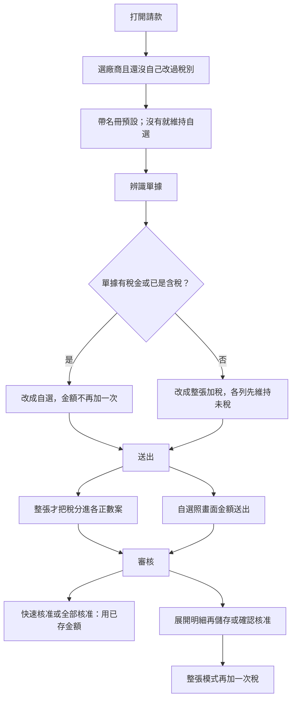

# 待付款稅金模式（現行行為）

最後對照程式：2026-11-17（Asia/Taipei）

| 項目 | 說明 |
|------|------|
| 給誰 | 會計、主管：請款時決定這張單的稅怎麼算；審核時可再改 |
| 狀態 | 畫面上是**兩種**稅別。舊的「逐筆加 5%」按鈕已拿掉，計算還留著 |
| 前端 | `modules/accounting/payment_request.html`、`ledger_review.html`、`vendors.html`；共用 `shared/js/accounting_tax_mode.js` |
| 後端 | `accounting-gas`：辨識可先把稅併進各案；送審之後**不再重算**，只存各列金額。契約見 `PAYMENT_REQUEST_UNIFIED_SPEC.md` |
| 不要當成正確行為 | 文末「已知問題」。那幾條是程式現況，不是規格要的結果 |

檔名仍沿用舊「計劃」，避免連結斷掉。下面寫的是**現行程式**，不是 2026-08 的三按鈕草案。

---

## 一句話

請款時先選這張單怎麼處理稅：各列自己決定含不含稅，或整張未稅、底下一次加稅。送出時才把整張稅分進各案。審核若展開明細再儲存或確認核准，整張加稅的單目前會**再加一次稅**。

---

## 人怎麼走

1. 打開待付款請款，明細上方看到兩個按鈕：「未稅／含稅自選」「未稅・整張加稅分攤」。一開始是自選。
2. 選了廠商、而且還沒自己按過稅別時，帶這家名冊的預設。名冊可以選「不強制／自選／整張」。
3. 辨識單據後，若人還沒按過稅別：單據有稅金或被看成已含稅 → 改回自選；都沒有 → 改成整張加稅。
4. 自選：每一列可勾「含稅」，金額不改，旁邊可顯示反推未稅。整張加稅：每一列保持未稅，稅金填在下面（空白＝未稅淨額×5%）。
5. 切換按鈕會先問一句。整張加稅在畫面上**先不加進各列**。
6. 按送出時，整張加稅才把稅依正數金額比例加進各案，折讓列不加。自選就照畫面上的數字送出。
7. 備註會寫上「稅模式」和「稅別」（哪個案號勾了含稅）。後端只存各列金額與這段備註，沒有獨立稅金欄。
8. 審核頁讀備註還原模式。列表上的「快速核准」「全部核准」沿用已存金額。展開明細後的「儲存修改」「確認核准」會再跑一次稅別算法（見已知問題）。

### 程式對照表

| 白話（圖上寫的） | 程式對照 |
|------------------|----------|
| 打開請款，一開始是自選 | `payment_request.html` 的 `taxMode = 'inclusive'` |
| 兩個按鈕 | `AccountingTaxMode.segHtml`；`per_row` 不畫出來 |
| 選廠商且還沒自己改過稅別 | `onPayeePick` → `setTaxModeQuiet(tax_mode_default)` |
| 帶名冊預設 | 廠商主檔 `tax_mode_default`；名冊頁 `vendors.html` |
| 辨識單據 | `paymentRequestOcrAnalyze`；請款頁 `runOcr` |
| 有稅金或已是含稅就改自選 | `suggestModeFromOcr`；`tax_amount > 0` 或 `is_tax_inclusive` 走自選 |
| 否則改成整張加稅 | 同上，否則 `prorate`，並 `applyTaxMode('prorate')` |
| 各列維持未稅、稅填在下面 | `applyTaxMode` 對整張使用 `displayOnly` |
| 空白稅金＝未稅淨額×5% | `resolveProrateTax`／`summarize`；按鈕「未稅合計×5%」 |
| 送出時整張才把稅分進各正數案 | `finalizedAllocRows` → `applyModeToRows` → `prorateTax` |
| 自選照畫面金額送出 | `taxMode === 'inclusive'` 時不重算 |
| 備註寫稅模式 | `syncModeNote` 寫入 `【稅模式】` |
| 快速核准或全部核准用已存金額 | `approveVendor(item)` 不帶畫面重算；`defaultPatchForItem` |
| 展開明細再儲存或確認核准 | `readPatchFromPanel` 再呼叫 `applyModeToRows` |
| 整張模式再加一次稅 | 已知問題：已入帳的含稅金額被當成未稅又加 5% |

---

## 兩種看得到的算法

1. **未稅／含稅自選**（程式 `inclusive`，舊稱已含稅）  
   金額就是填的數字。各列自己勾含稅或維持未稅。正數、折讓負數都可以勾。勾了含稅只加標籤，不乘 1.05。

2. **未稅・整張加稅分攤**（程式 `prorate`）  
   畫面上各列是未稅。稅金可手填；空白或按「未稅合計×5%」時，稅基是**未稅淨額**（正數＋折讓）。例：8952 加折讓 −271，淨額 8681，稅 434，含稅合計 9115。稅只分進正數列；折讓維持 −271、不標含稅。稅和約 5% 差超過兩成時，只出黃字，不擋送出。

### 畫面上看不到、但還會跑的舊算法

**未稅・逐筆加 5%**（程式 `per_row`）：每個正數列 ×1.05，折讓不動。  
請款、審核、名冊的新選項都不再提供。名冊若還存著這個舊值，請款頁仍會套用，而且兩個按鈕都不會呈亮（已知問題）。

---

## 辨識和名冊誰說了算

人**已經按過**稅別按鈕之後，辨識與名冊都不再改。

還沒按過時：

| 順序 | 發生什麼 |
|------|----------|
| 先選廠商、明細還是空的 | 只記住名冊預設，還沒算「按過」 |
| 辨識結果有稅金或已含稅 | **改回自選**，蓋過名冊的整張預設 |
| 辨識沒有稅金、也不是已含稅 | 改成整張加稅 |
| 明細已經有列，才選到「整張」或舊「逐筆」的廠商 | 立刻套用，並當成已經選過；之後辨識不再改模式 |

後端辨識會先嘗試把稅併進各案，但**只有**「含稅總計 − 各案合計」對得上稅金（或差額在約 12% 以內且沒另給稅金）才真的併入。畫面只要看到有稅金，就說「已分攤進各案」。對不上時這句話是錯的（已知問題）。

---

## 送出之後後端怎麼記

- 請款母單沒有稅別欄。模式只活在備註 `【稅模式】`。各列含稅與否另寫 `【稅別】`，但整張模式送出前畫面列還沒勾含稅，所以這段常寫成「未稅」，和實際已加稅的金額不一致（已知問題）。
- 分攤表只存案號、金額、品項。整張模式送出後，金額已是加過稅的數字，品項帶「(含稅)」。
- 後端不依模式重算，也不核對稅金是不是 5%。

---

## 風險與等待

- 辨識最長約 **3 分鐘**（有「辨識中」；失敗可再試）。稅金加減是當場算，不另外等。
- 送出沿用請款送出的約 60 秒上限。逾時再按可能多一筆，這是先前請款送出已記下的問題，本文件不另開。
- 整張加稅的「支付合計」在送出前是對的（未稅＋稅）。展開審核後，畫面上的支付合計會先顯示成**再加一次**的數字，和已送出的金額不同。
- 兩條核准路結果不同：列表快速核准／全部核准用已存金額；展開後確認核准會改寫金額。

---

## 已知問題（不要寫成正確規格）

1. **展開審核再儲存或確認核准，整張加稅會再加一次。**  
   例：未稅 10000、空白稅金，送出存 10500。展開後畫面顯示支付合計 11025，按確認核准就寫成 11025。折讓例：送出應為 9386 與 −271（合計 9115），再核准會變成 9842 與 −271（合計 9571）。  
   列表「快速核准」和「全部核准」不會再加。  
   原因：送出時稅已進金額；審核把這個金額當未稅，又跑一次整張加稅。含稅標籤在還原時被拿掉，所以不會先除回未稅。

2. **有稅金就說已分攤。**  
   辨識指示同時要求「各案填未稅」和「各案加總要等於含稅總計」。差額對不上時，金額仍是未稅，品項卻被標含稅，畫面仍說稅已分攤。人若照送，會少付稅。

3. **名冊舊值「逐筆加 5%」會默默加成。**  
   畫面沒有這個按鈕。選到這種廠商且已有明細時，正數列會 ×1.05，兩個按鈕都不亮。

4. **備註「稅別」在整張模式常寫「未稅」。**  
   因為送出前畫面上的列還沒標含稅；實際存進去的金額已經含稅。

---

## 仍可用的驗收

下面幾條在**請款頁送出當下**仍成立。不要用「展開審核再確認核准」當驗收，那條目前會失敗。

1. 自選：金額不變；勾含稅只加標籤。折讓 −285 勾含稅仍是 −285，旁邊未稅約 −271。
2. 整張：未稅 8952＋折讓 −271，空白稅金 → 稅 434、支付合計 9115。送出後正列 9386、折讓 −271。
3. 稅金手填時以手填為準，不強制 5%。差太多只黃字。
4. 人先按過稅別，辨識不再改模式。
5. 快速核准／全部核准不改已存金額。

---

## 修訂紀錄

| 日期 | 說明 |
|------|------|
| 2026-08-10 | 計劃：表頭三模式 |
| 2026-08-11 | 請款／審核接上共用演算法；名冊可設預設稅別 |
| 2026-09-02 | 第一個選項改名「未稅／含稅自選」 |
| 2026-10-11 | 折讓負數可勾含稅 |
| 2026-10-12 | 整張稅基改為淨額（含折讓）；稅只進正數列 |
| 2026-11-17 | 對過程式重寫主段：畫面只剩兩種；逐筆僅舊值；寫明審核再加稅、辨識文案、備註不一致。不再把三按鈕草案當現行 |
