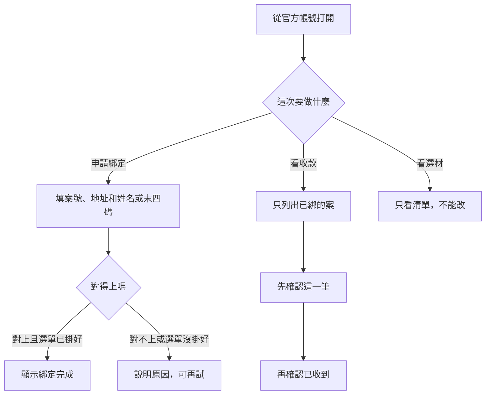
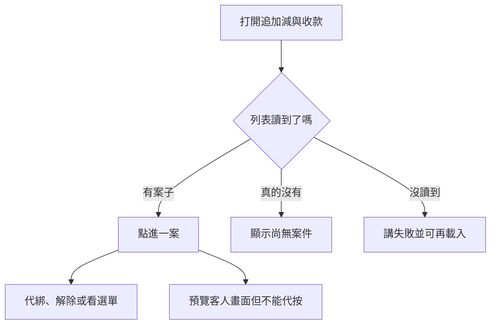

# 客戶財務入口

最後對照程式：2026-11-29（Asia/Taipei）

給已綁定的客人，用官方帳號看自己案的收款並分兩段確認，或只看選材；還沒綁的人可自己申請綁上。同事在內部頁管理追加減與收款，也可預覽客人畫面，但不能代按。

後端契約：`Backend_GAS/accounting-gas/SPEC/CUSTOMER_FINANCE_PORTAL_SPEC.md`。  
追加減與收款的內部登記、狀態設計稿仍見 `SPEC/21.案件毛利擴充與薪資連動.MD` §B5；與本檔衝突時，**客人頁與綁定以本檔為準**。

## 人怎麼走

客人：

1. 從官方帳號打開。收款那一鍵只看收款；我的案場只看選材；綁定那一鍵只填綁定。頁內不再用三張卡互切。
2. 先確認是這位客人的 LINE。登入失敗可再登入一次；畫面另有「重新登入 LINE」。
3. 一個案子都還沒綁，或這次就是來綁定：填案號、施工地址，以及業主姓名或手機末四碼（擇一）。
4. 對上才綁上，並確認會員選單已掛好，才顯示完成。對不上會說明原因，可再試。送出若整段連不上，會說這次沒送到、不代表沒綁上，按鈕恢復可按。
5. 已綁的人選自己的案號看收款。待確認的先按「確認此收款紀錄」，再按「我確認已收到此收款紀錄」。第二段送出前會再問一次，並寫明提交後不可取消。
6. 選材只看空間、部位、日期與照片，不能改。照片慢到會先出文字；打不開可再試，不會改去收款頁。

同事：

1. 會計選單進「追加減與收款」（權限至少 2）。
2. 先看案件列表。讀失敗會講出來並可再載入；有舊名單就留著，不會說成沒有案子。
3. 進一案可登記追加減與收款、代綁或解除客人、看選單是否掛上。
4. 可開「預覽客戶畫面」。可切全部毛利案號，畫面跟客人相同，但不能代確認、代簽名或代綁。

## 客人頁流程

| 白話（圖上寫的） | 程式對照（開發用） |
|------------------|-------------------|
| 從官方帳號打開 | `modules/accounting/customer-finance-portal.html`；`AccountingApi.initCustomerPortalSession` |
| 申請綁定 | 網址帶綁定標記，或一個案子都還沒有；`showBindView` |
| 填案號、地址和姓名或末四碼 | `client_portal_self_bind` |
| 對上且選單已掛好 | 要同時看到成功、選單已核對、選單編號才顯示完成卡 |
| 說明原因，可再試 | 對不上用後端那句；連線失敗用人話，按鈕恢復 |
| 只列出已綁的案 | `margin_customer_finance_portal_auth` 的案件清單 |
| 先確認這一筆 | `margin_receipt_customer_confirm_stage1` |
| 再確認已收到 | `margin_receipt_customer_confirm_stage2`；送出前 `confirm` |
| 只看清單，不能改 | 網址帶選材標記；`margin_material_portal_list`（經會計轉主控台） |

## 同事頁流程

| 白話（圖上寫的） | 程式對照（開發用） |
|------------------|-------------------|
| 打開追加減與收款 | `modules/accounting/designer-customer-finance.html`；主控台 `#/accounting/customer-finance` |
| 有案子／尚無案件／沒讀到 | `loadOverview`；失敗留 `lastOverviewItems`，不寫成尚無案件 |
| 代綁、解除或看選單 | `shared/js/customer_finance_bind.js`；`client_portal_bind`／`revoke`／`menu_status`／`menu_sync` |
| 預覽客人畫面但不能代按 | 連結帶預覽標記；`staff_preview`。確認與簽名按鈕不畫，後端也拒絕 |

## 畫面現況

| 畫面 | 現在怎麼做 |
|------|------------|
| 收款 | 列出這案看得到的收款。待客人確認顯示第一段按鈕；已按第一段顯示第二段。沒有任何一筆時寫「目前無待確認收款」。 |
| 追加減 | **客人頁關掉**（`SHOW_CUSTOMER_ADJUSTMENTS = false`），含預覽。確認與簽名程式還在，但不會畫出來。深連結也不會打開簽名。 |
| 選材 | 只讀。標籤、補充說明、照片網址直接組成畫面。 |
| 測試說明 | 三個畫面上方仍有「測試階段、自 2026-08-16 起」的黃框，不擋操作。 |
| 綁定完成後按進入 | 若這次是從綁定連結進來，進入後會開選材，不是收款。 |

收款狀態客人看得到的說法：待確認、待最終確認、已確認。沒對到的狀態會直接顯示原文。

## 權限與身分

| 誰 | 門檻 | 實際 |
|----|------|------|
| 客人讀寫自己的案 | 官方帳號登入，且這案有有效綁定 | 沒登入不能讀。沒綁定不能看該案收款或選材清單。 |
| 同事進內部頁、代綁、預覽 | 權限至少 2 | 前端不足會拒絕。後端不足時文句卻寫「至少 3」。 |
| 員工預覽 | 同上，且帶預覽標記 | 唯讀。可看全部毛利案號，不限自己負責的案。 |

## 風險與等待

- 沒綁定的客人讀不到該案收款與選材清單。預覽不能代按確認、簽名或綁定。第二段若是從案件收入來的，寫進毛利失敗就不會改成已確認。
- 每次看收款都會整張讀追加減與收款。員工預覽還會先掃全部毛利案。自助綁定會整張讀案場資料。前端這幾支約 60 秒沒回應才放棄。
- 收款開頁若整段失敗，只改載入文字，沒有再試按鈕。選材與綁定失敗有再試或可再送。

## 已知問題

下列是現行程式，**不要當成正確規格**。

1. 登入票開關預設只警告、仍放行。只帶員工編號就能代綁、解除、搜尋顧客、用預覽看全部案的收款。客人自己的頁仍要 LINE 登入。
2. 客人只為了看收款，也會把「已確認內容、還沒簽名」的追加減退回待確認，並清掉確認時間。追加減畫面又是關的，客人無法重做。若以後打開追加減，按完「我確認內容」會立刻重讀，簽名步驟走不到。
3. 追加減簽名即使送出成功，也只記下長度與一小段代號，簽名圖沒有留下。
4. 財務還沒核准、狀態仍是待審的收款，客人打開就看得到金額，狀態還可能顯示英文原文。正確意圖是核准後才給客人看。
5. 兩次同時送出自助綁定，可能各寫一筆有效綁定。
6. 地址比對過鬆：路名只要互相包含、門牌相同就算對。只寫很短路名也可能過。
7. 自助綁定的鎖定若檢查出錯，會當成沒鎖，還能繼續試。
8. 收款讀取若丟出例外，沒有失敗句，列表可能停在橫線。後端明確回失敗時會顯示那句，不會寫成沒有收款。
9. 階段名稱、收據編號、案名、選材說明直接組成畫面。內容若含網頁標記會被執行。

## 可改進

- 收款開頁失敗補「再試一次」，跟選材一樣。
- 測試黃框已過開始日，應拿掉或改成正式說明。
- 預覽提示的樣式選擇器不見了，藍框不會套上。
- 從綁定完成按「進入我的案件」應開收款，或依該鍵本來的用途說明。
- 權限不足的文句改成與實際門檻相同（至少 2）。
