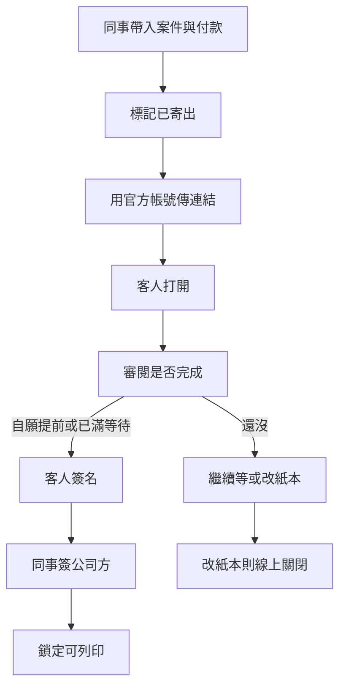

# 線上合約（ESIGN-CONTRACT-2）

最後對照程式：2026-11-28（Asia/Taipei）

給已綁定該案的客人審閱工程承攬契約、手寫簽名（甲方）。同事在客戶財務頁調整付款節點、標記已寄出，再用官方帳號回覆傳連結；客人簽完後，同事從「簽乙方」簽公司方。不同意線上簽可改用紙本。系統不主動推播。正式開關預設關。

後端契約：`Backend_GAS/project-console/SPEC/ESIGN_CONTRACT_2.md`。簽約注意事項是另一份：`SPEC/ESIGN_NOTICE_1.md`。

範本版本 `2025-0922`，29 條。範本裡的五處文字修正本版不套用，等另行確認後整份替換。乙方公司資料在範本內，規格不複述帳戶與證照號碼。

## 人怎麼走

1. 同事打開客戶財務頁的「線上合約」。案名、地址、業主姓名與手機、開工日、工期、總價會從案場與毛利帶入；缺的留空。付款沒另存就是四期 30／30／30／10。
2. 同事可改期數、名稱、比例（合計要 100%，最多 12 期），也可覆寫總價，再按儲存。
3. 按「標記已寄出」會存下付款表，並記下第一次寄出時間。同事自己複製連結，用官方帳號回覆傳給客人。
4. 客人打開後開始審閱。要嘛勾「已充分審閱，自願提前簽約」再按完成審閱，要嘛等寄出後滿 7 個 24 小時再按完成審閱。
5. 完成審閱後客人手寫簽名（甲方）。之後同事開「簽乙方」簽公司方。雙方都簽完就鎖定，可回看、列印。
6. 任一方在雙方都簽完之前可改用紙本。改了就鎖定，線上不能再簽。

### 程式對照表

| 白話（圖上寫的） | 程式對照（開發用） |
|------------------|-------------------|
| 同事帶入案件與付款 | `designer-customer-finance.html` 分頁「線上合約」；`esign_contract_status`、`esign_contract_staff_save` |
| 標記已寄出 | 同一支儲存，帶 `mark_sent=1`。另有 `esign_contract_staff_send` 可重寄並清掉審閱，主控台按鈕沒接 |
| 用官方帳號傳連結 | 畫面只複製連結，沒有推播 |
| 客人打開 | `modules/projects/esign-contract.html`、`esign-contract-main.js`；`esign_contract_get` 後客人再 `esign_contract_open` |
| 自願提前或已滿等待 | `esign_contract_ack_early`、`esign_contract_ready`。等待是滿 7 個 24 小時，不是日曆跨 7 天 |
| 客人簽名 | `esign_contract_sign_party_a` |
| 同事簽公司方 | 連結帶員工簽乙方參數，且不要帶預覽參數；`esign_contract_sign_party_b` |
| 改紙本則線上關閉 | `esign_contract_paper_opt` |
| 鎖定可列印 | 雙方簽完或改紙本後 `locked`；`esign_contract_print` |
| 只預覽 | 網址帶預覽參數。預覽不可改付款表、不可代客簽、不可簽乙方 |

## 狀態（畫面上的字）

| 畫面 | 內部狀態 | 意思 |
|------|----------|------|
| 草稿 | `draft` | 還沒標記寄出 |
| 已寄出 | `sent` | 已記下寄出，客人還沒打開 |
| 已開啟審閱 | `opened` | 客人打開過 |
| 已勾自願提前 | `early_acked` | 勾了提前，還沒按完成審閱 |
| 可簽約 | `ready_to_sign` | 審閱完成，客人可以簽 |
| 甲方已簽（待乙方） | `party_a_signed` | 客人已簽，公司還沒簽 |
| 雙方已簽 | `signed` | 雙方簽完並鎖定 |
| 改用紙本 | `paper_preferred` | 改紙本並鎖定 |

畫面狀態以推導結果為準，不以表格裡舊的狀態欄單獨為準。

## 付款與案件欄

- 沒自訂時用四期：簽約金 30%、木作退場 30%、系統櫃完工 30%、驗收尾款 10%。
- 自訂時每期要有名稱，比例 0～100，合計 100%，最多 12 期。
- 金額用總價依比例四捨五入，差額放最後一期，加總等於總價整數元。
- 總價來自毛利設定的合約額，同事可在畫面上覆寫。工期是開工日到預計完工日的日曆相減，至少 1。
- 條文第 6 條仍寫 30% 與四期句子；頁尾註明實際以期表為準。自訂比例時，條文百分比和金額可能對不上。這是本版故意不套用的修正之一，不是已經對齊的正確文案。

## 風險與等待

- 沒綁定的客人：已防，要登入票且對照表已通過。
- 預覽代簽甲方、簽乙方：後端會拒絕。已防。
- 預覽存付款表：畫面上沒有按鈕。後端的拒絕只看驗證結果有沒有預覽旗標；員工驗證先通過時不會帶上這個旗標，只帶員工編號的預覽請求仍可儲存。未防。
- 甲方簽了之後再改付款表：後端拒絕。已防。
- 雙方簽完或已改紙本再簽：拒絕。已防。
- 簽名太大、沒設存放資料夾、內容版本對不上：拒絕，不會當成簽成功。已防。
- 客人送出失敗會顯示錯誤句。已防。
- 只帶員工編號就能改付款、標記寄出、簽乙方、改紙本、讀走地址電話與簽名：未防。見已知問題。
- 預覽在客人已簽、公司未簽時仍可按改紙本：未防。
- 完成審閱後、客人簽名前，付款表仍可改：未防。
- 案名、地址、付款期名直接貼進合約畫面：未防。
- 另一位已綁定的客人改紙本，可能變成同事看到的「最新一筆」：未防。
- 開頁與主控台這幾支沒有時間上限。每次看狀態都會整張讀合約紀錄，並再讀全部案場與整張毛利設定來帶欄位。

## 已知問題

這些是缺陷，不是正確規格。

1. 員工登入票開關仍關時，只帶員工編號就會當成那位員工。不限權限（主控台這頁畫面要至少 2，接口沒有）、不看是否離職、也不限是不是這案的負責人。可以讀合約與簽名、改付款與總價、標記寄出、簽乙方、改紙本鎖定。預覽請求若同時帶員工編號，儲存付款表的拒絕不會生效。
2. 預覽在甲方已簽、尚未雙方簽完時，仍看得到「改用紙本」。按下去會鎖定。後端對預覽身分也沒有擋這一步。
3. 完成審閱會凍結當時的案件欄，但在甲方簽名前，主控台仍可改付款與總價。客人若沒重整就簽名，畫面上的條件可能已不是寫進去的。
4. 案名、地址、條文帶入值、付款期名是直接組成網頁。欄位裡若有網頁標記，打開或列印時會被執行。摘要區用純文字，全文區沒有。
5. 同事看狀態、儲存、簽乙方，都拿該案「最近更新」的一列。另一位已綁定客人若改紙本，會多一列並變成最新，真正在審的那份會被蓋住。
6. 寫入沒有鎖定。兩人同時簽甲方，可能各留下一筆。
7. 工期天數是日曆相減，條文卻寫工作天且不含週休二日、例假及雨天。
8. 客人打開若失敗，錯誤被略過，畫面仍可能寫「可審閱」。主控台與客人頁都沒有逾時；一直不回就停在載入中。主控台只有在收到網頁錯誤時才會再試。

## 待確認（本版故意不做）

範本列了五處待改：刪英文假字、統一變更／取消費說法、付款節點改由每案付款表帶進條文、附件效力、第十五條第四款改寫。程式註明等確認後整份替換，本版不套用。

## 舊規格落差

先前這份只有四行路徑。沒有審閱規則、付款表、狀態、風險與已知問題。本輪依程式重寫主段。
