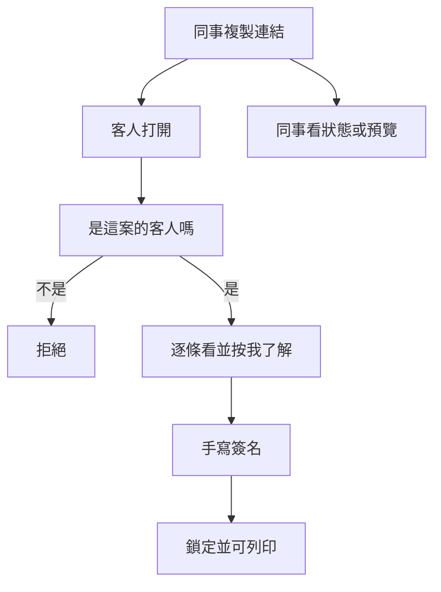

# 簽約注意事項（ESIGN-NOTICE-1）

最後對照程式：2026-11-28（Asia/Taipei）

給已綁定該案的客人，在簽約前逐條看完裝潢標準規範、每條按「我了解」，再手寫簽名鎖定。同事在客戶財務頁看狀態、複製連結，用官方帳號回覆傳給客人。系統不主動推播。正式開關預設關。

後端契約：`Backend_GAS/project-console/SPEC/ESIGN_NOTICE_1.md`。線上合約是另一份：`SPEC/ESIGN_CONTRACT_2.md`。

## 人怎麼走

1. 同事在客戶財務頁打開「簽約注意」，複製客人連結，用官方帳號回覆傳出。
2. 客人用 LINE 打開連結。要是這案已通過綁定的人，才看得到內容。
3. 一頁一條，共 18 條。按「我了解」才進下一條。條文可含圖與加價說明。
4. 18 條都按過後手寫簽名並送出。簽名鎖定，之後不能改。
5. 已簽的人可以回看、列印。列印用的是簽名當下的內容，之後改版不會改掉這份。
6. 同事可預覽客人畫面（唯讀）、重新整理狀態、列印已簽版本。

### 程式對照表

| 白話（圖上寫的） | 程式對照（開發用） |
|------------------|-------------------|
| 同事複製連結 | `modules/accounting/designer-customer-finance.html` 分頁「簽約注意」；`AccountingApi.esignNoticeStatus` |
| 客人打開 | `modules/projects/esign-notice.html`、`modules/projects/js/esign-notice-main.js`；`esign_notice_get` 後再 `esign_notice_open` |
| 是這案的客人嗎 | 客人要登入票，且對照表有這案的已通過綁定。內部預覽另走員工身分 |
| 拒絕 | 回傳失敗句，例如尚未開放、無權限、已有別人簽完 |
| 逐條看並按我了解 | `esign_notice_ack`，條號 1～18 |
| 手寫簽名 | `esign_notice_submit`，帶簽名圖與內容雜湊 |
| 鎖定並可列印 | 狀態變成已簽；`esign_notice_print` |
| 同事看狀態或預覽 | 狀態 `esign_notice_status`；預覽網址帶預覽參數。預覽不可代按、不可代簽 |

## 狀態（畫面上的字）

| 畫面 | 內部狀態 | 意思 |
|------|----------|------|
| 未開啟 | `not_opened` | 這個人還沒打開 |
| 已開啟 | `opened` | 打開過，還沒按任何一條 |
| 進行中 | `in_progress` | 至少按過一條 |
| 已簽 | `signed` | 簽名並鎖定 |

一案以「已有人簽完」為準。別人再簽會被拒絕。進行中可以有多人各記各的，直到有人簽完。

## 開關與存放

- 正式開關預設關。沒打開時，只有測試案號名單裡的案子能用。
- 簽名圖要先設好存放資料夾才送得出去。沒設會拒絕，不會假裝已簽。解碼後超過約 200KB 也拒絕。
- 設定名稱留在後端規格。這裡不寫網址、識別碼、資料夾編號。

本機只有迴圈位址加上測試參數可以假身分。正式站不走這條。

## 風險與等待

- 客人沒綁定這案：已防，會拒絕。
- 預覽代按、代簽：畫面與送出都已防。
- 送出失敗：會顯示錯誤，不會當成已鎖定。已防。
- 讀取失敗與「還沒有紀錄」：沒紀錄是「未開啟」；試算表讀不到會失敗。已防，不會把故障說成沒人簽。
- 預覽看不到客人進行中：未防。見已知問題。
- 兩台裝置同時按「我了解」，或兩人同時送出簽名：未防。見已知問題。
- 只帶員工編號就能查狀態、列印簽名：未防。見已知問題。
- 開頁沒有時間上限。連線一直不回，會停在「載入中」，沒有再試按鈕。每次讀寫都會整張讀簽署紀錄。

## 已知問題

這些是缺陷，不是正確規格。

1. 內部查狀態、列印，在登入票開關仍關時，只帶員工編號就會當成那位員工。不限是不是這案的負責人，也不看是否離職。列印會帶出簽名圖。
2. 預覽客人畫面時，若還沒有人簽完，看的是預覽者自己的列，不是客人的進行中。主控台狀態看的是該案最新一筆，兩邊會不一致。
3. 寫入沒有鎖定。兩人同時送出，可能各留下一份已簽。兩台裝置同時按不同條「我了解」，可能少記一條，但兩次都顯示成功。
4. 客人頁開頁沒有逾時。例外會寫在載入區；一直不回就停在載入中。

## 舊規格落差

先前這份只有放置位置與開關，沒有人怎麼走、狀態、風險與已知問題。本輪依程式重寫主段。
