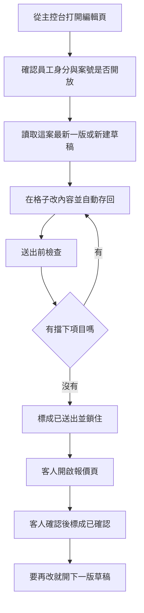

# 線上報價編輯（QUOTE-EDITOR-3）

最後對照程式：2026-11-11（Asia/Taipei）

**一句話**：給設計師在主控台把一案的報價打成草稿、送出給客人看；客人只能確認已送出的那一版。這不是報價驗收審核（見 `SPEC/12_報價單審核與主控台整合規格書.md`）。

後端契約：`Backend_GAS/project-console/SPEC/QUOTE_EDITOR_3.md`。

## 人怎麼走

1. 從客戶財務頁的「線上報價」進編輯頁（網址要帶案號）。
2. 頁面先確認是員工（畫面要求權限至少 2）。正式開關關掉時，後端只放行白名單案（沒另設時預設測案 `999`）。
3. 沒有草稿就會新建一版「草稿」。在格子打字，約 0.6 秒後自動存回；也可加空間、從標準計價帶入、掛櫃子加購、填丈量／啟動／規劃扣費。
4. 按「送出前檢查」看擋下項目與提醒。擋下（0 元、空空間、待確認字樣等）就不能送出。
5. 「送出給客人」成功後，這一版鎖住。客人頁只看得到已送出或已確認的版本，沒有單價、沒有成本。
6. 客人按確認後變成「客人已確認」。要再改必須「開新版本」（目前若仍是草稿，不能另開）。
7. 列印預覽拿的是**最新一版**（含尚未送出的草稿），同樣不印單價與成本。

狀態只認三種：草稿、已送出、客人已確認。只有草稿能改格子。

## 流程

### 程式對照表

| 白話（圖上寫的） | 程式對照 |
|------------------|----------|
| 從主控台打開編輯頁 | `designer-customer-finance.html` 的線上報價分頁 → `modules/projects/quote-editor.html` |
| 確認員工身分與案號是否開放 | `AccountingApi.initSession({ minPermission: 2 })`；後端 `quote_editor_get` 與正式開關／測試白名單 |
| 讀取這案最新一版或新建草稿 | `quote-editor-main.js` 的重新載入；後端取得草稿（沒有就寫入一筆） |
| 在格子改內容並自動存回 | `quote-editor-grid-ui.js` 約 0.6 秒後送出；加入／更新／刪除／排序工項、設定扣費 |
| 送出前檢查 | 按鈕「送出前檢查」→ `quote_editor_preflight` |
| 有擋下項目嗎 | 回傳 `ok_to_send`、`blockers`、`warnings` |
| 標成已送出並鎖住 | 「送出給客人」→ `quote_editor_send`；狀態改已送出 |
| 客人開啟報價頁 | `modules/projects/quote-view.html` → `quote_editor_customer_view` |
| 客人確認後標成已確認 | 確認按鈕 → `quote_editor_confirm` |
| 要再改就開下一版草稿 | 「開新版本」→ `quote_editor_new_version` |

客人頁與列印會再擋一次成本類欄位與單價（`quote-editor-sanitize.js`）。本機網址帶測試參數時可改看假資料，不代表正式雲端。

## 風險與等待

- 每次存草稿都會整張讀「報價草稿」表再寫回一列。筆數變多會變慢。價目表有約 6 小時快取；快取冷掉才掃標準計價全部分頁。編輯頁打主控台**沒有**前端逾時（會計那條預設 60 秒不套到這條）。
- 畫面上有「暫存中…／已自動暫存」。慢的時候看得到字，但不會自己中止。
- 兩次自動暫存若重疊，可能互相蓋掉（見已知問題）。刪除同一列再按一次，後端會回成功並標「已經不在」，這點有防連點刪兩次。

## 已知問題／風險（不要當成正確行為）

1. **送出或確認先寫入狀態，再檢查有沒有不該出現的欄位。** 檢查沒過時介面回失敗，但雲端可能已經是「已送出」或「已確認」。畫面若再因為預覽含單價而自己擋下，會看起來像沒送出，下一筆修改卻被告知不能改。應先檢查、通過才改狀態。
2. **草稿沒有整包鎖定，也沒有「我是基於哪一版」的檢查。** 格子自動暫存是整包讀出來改一點再寫回。兩次寫入重疊時，後寫的會蓋掉先寫的列。
3. **畫面要求權限至少 2，後端只確認「是員工」就放行。** 網址加上員工預覽或開發參數時，員工身分還能把報價標成客人已確認。後端應檢查權限，且客人確認不應靠員工預覽捷徑完成。
4. 打開編輯頁若還沒有草稿，會立刻新建並寫入。兩人同時第一次打開，可能產生兩筆同版草稿，之後只跟著「較新的那筆」走。

## 可改進

- 送出失敗時應再讀一次雲端狀態，避免畫面停在草稿、雲端已鎖定。
- 自動暫存改成排隊，同一時間只跑一筆，並帶版本號。
- 主控台這條補上逾時與「等太久請先重新載入、不要連按」的人話。
