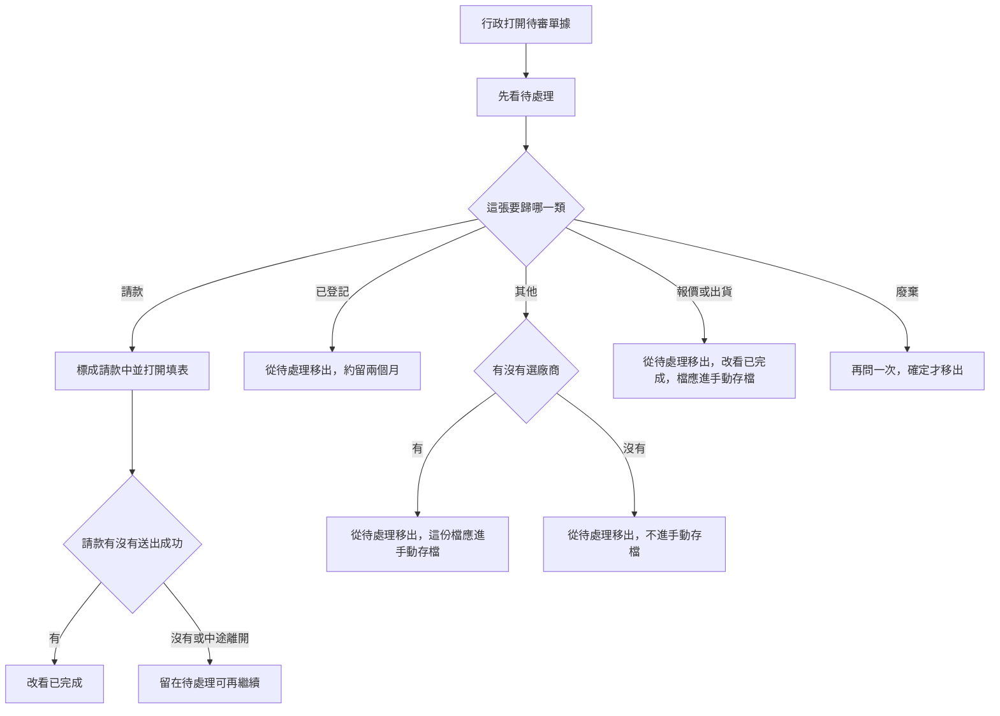

# 單據快審（待審單據）

最後對照程式：2026-11-13（Asia/Taipei）

**一句話**：權限 2 以上的行政，把 LINE 傳來的圖或 PDF 分成「廢棄／請款／報價／出貨／其他／已登記」；只有請款會打開填表頁。

同一頁還有「手動存檔」（自己上傳報價、合約）。那一段見 [`22_廠商檔案上傳與檔名規則.md`](22_廠商檔案上傳與檔名規則.md)。本檔只寫 **待審單據**。

後端契約：`Backend_GAS/accounting-gas/SPEC/單據快審_SPEC.md`。模組總覽仍在 [`15_會計系統模組規格書.md`](15_會計系統模組規格書.md) §2.1.2。欄位在 [`專案全域資料字典.md`](專案全域資料字典.md) §8.1.1。

## 人怎麼走

1. 廠商或群組用 LINE 傳圖或 PDF。對得到廠商就放進該廠資料夾並出現在待處理；對不到就標「待認領」。傳圖當下不讀金額、不自動開請款單。
2. 行政從會計選單「日常款項」→「單據與存檔」，或主控台「單據與存檔」。預設是「待審單據／待處理」。
3. 待認領若要標請款、報價、出貨，要先選廠商。已登記、其他、廢棄可以不選。
4. 點分類。同一張卡片處理中不能連點。廢棄會再問一次，預設焦點在取消。
5. 點「請款」：這張改成「請款中」，仍留在待處理，並打開待付款填表（盡量帶上那張圖，票大約 45 分鐘）。送出成功才改成已完成。沒送出或中途離開，回來按「請款還沒送完」或「繼續請款」。
6. 點已登記、其他、報價、出貨、廢棄：成功後**不自動換分頁**。要看結果，自己點上方「已登記／其他／已完成」。
7. 標錯可以再點別的分類。已登記大約留 60 天，逾時從清單消失（軟封存，不是刪檔）。

## 流程

圖上「應進手動存檔」是產品要的結果。程式有時寫失敗仍顯示已標好，見下方「已知問題」，不要把那個當成正確規格。

**程式對照表**

| 白話（圖上寫的） | 程式對照（開發用） |
|------------------|-------------------|
| 行政打開待審單據 | `modules/accounting/quick_review.html`；主控台 `#/accounting/quick-review`；殼層 `accounting_shell.js` |
| 先看待處理 | 篩選 `open`＝待審＋待認領＋請款中；`AccountingApi.quickReviewList` → `quick_review_list` |
| 這張要歸哪一類 | 卡片按鈕；`classify` → `quickReviewClassify` → `quick_review_classify` |
| 標成請款中並打開填表 | 狀態改 `請款中`；`payment_url`／`pending`；約 280ms 後前往 `payment_request.html` |
| 請款有沒有送出成功 | 請款送出成功才 `finalizeQuickReviewAfterPayment_` 改 `已分類` |
| 留在待處理可再繼續 | 狀態維持 `請款中`；返回可帶 `notice=pay_fail` 或 session `acct_quick_review_pay_resume_v1` |
| 已登記約留兩個月 | status＝`已登記`；60 天後 `is_active=否` |
| 其他、有沒有選廠商 | 有 `vendor_id` 才寫「廠商檔案索引」；沒有就不寫 |
| 報價或出貨進已完成與手動存檔 | status＝`已分類`；類型對到報價單或「其他」檔 |
| 廢棄再問一次 | `#dropDlg`；確定才送 category＝`廢棄` |

## 畫面與狀態

| 人看到的 | 後端狀態 | 備註 |
|----------|----------|------|
| 待處理 | `待審`、`待認領`、`請款中` | 預設 |
| 請款還沒送完 | `請款中` | 綠框；按鈕寫「繼續請款」 |
| 已登記 | `已登記` | 約 60 天 |
| 其他 | `其他`；舊資料也可能是 `已分類` 且分類是其他 | 已完成不再含這類舊列 |
| 已完成 | `已分類` 且分類不是其他 | 請款送出成功，或已標報價／出貨／廢棄 |

權限：開頁與分類都要 **≥ 2**（`INGEST_MIN_PERMISSION` 與後端一致）。低於 2 開不了這一頁。

來源標籤用真實群名或對話名。沒有就留空或退回來源代碼，不寫「會計群組」「未知使用者」。

## 風險與等待

- **等很久**：每次開清單都整張「廠商單據快審」讀完，再只留最多 200 筆（新的在前）。點「已登記」還會先把過期的一筆筆找回來封存。來源若還沒記住群名，會再問 LINE。畫面有「更新中」、約 45 秒會停並可「重新載入」。非嵌入時可先畫 90 秒內的舊清單；嵌入主控台不先畫舊清單。
- **失敗不要看成沒有**：讀取失敗會寫「無法載入清單」或逾時，有舊清單就留著。真的零筆才說目前沒有。
- **超過 200 筆不會說還有更多**，較舊的待處理會像消失。見已知問題。
- **同一頁連點**有鎖定。兩個分頁或兩人同時分類，後寫的蓋過前寫的，沒有版本號。

## 已知問題（不要寫成正確行為）

1. **只帶員工編號就能看清單並分類。** 主控台那條若沒有短效登入票，後端目前只警告仍放行（與記帳、改歷史同一道閘）。知道一位權限 ≥2 同事的編號，就可以列出雲端連結，或把單據標成廢棄、改掛廠商。應改成沒有有效憑證就拒絕。
2. **手動存檔沒寫上，畫面仍像成功。** 報價、出貨、其他會先改快審狀態，再寫廠案索引；寫失敗被吃掉，仍回成功。有選廠商時，成功提示仍說「會進手動存檔」；「其他」分頁的筆數句也一律寫「已列入手動存檔」（沒選廠商的其實沒寫）。應改成寫失敗用黃字，沒寫上就不要那麼說。
3. **待處理超過 200 筆仍像完整清單。** 回傳沒有「還有更多」。人會以為較舊的單據已經處理完。
4. **請款單已成立，快審卻沒改成已完成。** 結案若丟出錯誤，請款仍回成功，單據留在「請款中」。畫面會請人繼續請款，可能再送出第二筆。請款本身沒有用快審編號擋重複。

## 本輪沒做

傳圖當下不辨識金額、不自動建請款。背景自動建議分類沒有做。手動存檔的上傳規則不在本檔重寫。
