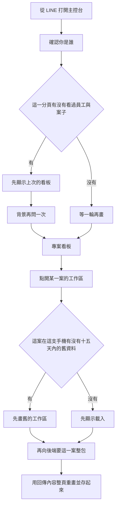

# 專案主控台入口（看板與打開工作區）

最後對照程式：2026-11-12（Asia/Taipei）

給內部同事用的 LINE 主控台首頁：先认出你是誰，再看專案看板；點一案會在同一頁嵌出該案工作區。  
寫入（改排程、寫日誌、上傳照片）的動作名稱仍見 [`08_專案主控台核心功能與通訊協定規格書.md`](08_專案主控台核心功能與通訊協定規格書.md)；該檔前半有過時段落，以本檔與程式為準。  
後端讀取契約：`Backend_GAS/project-console/SPEC/主控台入口讀取_SPEC.md`。

## 人怎麼走

1. 從 LINE 打開主控台首頁。
2. 若這一分頁最近看過，先用舊的員工名單與專案卡片把畫面畫出來，再在背景更新。
3. 第一次開、沒有舊資料時，會等一輪：一邊問出勤「你是誰、同事名單」，一邊問主控台「你看得到哪些案子」。
4. 專案看板只列出「畫面認定你看得到」的案子，並依最近進度排序。讀不到時應寫「暫時讀不到，不代表沒有案子」，並可再試。
5. 按「開啟工作區」後，同一頁嵌出該案工作區，網址帶上你的編號、顯示名，以及前端此刻的權限數字。
6. 工作區若本機有 15 天內、且屬於同一人的舊資料，先畫舊的，再向後端要整包（排程、日誌、通知）。
7. 之後約每 10 分鐘再要一次整包。

直接用網址打開工作區、且網址同時有編號與姓名時，**不會**再走 LINE 登入。這是已知問題，不是正確的安全設計（見下）。

## 流程

### 程式對照表

| 白話（圖上寫的） | 程式對照（開發用） |
|------------------|-------------------|
| 從 LINE 打開主控台 | `index.html` 載入 `spa/app.js`；正式站走 LINE 登入 |
| 確認你是誰 | `liff.getProfile`；本機測試不走 LINE |
| 這一分頁有沒有看過員工與案子 | `localStorage`／`HubRefCache`：員工、專案 |
| 先顯示上次的看板 | `initializeApplication` 有快取就先關掉全頁載入 |
| 背景再問一次 | `fetchAttendanceData`（出勤 `get_hub_core_data`）＋ `fetchHubProjectsData`（`page=get_hub_projects_data`） |
| 等一輪再畫 | 無快取時 `Promise.all` 兩支一起等；專案失敗約 0.8 秒再試一次 |
| 專案看板 | `spa/ProjectBoard.js` 再用權限與負責人濾一次、排序 |
| 點開某一案的工作區 | 網址 `#/project-console?id=`，`IframeView` 嵌 `modules/projects/managementconsole.html` |
| 這案在這支手機有沒有十五天內的舊資料 | `localStorage` 鍵 `project_data_<案號>_<使用者>`，期限 15 天 |
| 先畫舊的工作區／先顯示載入 | `loadDataAndRender`：有合格快取就 `handleDataResponse`，否則骨架 |
| 再向後端要這一案整包 | `projectApi.request`，`action: 'project'`（GET `page=project`） |
| 用回傳內容整頁重畫並存起來 | 與快取簽名不同就整頁重畫並覆寫 `localStorage` |

## 畫面怎麼分「失敗／還沒載入／真的沒有」

| 情況 | 專案看板應顯示 | 程式現況 |
|------|----------------|----------|
| 還在等、沒有舊卡片 | 「載入專案中…」 | 有 |
| 連線或回傳失敗、沒有舊卡片 | 「暫時讀不到。這不代表你沒有案子」＋再試 | 無快取、或按再試時有 |
| 已有舊卡片，背景更新失敗 | 舊卡片留下，並說明更新失敗 | **沒有**。出勤那支若成功，專案失敗不會設錯誤字（已知問題） |
| 後端說成功但案子是空的（含讀表失敗被當成空） | 應說失敗 | **會當成真的沒有案子**，並清掉錯誤字（已知問題） |
| 認不出你的員工身分 | 「還不能確認你的身分」 | 有 |
| 認得出人、濾完是空的 | 「目前沒有你負責的專案」 | 有；可能把「濾掉」或「讀取失敗」也顯示成這句 |

工作區：整包 `success: false` 會顯示錯誤（配額字樣會再試一次，但再試成功寫不回去，見已知問題）。日誌讀取失敗仍可能整包成功、日誌變空陣列，畫面不看失敗註記。

## 誰看得到哪些案子（畫面上）

看板在後端已篩過一輪之後，**再篩一次**：

| 畫面認定的權限 | 看哪些卡片 |
|----------------|------------|
| 4 以上 | 後端有回的全部 |
| 剛好 3 | 專案分區等於你的組別 |
| 其他 | 負責人欄以逗號切開後，有沒有你的使用者編號 |

排序用卡片上的近期日誌時間，或排程的預計開始／完成日，較新的在前。

這套與後端不完全相同（後端權限 2 以下還會認負責人欄裡的**姓名**）。權限數字來自出勤核心的員工名單，不是主控台自己的員工表。兩邊不一致時，會出現「其實有案子，看板卻說沒有」（已知問題）。

## 與舊規格的落差

- 舊的核心規格把主控台寫成「留言、樂觀更新、所有寫入都進佇列」。入口現況是上面這條；寫入仍有任務輪詢，但不是每一種讀取。
- 懶載入（先要筆數、展開再要一案）後端有做，**開關關閉**。首頁仍一次要「每案都帶近期日誌與排程摘要」的那一支。

## 已知問題／風險

下列是程式現況，**不是**應有行為。

1. 工作區網址同時帶使用者編號與姓名時，略過 LINE 登入。後端開案只檢查這號在不在員工表，不檢查能不能看這案；員工登入驗證開關預設關閉。換成別的編號或別的案號，就讀得到該案排程、日誌、通知與案場欄位。
2. 案場清單讀取失敗時，後端仍回成功加空清單。看板會寫成沒有你負責的專案，並蓋掉本機舊清單。
3. 工作區日誌讀取失敗仍整包成功，並附一個失敗註記；畫面不看該註記。若與舊快取不同，會整頁改成沒有日誌，並寫進最長約 15 天的本機快取。已結案若封存讀到一半失敗，後端只回已掃到的年份，畫面像日誌就是這些。排程讀取丟出錯誤時，同樣變成空排程，還附上範本，看起來像這案還沒排。
4. 有舊看板時，背景更新失敗不一定出現錯誤句。
5. 通知按掉之後先從畫面移除；送出失敗只跳警告，不會放回來。
6. 開工作區若因配額再試且第二次成功，結果寫不回變數（該變數不可再指定），人仍看到初始化失敗。

## 風險與等待

- **交叉**：見上列 1～5。身分用網址編號、清單失敗像沒案子、日誌失敗蓋掉好的快取，都會讓人信錯畫面。
- **等待**：冷啟動要掃整份案場、日誌、排程與通知快取；已結案工作區還會逐年翻封存。畫面有「載入中」或先畫舊資料，專案清單失敗會再試一次，**沒有讀取逾時**。慢的時候只能乾等或看舊資料。工作區寫入若走任務輪詢，最長約 3 分鐘會放棄（那是寫入，不是本檔的開頁讀取）。

## 可改進

- 看板與開案改為同一套「能不能看」；失敗與空清單分開，失敗時不要覆寫還能看的快取。
- 懶載入開關打開後，首頁改要摘要，展開再要一案，縮短冷啟動。
- 工作區配額再試要能採用第二次的結果。
