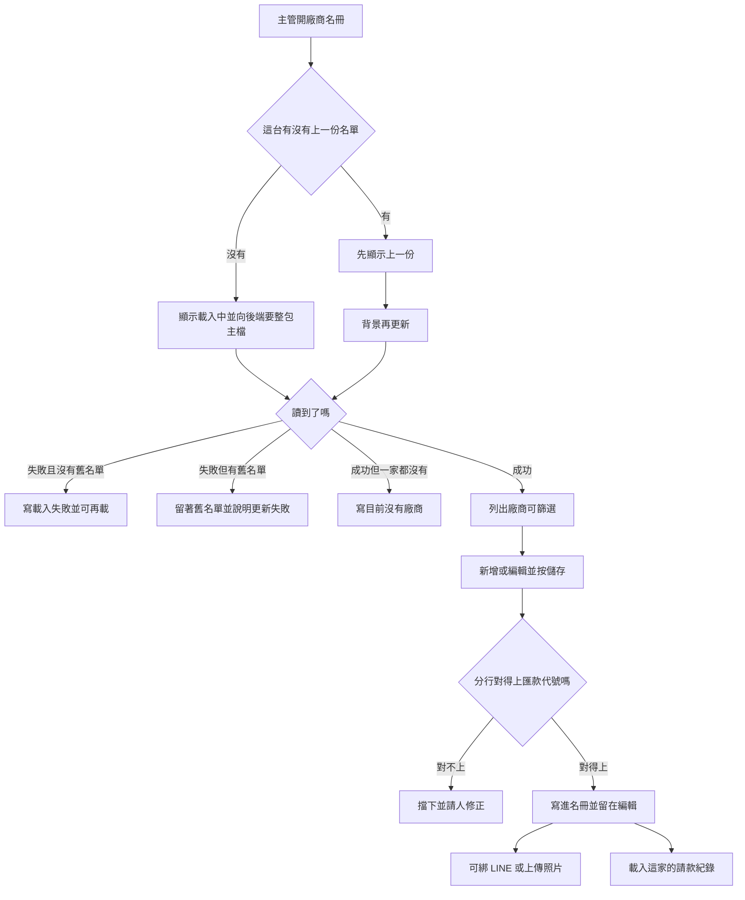
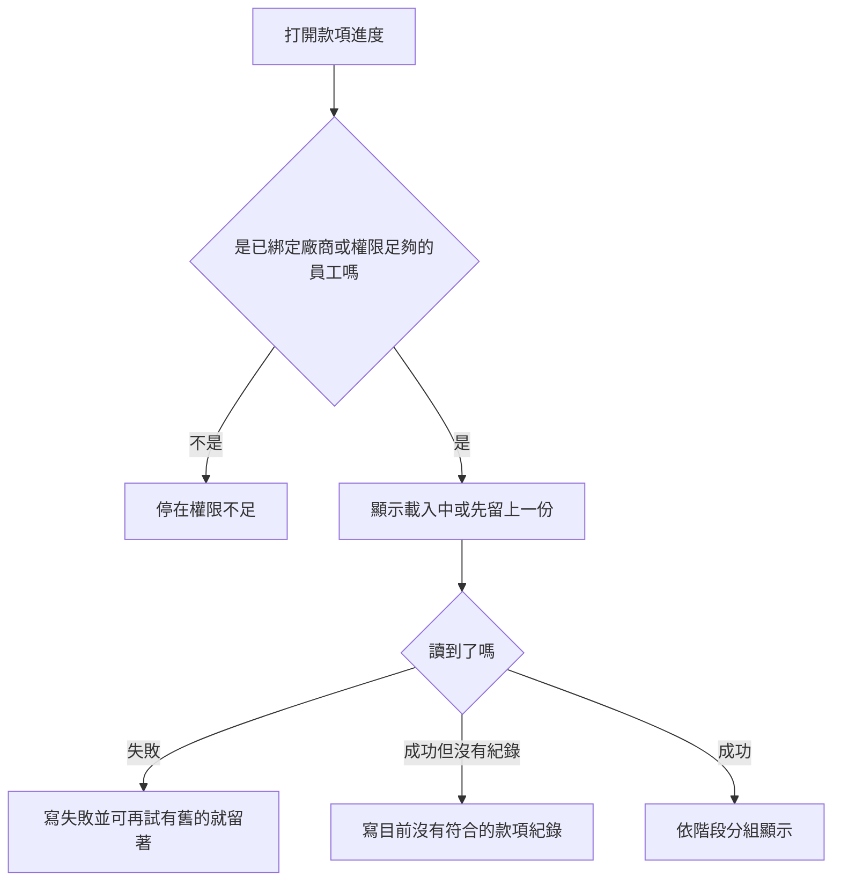

# 廠商名冊與款項進度

最後對照程式：2026-11-16（Asia/Taipei）

給誰：主管（權限 3 以上）維護廠商與匯款帳戶；已綁定的廠商看自己的款項走到哪；權限 4 以上的員工也可開同一頁進度。

人怎麼走、畫面與等待寫在這裡。後端契約與表見 `Backend_GAS/accounting-gas/SPEC/VENDOR_ROSTER_AND_STATUS_SPEC.md`。廠商自己填表見該檔的自填節，以及後端 `VENDOR_REGISTER_SPEC.md`。

---

## 1. 人怎麼走

### 1.1 主管維護名冊

1. 從會計選單開「廠商名冊」（權限不足會被擋在門外）。
2. 這台瀏覽器若已有名單，先顯示上一份；沒有就顯示「載入中」，再向後端要整包主檔。
3. 可依工項、合作狀態篩選。一家都沒有才寫「目前沒有廠商」；篩選沒命中才寫「沒有符合篩選的廠商」。
4. 新增或編輯：名稱、聯絡人、銀行代碼、帳號、戶名必填。有填分行時，存檔前會先問這分行能不能對上匯款代號，對不上就擋下。
5. 新增時若已有同名，預設改去編輯那一筆；人確認後才允許再加一筆同名。統編跟別家一樣時只再問一次，後端不擋。
6. 存成後留在編輯畫面，以便綁 LINE、上傳名片或存摺。照片若沒存上，會用黃字說明「廠商資料已儲存」。
7. 編輯區下方載入這家近一年的請款紀錄（只讀請款單，不掃每月收支）。待匯款要權限 4 以上才能改或刪；已匯款可補通知（同樣 4 以上）。
8. 列表上的「暫停合作／恢復合作」只在「合作中」與「暫停合作」之間切換。

### 1.2 廠商自填

1. 用 LINE 開自填頁，不進員工選單。
2. 填名稱、聯絡人、銀行代碼、帳號、戶名即可送出。照片與辨識是附帶的，沒附也能送。
3. 第一次送出就變成「合作中」，並綁上目前這個 LINE。
4. 若這家已被改成「暫停合作」，再開只能看、不能改，畫面請人聯絡行政。

### 1.3 看款項進度

1. 已綁定的廠商可開「款項進度」。員工要權限 4 以上才進得了這一頁。
2. 先顯示載入中；若有上一份就先留著並寫「更新中」。
3. 依階段分成待審核、待匯款、已匯款、已退回；另外把收支裡對到的列放在「其他收支」。
4. 真的沒有紀錄才寫「目前沒有符合的款項紀錄」。讀失敗寫失敗並可再試，有舊內容就留著。

---

## 2. 流程圖

### 程式對照表

| 白話（圖上寫的） | 程式對照（開發用） |
|------------------|-------------------|
| 主管開廠商名冊 | `modules/accounting/vendors.html`；進頁門檻 `AccountingBoot`＋`SUPERVISOR_MIN_PERMISSION`（3） |
| 這台有沒有上一份名單 | `AccountingCache.get`／`peekVendors` |
| 先顯示上一份 | `boot` 裡有快取就先 `renderList` |
| 顯示載入中並向後端要整包主檔 | `loadVendorList`；`AccountingCache.load` → `accounting_bootstrap` |
| 背景再更新 | 已有名單時 `loadVendorList` 不擋畫面；失敗走 catch |
| 寫載入失敗並可再載 | `listLoadFailed` 與「重新載入最新」 |
| 留著舊名單並說明更新失敗 | 已有 `allVendors` 時失敗只 `setMsg`，不把列表清成沒有 |
| 寫目前沒有廠商 | `renderList`：名單空且非載入中、非失敗 |
| 列出廠商可篩選 | `filterLocal`（工項、合作狀態） |
| 新增或編輯並按儲存 | `readForm` → `crud_create`／`crud_update`，entity `vendor` |
| 分行對得上匯款代號嗎 | 有填分行才呼叫 `ctbc_lookup_branch`；後端 `validateVendorBankBranchFields_` 再擋一次 |
| 擋下並請人修正 | 存檔前 `setMsg`；後端回失敗訊息 |
| 寫進名冊並留在編輯 | 成功後 `AccountingCache.patchMaster`、`fillForm` |
| 可綁 LINE 或上傳照片 | `line_contact_search`、`crud_create` entity `vendor_line_binding`；`vendor_upload_photos` |
| 載入這家的請款紀錄 | `vendor_payment_status`，並帶這家 `vendor_id` |

款項進度（另一條路）：

| 白話（圖上寫的） | 程式對照（開發用） |
|------------------|-------------------|
| 打開款項進度 | `modules/accounting/vendor_status.html` |
| 是已綁定廠商或權限足夠的員工嗎 | 頁面用 `initPaymentRequestSession`；員工要 `MIN_PERMISSION`（4）。接口另見後端規格 |
| 停在權限不足 | `AccountingBoot` 的拒絕句 |
| 顯示載入中或先留上一份 | `AccountingListCache.peek`／`load`，鍵 `vendor_status` |
| 寫失敗並可再試有舊的就留著 | `renderFail`；`fetchStatusRetry` 會再要一次 |
| 寫目前沒有符合的款項紀錄 | `renderOkItems` 在 `items` 空陣列時 |
| 依階段分組顯示 | `STAGE_ORDER`：請款待審、待匯款、已匯款、已退回、收支紀錄（標題「其他收支」） |

---

## 3. 頁面與動作

| 人做的事 | 頁面 | 後端動作 |
|----------|------|----------|
| 看／新增／改廠商 | `vendors.html` | `accounting_bootstrap`；`crud_create`／`crud_update`，entity `vendor` |
| 暫停或恢復 | 同一頁列表按鈕 | `crud_update` 只送合作狀態 |
| 綁或移除 LINE | 同一頁編輯區 | `line_contact_search`；`crud_create`／`crud_update`，entity `vendor_line_binding` |
| 看這家請款紀錄 | 同一頁編輯區 | `vendor_payment_status`（帶 `vendor_id`，權限 3 以上代查） |
| 改或刪待匯、補通知 | 同一頁 | 請款更新／刪除／補通知（權限 4 以上） |
| 廠商自填 | `vendor_register.html` | `vendor_register_auth_me`／`get`／`submit`／`ocr` |
| 看自己的進度 | `vendor_status.html` | `vendor_payment_status`（不帶廠商編號） |

權限：名冊進頁與寫入是 3 以上。請款紀錄的改、刪、補通知是 4 以上。進度頁給廠商，或給員工 4 以上。接口本身對「在職員工」更寬，見已知問題。

---

## 4. 風險與等待

- 名冊強制重載會整包讀主檔（廠商與綁定都在裡面）。有上一份就先顯示。讀取約 60～120 秒仍無結果會停下來，可按「重新載入最新」。
- 編輯區的請款紀錄只讀請款單，不掃每月收支。
- 廠商自己開進度會再掃近六個月收支整表，預設約 60 秒會停。有載入中、失敗可再試。這條又慢又可能混進別筆，見已知問題。
- 別人在別台改的名冊，這台最快要等快取過期（約三天）或自己按重新載入才看得到。
- 兩人同時改同一家，後寫入的整筆蓋過先寫的，沒有版本號。

---

## 5. 已知問題（不要當成正確規格）

1. 畫面寫「暫停合作整廠不認」，請款下拉與 LINE 進線仍會認這家。待審核也一樣。只有廠商自填的「再更新」會被暫停擋住。案件毛利選廠商會排除暫停，跟請款不一致。
2. 知道權限 3 以上同事的員工編號、不帶有效登入票，仍可新增或修改廠商（含帳戶與合作狀態）。與會計其他寫入是同一道只警告仍放行的閘。
3. 廠商自查進度時，近六個月收支只要摘要裡含這家名稱就進「其他收支」，並帶金額與案號。名稱很短時會混到別筆。名冊裡代查不會走這條。
4. 自填不強制存摺或名片。送出仍直接變成合作中並綁上 LINE。舊說明曾把首次照片寫成必填，程式沒有做。
5. 自填若主檔已寫上、照片或綁定中途失敗，畫面像整筆失敗，名冊裡可能已經有這家。
6. 進度頁寫員工要權限 4 以上；接口從在職員工（權限 1）就接受查詢。

---

## 6. 可改進

- 暫停合作（以及尚未核對的待審核）不要出現在請款下拉，LINE 也不要再認。
- 自己看進度時不要掃收支，與名冊代查同一套，只讀請款單。
- 自填沒附核對照就不要直接當成合作中，或至少明白寫「尚未附照片」。
- 只改合作狀態時不要因為舊的分行對不上而暫停失敗。
