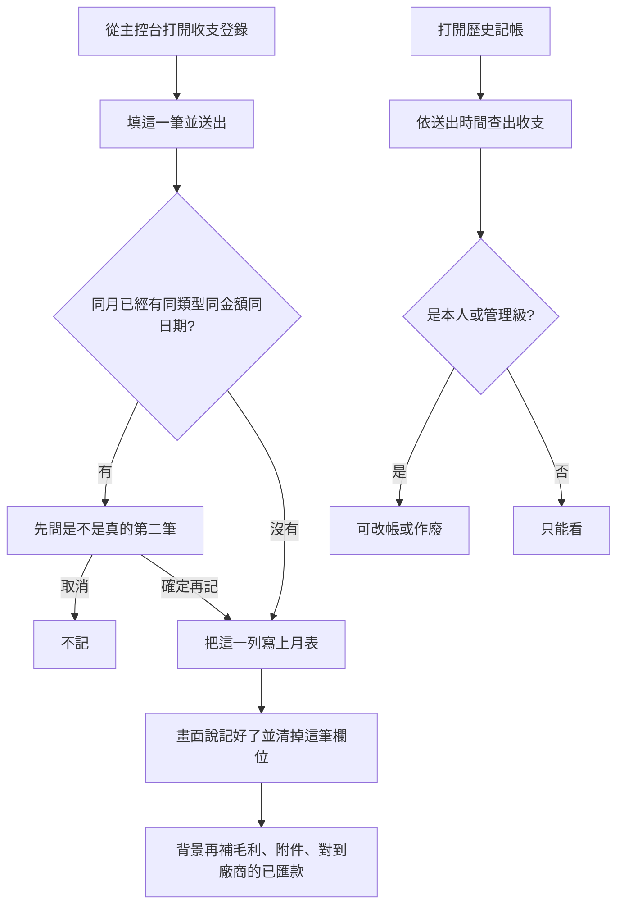

# 收支登錄與歷史記帳

最後對照程式：2026-11-13（Asia/Taipei）

給行政／財務在主控台記一筆收入或支出，之後用歷史頁查、改、作廢。  
本檔寫**現在程式怎麼走**。舊檔 `15_會計系統模組規格書.md` 文首 v1.73、v1.74 的「看全部要權限 4 或 5」已廢止；看全部以 **權限 ≥3** 為準。快審（單據與存檔）本輪沒查，仍看該規格 §2.1.2。

後端契約：`Backend_GAS/accounting-gas/SPEC/收支登錄送出與歷史記帳_SPEC.md`。權限細則：同目錄 `LEDGER_PERM_API.md`。

## 一句話

主控台「會計」裡，權限 ≥2 的人記帳；權限 ≥1 可查自己的歷史，≥3 可看別人的；改帳或作廢限本人或權限 ≥5。

## 人怎麼走（記一筆）

1. 從主控台進會計，打開收支登錄（權限 ≥2）。
2. 選收入或支出，填日期、對象、金額；支出還可填案號或分攤、選廠商。
3. 按送出。按鈕會變成「送出中」，避免連點。
4. 若同類型、同金額、同日期已經有一筆，先跳出確認。取消就不動；確定才再記一筆。
5. 主列寫上後，畫面綠色「記好了」，並清空金額、對象等，日期留著，可連記下一筆。
6. 若主列寫上但後續補資料當時就失敗，改成黃字：帳已留下，請勿再送同一筆。
7. 等太久：先看進出群或試算表有沒有入帳，不要立刻再按。

## 人怎麼走（查歷史）

1. 從收支登錄或會計選單進「歷史記帳」。權限 ≥1 可進。
2. 這一頁只查收支登錄，不列請款單（請款看「送出紀錄」）。
3. 預設近 30 天，日期是**按下送出的時間**，不是單據上的交易日。可改區間或按近 90 天。
4. 權限 1～2 只看自己。權限 ≥3 預設看全部人，可改「只看我記的」。範圍選項只看登入後的權限，不拿網址上較高的數字來顯示。
5. 可再用類型、金額、關鍵字縮小。金額也可對到請款原額（入帳含匯費時，填原額仍可能查到）。
6. 點一列看詳情與圖片。本人或權限 ≥5 可改帳、作廢。作廢後仍看得到，但不計入合計。硬刪除已停用。
7. 權限 ≥3 可標「錯誤記帳」（要填原因）。已標或已作廢的不能再改。
8. 讀取失敗會寫「讀不到」，不會假裝沒有資料。查詢中有狀態字；逾時可再按查詢。

### 程式對照表

| 白話（圖上寫的） | 程式對照（開發用） |
|------------------|-------------------|
| 從主控台打開收支登錄 | `modules/accounting/accounting_ingest.html`；主控台身分 `buildHubSession_`（不帶通行證） |
| 填這一筆並送出 | `submitEntry` → `accounting_form_submit`；送出中 `AccountingUi.runAsync`；逾時約 120 秒 |
| 同月已經有同類型同金額同日期 | `peekAccountingDuplicatePriorAg_`／當月分頁掃描 |
| 先問是不是真的第二筆 | 回 `needs_dup_confirm`；頁內 `askDupConfirm`；確定才帶 `force_duplicate` |
| 不記 | 取消後丟「已取消，沒有再記一筆」 |
| 把這一列寫上月表 | `handleAccountingFormSubmit_` → `ingestAccountingFromLineAg_`（`deferAfter: true`） |
| 畫面說記好了並清掉這筆欄位 | 有分頁名與列號才當成功；`clearVolatileFields(true)` |
| 背景再補毛利、附件、對到廠商的已匯款 | `deferred_token` → `accounting_form_flush_deferred` → `afterLedgerIngest_` |
| 打開歷史記帳 | `modules/accounting/ledger_history.html`；固定 `record_kind=ledger` |
| 依送出時間查出收支 | `accounting_ledger_recent`；預設近 30 天；`window_basis=recorded_at` |
| 是本人或管理級 | `can_edit`／`can_void`：本人或權限 ≥5；看全部 ≥3 |
| 可改帳或作廢 | `accounting_ledger_update`、`accounting_ledger_void` |
| 只能看 | 權限不夠時按鈕不出現；後端另擋 |

## 與舊規格的落差

| 舊寫法 | 程式現況 |
|--------|----------|
| v1.73 看全部要 ≥4；v1.74 要 ≥5 | 看全部是 **≥3**；1～2 伺服器強制只看自己 |
| v1.63 歷史頁唯讀、不能改 | 本人或 ≥5 可改、可作廢 |
| 舊「刪除已標錯誤」 | 已停用，請用作廢 |
| 官方 LINE 規格把歷史 API 寫成進門就要 ≥3、改帳要 >4 | 進門 ≥1；改帳是本人或 ≥5 |

## 已知問題／風險

這些是缺陷，**不是**正確行為。

1. **主控台記帳不認通行證。** 請求只要寫來源是主控台並帶員工編號，後端就用該編號查員工表（權限 ≥2 就記）。不走「主控台憑證」那道閘（那道閘目前也只警告、不拒絕）。知道別人的編號就能代記。
2. **主控台補資料失敗仍像記好了。** 主控台這條不帶通行證，補跑那一呼卻要求通行證，所以會失敗。畫面只在看到「後續失敗」註記時才變黃字；這次是整包失敗，沒有那個註記，人仍看到綠色「記好了」。暫存約 10 分鐘，過了就補不了。補的內容含毛利、附件索引、支出對到廠商時的已匯款單、有案號的收入收款單。
3. **就算補跑有通過驗證，裡頭失敗也常被吃掉**，外面仍回「已補 1」。人看不出毛利或廠商單沒寫上。
4. **歷史清單掃不完仍回成功。** 掃月表碰到時間上限，或讀表中途出錯，只留下已掃到的筆數，不告訴前端「不完整」。有筆數就寫「共 N 筆」；一筆都還沒掃到就像這段沒有資料。

## 風險與等待

- 記一筆：送出最長約 2 分鐘；同月對重複會掃該月帳。有「送出中」與疑重確認。等太久要先對帳，不要連按。等級偏**中**。
- 查歷史：依區間最多翻約 24 個月份帳，單次掃表約 18 秒內停、整支約 28 秒預算；畫面另有約 90 秒上限。有「查詢中」與再查。冷門區間或關鍵字會掃更久。等級**高**。掃不完卻不講，見上面已知問題。
- 第一次認人若沒快取，會整張讀員工表；之後短時間用快取。
