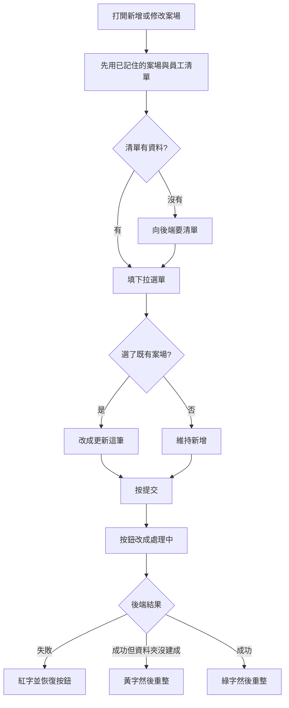

# 新增／修改案場（開案表單）

最後對照程式：2026-11-11（Asia/Taipei）

後端契約：`Backend_GAS/CheckinSystem/SPEC/案場表單_SPEC.md`  
雲端資料夾細節：`Backend_GAS/CheckinSystem/SPEC/新建案場Dropbox標準資料夾_SPEC.md`  
清單快取策略另見 `SPEC/19_HUB與會計全域身分傳承.md`（本檔只寫這張表單怎麼走）。

## 一句話

給內部同事新增一筆工地，或改既有工地的地址、進場方式、負責人等。新建成功時，後端會再試著在雲端建一套標準資料夾。同一頁還能幫客人綁 LINE，但那條走會計權限，跟存案場不是同一道門。

## 人怎麼走

1. 從主控台打開「新增／修改案場」。
2. 案場清單與員工清單：父頁或這台瀏覽器若已記住，就直接用；沒有才向後端要。案場清單約可記 3 天。
3. 下拉留在「建立新案場」就是新增；選了既有案號就把該筆填進表單，按鈕改成「更新資料」。
4. 案名、地址、案號必填。負責人只能從權限 2（含）以上的員工勾選。業主姓名／手機選填，複製進場資訊時不會帶出。
5. 按提交後按鈕變成「處理中」，並暫時不能再按。
6. 後端說成功：綠字。若是新建且標準資料夾沒建成：黃字，仍算案場已存。約 2.5 秒（資料夾失敗則約 4 秒）後整頁重新整理。
7. 後端說失敗或連線中斷：紅字，按鈕恢復，表單留在畫面上。
8. 客戶 LINE 綁定要先有案號，且會計登入成功（畫面寫需要設計師權限至少 3）。這一步失敗不會擋案場存檔，存檔成功也不代表已經綁好客人。

## 流程

### 程式對照表

| 白話（圖上寫的） | 程式對照（開發用） |
|------------------|-------------------|
| 打開新增或修改案場 | `modules/projects/NewSiteForm.html` |
| 先用已記住的案場與員工清單 | `HubRefCache.read('projects'/'employees')`；父頁記憶體優先 |
| 向後端要清單 | GET `get_all_sites`、`get_employees`（`page=attendance_api`） |
| 選了既有案場就改成更新 | 下拉 `change` → `fillFormForUpdate`；`currentMode='update'` |
| 按提交／處理中 | `form` submit；`process_site_form` POST JSON |
| 成功、黃字、紅字 | `handleFormResponse`：看 `success` 或 `status==='success'`；`folders.ok===false` 為黃字 |
| 成功後清清單記憶 | `HubRefCache.invalidate('projects')`，並 `postMessage` `spa_hub_invalidate_projects` |
| 客戶 LINE 綁定 | `AccountingApi.cfDetail` + `CustomerFinanceBind.render`（另一支會計服務） |

表單打的是頁內寫死的後端網址，沒有走全站設定檔。規格不記錄該網址。

## 畫面與後端欄位

| 畫面上的意思 | 送出時的欄位 |
|--------------|----------------|
| 案場名稱 | `siteName` |
| 地址 | `siteAddress` 與 `address`（兩個都送） |
| 案號 | `案號`；更新時另帶 `originalProjectCode` |
| 業主姓名／手機 | `業主姓名`、`業主手機` |
| 負責人 | `專案負責人`（員工 id，逗號分隔） |
| 設計師／助理／工務／分區／入門／停車／進場時間／保證金／四則備註 | 與表單 `name` 對應的中文欄位（見頁內 `fieldMapping`） |
| 新增或更新 | 前端有送 `mode`，後端不看這個欄位，改看案號或案名是否已存在 |

## 已知問題（不要當成正確行為）

1. 存檔請求沒有帶登入者，後端也沒有先確認是員工、權限夠不夠。知道位址的人可以新增或覆蓋案場。表單只在「選負責人」時過濾權限，擋不住直接呼叫。
2. 前端以為自己在「新增」，只要案號或案名對到舊列，後端就改那一列，不會拒絕。
3. 案場清單若讀取失敗，後端仍回成功加空陣列；這頁只在主控台印錯誤，下拉會像「沒有任何案場」。
4. 清單以父頁記憶體或最多約 3 天的本機紀錄為準。用舊清單打開再存，可能把別人之後改過的欄位蓋回去。
5. 地址轉成座標失敗時，後端仍說成功，並把座標清成 0。打卡範圍會錯，畫面不解釋。
6. 送出沒有逾時。後端要讀完整張案場表、問地圖、通知其他系統清快取、新建才建資料夾。按鈕會停在「處理中」直到回應或連線失敗。
7. 客戶綁定與存案場各做各的。存成功會在數秒內重整，綁到一半的操作會被清掉。

## 風險與等待

- 交叉：無登入可寫（未防）；新增撞號變更新（未防）；清單失敗像沒有案場（未防）；同一頁連按由按鈕鎖住（已防）；資料夾失敗有黃字（已防，但很快重整）。
- 等待：開頁多半用已記住的清單，偏快。按提交偏慢，且沒有逾時與「再試一次」。系統忙碌時後端會回「系統忙碌中」，畫面會當失敗。
