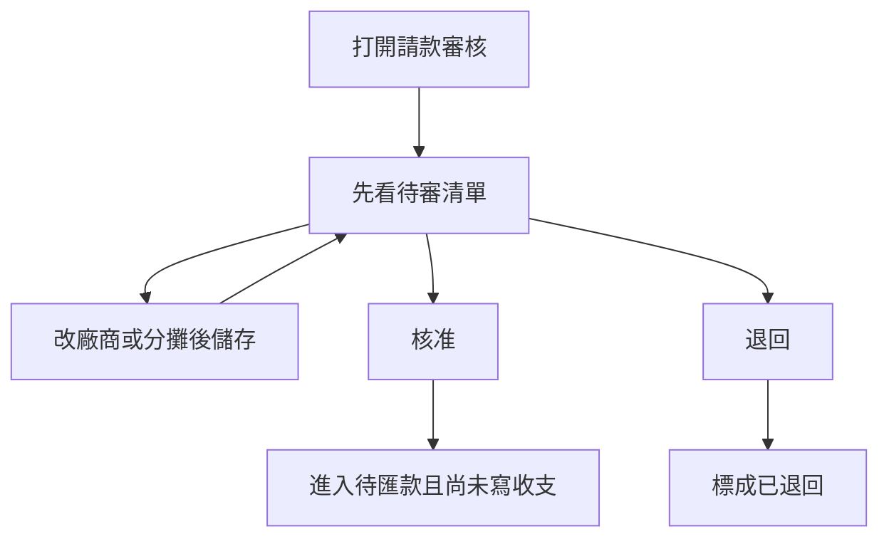

# 請款審核

最後對照程式：2026-11-15（Asia/Taipei）

給主管看「還沒匯出去」的廠商請款：可以改廠商與各案分攤再儲存、核准後進待匯款，或退回。看清單權限 3 以上；改內容與刪除未匯款也是 3 以上；核准與退回要 5 以上。核准當下不寫收支。

舊頁 `vendor_payment_approve.html` 只轉到本頁。客戶收款核準是同一頁另一個分頁，本檔不寫那套。送出請款、待匯款標記不在本檔。

後端契約：`Backend_GAS/accounting-gas/SPEC/VENDOR_PAYMENT_REQUEST_SPEC.md` §4.2a。

## 人怎麼走

1. 從會計選單打開請款審核。預設只看待審。
2. 清單出來前有載入中。讀失敗會說載入失敗，不會假裝沒有單。稍早看過的清單可先留著，背景更新失敗會留一句。
3. 權限 3 以上可打開一筆，改廠商、分攤、稅別、備註，按儲存。這一步不核准。
4. 權限 5 以上可快速核准（分攤已齊），或打開後確認核准。成功會說已進入待匯款，並從目前清單拿掉。
5. 同一權限可退回。原因可空白。成功會說已退回，並從目前清單拿掉。
6. 未匯款的單，權限 3 以上可刪除。已匯款不能改、不能刪。
7. 篩選改成已審、尚未匯款時，仍可「修改內容」。這個面板裡，權限 5 以上仍看得到確認核准與退回。

程式對照表

| 白話（圖上寫的） | 程式對照（開發用） |
|------------------|-------------------|
| 打開請款審核 | `modules/accounting/ledger_review.html`；舊址 `vendor_payment_approve.html` 轉址 |
| 先看待審清單 | `AccountingApi.ledgerReviewBundle` → `ledger_review_bundle`；預設審核狀態「待審」 |
| 改廠商或分攤後儲存 | `AccountingApi.vendorPaymentUpdate` → `vendor_payment_update` |
| 核准 | `AccountingApi.vendorPaymentApprove` → `vendor_payment_approve` |
| 退回 | `AccountingApi.vendorPaymentReject` → `vendor_payment_reject` |
| 進入待匯款且尚未寫收支 | 母單 `review_status=已審`、`payment_status=未匯款`；不在這一步寫收支 |
| 標成已退回 | 母單 `review_status=退回`；`reject_reason` 可空 |

## 權限（現行）

| 動作 | 門檻 |
|------|------|
| 看清單、詳情、附件 | ≥3 |
| 儲存修改（廠商、分攤、稅別、備註） | ≥3，且未匯款；待審、退回、已審未匯都可 |
| 刪除 | ≥3，且未匯款 |
| 核准、退回、全部核准 | ≥5 |
| 客戶收款分頁的入帳核準 | ≥4（另一套，本檔不展開） |

畫面文案與上表一致。舊規格把「改分攤」寫成也要 ≥5，已過時。

## 風險與等待

- 開清單會讀整張請款主檔，並一次讀分攤與附件索引。慢的時候約十幾秒到將近一分半才有結果；有「載入中」，逾時可再按「重新載入最新」。筆數多時先回較新的一批並說明還沒列完。
- 單筆核准最長等約 2 分鐘，按鈕會寫「核准中」。中止後再按，不一定補得上這次分攤（見已知問題）。
- 清單約 90 秒內可能先顯示剛才那份。別人剛核准的單，你可能還短暫看得到。
- 登入票壞掉或沒帶票、只帶員工編號時，後端預設仍放行。知道權限 5 同事的編號就能代核准、代退回、代改分攤。

## 已知問題／風險

下列是程式現況，**不是**應有行為。

1. 核准會先把母單改成已審、未匯款，再整張換分攤。換分攤是先刪掉該筆舊列再寫新列。寫到一半失敗時，畫面說失敗，但狀態可能已經是已審，舊分攤也可能沒了。再按一次，後端回「已是核准狀態」且當成功，**不會**把這次分攤寫回去。畫面仍說「已進入待匯款」並把該筆從清單拿掉。
2. 只儲存、還沒核准時，也是先改母單金額再換分攤。換分攤失敗會說儲存失敗，但母單金額可能已改、分攤可能已空。再存一次有機會補上。
3. 已審、尚未匯款的單，從「修改內容」再按「確認核准」：後端看到已審就直接當成功，不採用畫面上剛改的分攤。畫面仍說已進入待匯款。
4. 退回不檢查現在是待審、已審還是已匯。待審列上的退回鈕是正常路徑。已審未匯打開修改面板仍有退回，會把這筆拉出待匯款，錢還沒匯但狀態變成退回。已匯款的畫面沒有退回鈕，接口仍接受，且不會把已寫的收支收回。
5. 兩人同時改分攤時，程式會先清空整張分攤表再寫回留下的列，可能互相蓋掉別人的列。
6. 改案號後，雲端檔名或附件索引沒跟上，仍回核准或儲存成功（只記在伺服器紀錄）。
7. 刪除母單成功後，清分攤若失敗，仍回刪除成功，分攤列可能留著。

## 交叉出錯

| 若… | 則… | 判定 |
|-----|-----|------|
| 核准時分攤沒寫完，或等太久再按一次 | 畫面說已核准並從清單拿掉，分攤可能是空的或舊的 | 未防 |
| 沒有有效登入票，只帶權限足夠的員工編號 | 仍可核准、退回、改分攤 | 未防 |
| 清單第一次就讀失敗 | 說載入失敗，不顯示成沒有單；有舊清單就留著並可再載 | 已防 |
| 筆數太多或組清單超過約 28 秒 | 先回已組好的較新幾筆，並說明還沒列完 | 已防 |

## 延時

**高**。開頁必讀整張請款主檔與分攤、附件索引；單筆核准還會整張重寫分攤。有載入中、核准中、逾時再試與「重新載入最新」。高延時本身有等待文案；和「再按卻補不上分攤」疊在一起才是上面的已知問題。

## 可改進

- 分攤寫成功再改成已審；失敗要把狀態留在待審，或讓再按一次補寫分攤，不要把「已經核准過」當成這次改分攤也成功。
- 已審的單不要再用「確認核准」假裝剛進待匯款；改分攤只走儲存。
- 退回只接受待審；若要從待匯款拉回，用另一句話並另記。
- 換分攤不要先清空整張表。
