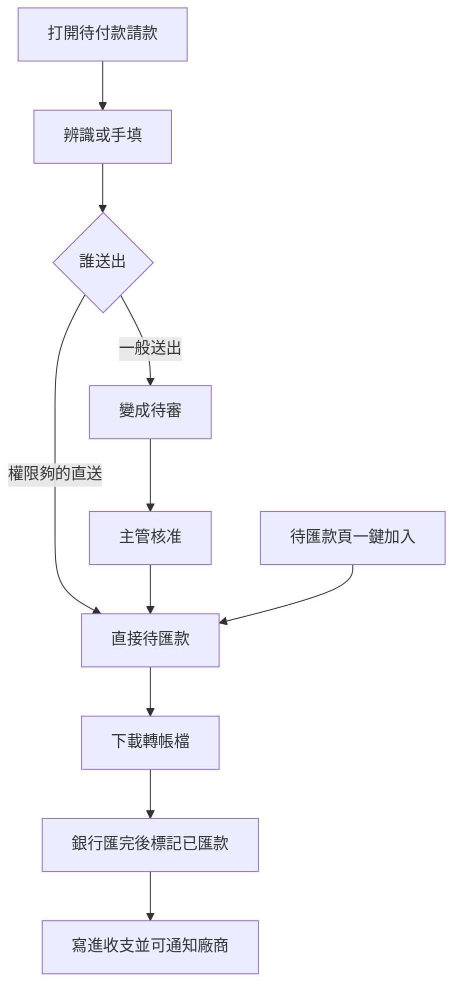

# 請款送出與待匯款

最後對照程式：2026-11-14（Asia/Taipei）。

後端契約：`Backend_GAS/accounting-gas/SPEC/PAYMENT_REQUEST_UNIFIED_SPEC.md`、`VENDOR_PAYMENT_REQUEST_SPEC.md`。  
本輪只對「送出請款」和「待匯款（匯出／標記已匯）」。請款審核頁、廠商名冊沒有重寫。

## 一句話

在職員工或已綁定的廠商，把還沒付出去的錢做成一筆請款；主管核准後，財務在待匯款頁匯出銀行檔，銀行匯完再標記已匯款，這時才寫進收支。

## 人怎麼走

1. 從會計選單打開「待付款請款」。在職員工可幫廠商或同事請；廠商登入只能用自己名冊上的帳戶。
2. 可傳最多 12 個照片或 PDF，勾選後辨識（畫面上寫最長約 3 分鐘），或直接手填案號與金額。請款日是送出當天，單據上的日期只供對照。
3. 按「送出請款」變成待審。權限 ≥5 才看得到「直送待匯款」，按了會跳過審核。
4. 送出成功會收起表單，並請人到「送出紀錄」或（廠商）回自己的款項進度。送出當下不寫收支。
5. 財務（≥4）打開「廠商待匯款」：可下載中信轉帳檔（不改狀態），銀行匯完再按「標記已匯款」。這時才寫收支，並可 LINE 通知廠商（預設要通知）。
6. 同一頁仍有「一鍵加入待匯款」。財務 ≥4 就能新增一筆已審、未匯的單，不必先走請款頁的 ≥5 直送。

舊頁：`payment_request_compose.html` 轉到請款頁；`vendor_payment_approve.html` 轉到請款審核；`payees.html` 轉回會計選單。

### 程式對照表

| 白話（圖上寫的） | 程式對照 |
|------------------|----------|
| 打開待付款請款 | `modules/accounting/payment_request.html`；登入 `payment_request_auth_me` |
| 辨識或手填 | `payment_request_ocr_analyze`（前端最長約 180 秒）；不建單 |
| 一般送出 | `payment_request_submit`，`submit_mode=review` → 待審、未匯款 |
| 權限夠的直送 | 同 action，`submit_mode=finance_direct`；後端門檻 ≥5 |
| 變成待審／主管核准 | 審核頁 `ledger_review.html`（本輪未重寫）；核准 `vendor_payment_approve` ≥5 |
| 待匯款頁一鍵加入 | `vendor_payment_finance.html` → `vendor_payment_create`；門檻 ≥4，狀態直接已審、未匯款 |
| 下載轉帳檔 | `vendor_payment_export_ctbc`；不改狀態、不寫收支 |
| 銀行匯完後標記已匯款 | `vendor_payment_mark_paid`；≥4 |
| 寫進收支並可通知廠商 | 先寫收支並標已匯款；毛利與附件對帳可後置 `vendor_payment_flush_deferred` |

## 兩條錢不要混

| | 請款 | 收支登錄 |
|--|------|----------|
| 錢 | 還沒付 | 已經發生 |
| 何時進收支 | 標記已匯款 | 送出當下 |

## 已知落差（本輪對過程式）

- 統一頁規格仍寫「直送 ≥4」「待匯款頁只留清單」。程式是：請款頁直送 **≥5**；待匯款頁新增表單還在，而且 **≥4** 就能跳過審核。
- 會計模組規格把「毛利、附件索引」寫成一定接上。程式在失敗時仍可能回成功，見下方已知問題。

## 已知問題

這些是缺陷，不是正確規格。

1. **只帶員工編號就能送請款、標記已匯款。** 登入票閘預設只警告仍放行。標記已匯款在登入票壞掉時，還會改信 body 裡的員工編號。知道財務同事的編號，就可以代標已匯並寫收支。
2. **請款頁要 ≥5 才能跳過審核，待匯款頁 ≥4 就可以。** 權限 4 按「一鍵加入待匯款」會直接變成已審、未匯款。
3. **送出超過約 60 秒會叫「請再試一次」。** 雲端可能已經寫進請款主檔。沒有用草稿擋第二筆，再送會多一筆。分攤沒寫完若中途失敗，也是主檔已有、畫面說失敗，再送再多一筆。
4. **標記已匯款後，毛利或附件對帳失敗，畫面仍說已匯款**，該筆會從清單拿掉。後補接口失敗也回成功；畫面只在瀏覽器紀錄裡留一句，人不看得到。
5. **從快審來的請款：結案沒寫上，成功頁仍說這張已進「已完成」。** 上輪已列，本輪只確認送出這條還是這樣。

## 風險與等待

- 送出帶多張圖要寫雲端，容易超過一分鐘。等待時有「送出中」，但逾時文案會叫人再按，有重複請款的風險。
- 辨識有「辨識中…（最長約 3 分鐘）」，逾時可再辨，這段不建單。
- 待匯款清單每次冷開會整張讀請款主檔，畫面上有載入中；約 90 秒內會先用剛才的清單。讀取失敗會說載入失敗，不會假裝沒有單。背景更新失敗時，人可能還看著稍早的清單。
- 多筆標記是一筆等一筆，畫面上有「第幾筆」。單筆逾時會請人先重整確認，不要馬上再按。
