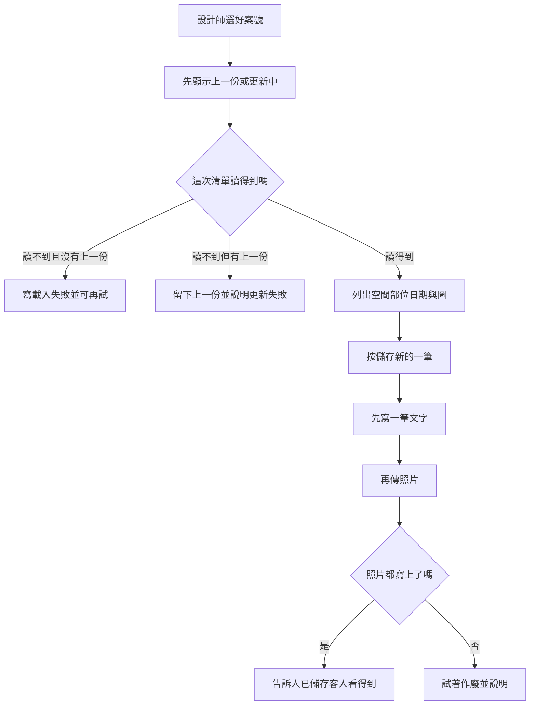

# 選材每日比對與看圖快取

> 給人點頭用。程式名稱、檔名、接口寫在同資料夾《選材每日比對與看圖快取_實作備註》。  
> 最後對照程式：2026-11-23（Asia/Taipei）。後端契約見 Backend_GAS `project-console/SPEC/選材契約_SPEC.md`。

## 一句話

給設計師把一案的材料照片放進清單（空間、部位、定案日），客人從 LINE「我的案場」只能看、不能改。長期圖在 Dropbox 與雲端硬碟；客人看圖優先用約 30 天的快層。

## 人怎麼走

1. 設計師從主控台進「選材」，選案號。畫面先出上一份清單或「更新中」，再向主控台要這案。
2. 新的一筆：選空間（至少一個）、部位、定案日、補充說明，附 1～3 張照片，按儲存。程式先建文字列，再傳照片。
3. 改說明或標籤：按「編輯說明／空間」，不換照片。換照片要「作廢並新建」。
4. 剛把檔丟進 Dropbox 選材夾、不想等隔天：選好案號按「現在補一次」。按鈕會停住，直到這次回來。
5. 客人從 LINE「我的案場」進來：先看到空間、部位、日期；圖慢一點。此頁不能改。

會計模組裡的同名頁只負責跳到專案選材頁，不是第二套編輯器。

### 程式對照表

| 白話（圖上寫的） | 程式對照（開發用） |
|------------------|-------------------|
| 設計師選好案號 | `modules/projects/designer-material-selection.html` 案號選單；`loadList` |
| 先顯示上一份或更新中 | 本機清單暫存 `readMaterialListCache_`；沒有則骨架「更新中」 |
| 這次清單讀得到嗎 | `AccountingApi.materialDesignerList` → `margin_material_designer_list` |
| 寫載入失敗並可再試 | `showListError_` |
| 留下上一份並說明更新失敗 | 有暫存時不蓋掉，`showMsg` 講更新失敗 |
| 列出空間部位日期與圖 | `applyListPayload_`／`renderList` |
| 按儲存新的一筆 | `#btnSave`，編輯中則改走更新 |
| 先寫一筆文字 | `materialCreate` → `margin_material_create` |
| 再傳照片 | `materialUploadPhoto` → `margin_material_upload_photo`（最多 3 張） |
| 告訴人已儲存客人看得到 | 成功句「已儲存，客人立刻可見」 |
| 試著作廢並說明 | 上傳回失敗才呼叫 `materialVoid`；見下方已知問題 |

## 目標

設計師把照片丟進該案選材夾後，系統每天自己對一次帳；客人開「我的案場」幾秒內先看到空間、部位、日期，圖可以慢一點，但不能整頁空白乾等。

## 三層存放（人怎麼記）

| 層 | 給誰用 | 留多久 |
| --- | --- | --- |
| 客人看圖的快層 | 開頁時圖快一點 | 大約 30 天就過期，過期再比對、不一樣才補 |
| 雲端硬碟副本 | 快層沒了、Dropbox 搬走了，還能看圖 | 結案後大約 2 年再清硬碟照（文字清單仍留） |
| Dropbox 選材夾 | 設計師日常丟檔的地方 | 長期；結案後資料夾仍可搬到 700–800 |

**不要**客人每次開案就把整包灌進快層。客人開頁也**不要**當場去掃整個 Dropbox 夾。

---

## 1. 設計師：丟檔之後，內部與客人看得到新檔

| 步驟 | 人做什麼 | 畫面呈現 | 結果／下一步 |
| --- | --- | --- | --- |
| 1 開始 | 把照片放進該案 Dropbox 名稱含「選材」的資料夾（例如選材、0705選材）。施工照不要放這裡。 | Dropbox 裡看得到檔 | 可以等隔天自動入列；急的話開內部選材頁 |
| 2 進行中（等隔天） | 去做別的 | 當天客人頁可能還沒有這一筆（還沒入列） | 等到隔天，或按「現在補一次」 |
| 2 進行中（現在補） | 選好案號，按「現在補一次」 | 按鈕立刻變不能連點，標題旁顯示處理中 | 等這一案對完 |
| 3a 成功 | 看內部列表 | 輕提示：新增幾筆，或「沒有新照片」。按鈕恢復。列表多出空間／部位／日期 | 客人「我的案場」同一案也應多這一筆（圖可能還在載入） |
| 3b 失敗 | 看說明 | 人話：哪一案讀不到、下次會再試或請再按一次。按鈕可再按 | 不要只看到一串英文錯誤碼 |

---

## 2. 每日自動：系統自己逐案比對

| 步驟 | 人做什麼 | 畫面呈現 | 結果／下一步 |
| --- | --- | --- | --- |
| 1 開始 | 人不用按。未結案的案，一天對一次 | 內部選材頁可看到「最近一次自動對帳」的人話（成功或哪一案失敗） | — |
| 2 進行中 | 人不用盯 | 一輪做不完會記下「下一案從哪裡續」。只核對檔名／路徑等清單，已在表裡的不重搬 | 時間到就停，下一輪接著做 |
| 3a 成功 | 可抽查任一未結案 | 該案新檔已在內部列表與客人清單 | 繼續做別的 |
| 3b 失敗 | 開內部選材頁看說明 | 「案 ○○○ 的選材夾這輪讀不到，下次會再試」。可對該案按「現在補一次」 | 已結案且資料夾已搬走的，不在每日名單裡 |

---

## 3. 結案：搬走 Dropbox 案夾

| 步驟 | 人做什麼 | 畫面呈現 | 結果／下一步 |
| --- | --- | --- | --- |
| 1 開始 | 要搬到 700–800 之前，先確認這案選材照硬碟副本已齊（內部列表圖能開、不是只靠舊 Dropbox 路徑） | 內部選材頁該案照片看得到 | 副本不齊就先補，不要先搬 |
| 2 進行中 | 把 Dropbox 案夾搬走 | 舊 Dropbox 路徑會失效，這是預期 | 看圖改走硬碟或客人快層，不依賴舊路徑 |
| 3a 成功 | 客人仍開「我的案場」 | 文字清單在；圖走硬碟／快層 | 結案後約 2 年才清硬碟照；文字仍留 |
| 3b 失敗 | 搬走後圖全破、清單也空 | 人話：可能搬太早、硬碟還沒齊，或已過保留年限 | 找設計師從備份重放，不能指望舊 Dropbox 連結 |

---

## 4. 客人開「我的案場」

進入方式不變：LINE 大圖「我的案場」只開選材；收款、綁定各走自己那一鍵。頁內不再放三張功能卡。圖文選單文案不要改。

三個入口（綁定／選材／收款）標題上方同一則**測試階段**說明：目前僅作為參考；自 2026-08-16 開始測試；這天之前的資料不一定齊全。這不是連不上，也不擋查看或綁定。

| 步驟 | 人做什麼 | 畫面呈現 | 結果／下一步 |
| --- | --- | --- | --- |
| 1 開頁 | 從 LINE 點「我的案場」 | 立刻看到頁面框架與「選材清單」；若在抓資料 → 標題旁「更新中」。約 3–5 秒內先出文字：空間、部位、日期 | 不要整頁空白只轉圈；不要當場去掃 Dropbox 夾 |
| 2 圖還在來 | 可先讀文字 | 圖位標「載入中／更新中」。快層過期時先對清單，一樣就不搬，不一樣才在背景補 | 可點已出現的圖放大 |
| 3a 成功 | 看選材 | 「更新中」拿掉；圖出來。此頁只能看不能改 | 內容不對就通知設計師 |
| 3b 失敗 | 看說明、再試 | 清單連不上：人話＋「再試一次」，已看到的文字盡量留。單張圖破：該張改「照片暫時打不開」，不要整頁當沒資料 | 可再載；不要把錯誤碼當畫面 |

---

## 已鎖定（不要重開）

- 快層約 30 天；硬碟＋Dropbox 才是長期備援。
- 不要開案就把整包灌進快層。
- 每日主線＝未結案逐案比對；人手按鈕＝剛丟檔不想等明天。
- 結案後 Dropbox 仍可搬 700–800；搬走前硬碟要齊。
- 自動對帳要快、可續跑；舊的「網頁一次大約 40 秒、最多約 20 張」不夠當每日主線。
- 不設 LINE 預設圖文選單；測試時不要對測試 UID 一鍵同步所有圖文選單。

## 這一階段人會感覺到什麼

- 丟檔後隔天（或按一次「現在補一次」）內部與客人清單多一筆；新檔會盡量補硬碟副本，並把小圖放進客人快層。
- 客人先看到字；圖優先走快層，沒有或過期則硬碟縮圖或「載入中」。開頁不會整包重傳、也不會去掃 Dropbox 夾。
- 快層過期後先對檔名／大小／時間，一樣就不搬。完整「瀏覽器直傳」尚未做；30 天自動刪檔要在 Firebase 主控台設生命週期（程式無法代設）。

## 風險與等待

- 已結案且夾已搬走的，不在每日掃描。
- 剛丟進夾、還沒入列：要等到當日排程或設計師按一次，客人才看得到。
- 打開一案清單會先讀完整張選材表，再開列表時可能再補幾張硬碟副本，才把清單還給畫面。畫面有「更新中」；大約一分鐘沒回來會停並可再試。這條容易變慢。
- 「現在補一次」按鈕會停住。後端這一輪大約 40 秒內要停；畫面大約 60 秒沒回來會停。做不完的檔下次再補，但見已知問題：沒寫成仍可能被當成成功。
- 客人頁先出文字，圖另外來。清單失敗與「目前尚無選材」是兩句。已看過的卡片在更新失敗時會留著。
- 補一張快層失敗時，客人頁不當成整頁連不上；只有真的補上新圖才重載。後端這支失敗仍回成功，是為了不讓清單變「連不上」，不是照片已經更新。

## 已知問題（不要當成正確行為）

正確意圖：寫入要能確認是本人；照片沒寫上就不要留一筆給客人，也不要說已經取消；有檔沒寫進表就要用失敗色，並可再試；客人頁的說明一律當純文字。

現行程式與此不符，細節與建議在巡檢回報，契約見後端《選材契約_SPEC》：

- 選材新增、修改、作廢、上傳、現在補一次，在身分開關關閉時，只帶員工編號就會寫。嚴格驗證的程式存在，但選材路由沒有用。
- 儲存是兩段。文字列先給客人看得到。傳圖失敗時畫面寫「已取消」，卻不看取消有沒有成功。傳圖中斷則只說儲存失敗，那筆還在。已進選材夾、表上沒路徑的檔，下次比對可能再變成新的一筆。
- 「現在補一次」有檔沒寫成仍回成功，按鈕用成功色。每日比對也會把這種案當成這輪成功。
- 客人「我的案場」把空間、部位、補充說明直接貼進畫面；設計師頁會先變成純文字。
- 轉接「補一張」，以及帶員工預覽旗標的清單／明細，在主控台不再核對這個人是否綁定該案。客戶走清單（沒有預覽旗標）有重驗。

---

Firebase 怎麼用、總監在主控台要點哪裡：見同資料夾《選材Firebase操作流程》（給人看，不含金鑰）。
