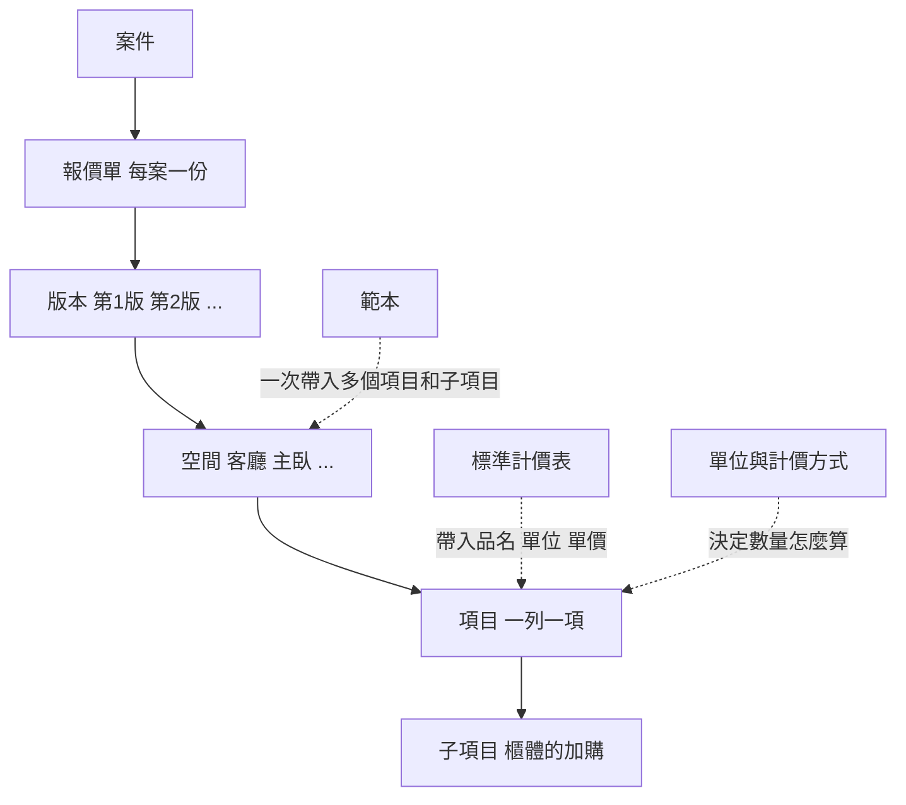
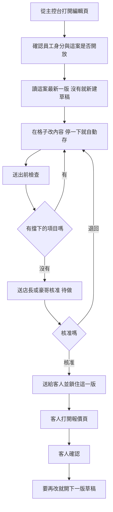
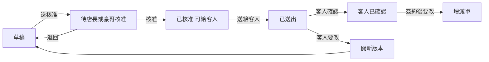
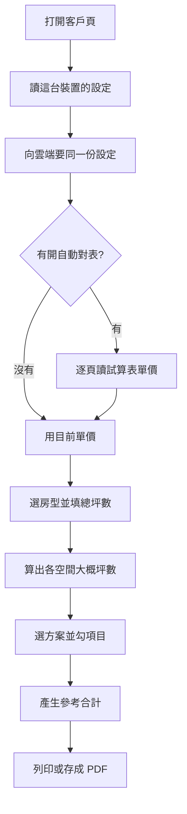
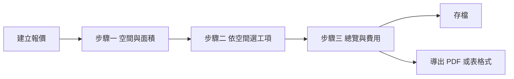

# 添心設計 報價系統 SPEC

> **版本**：v1.1（2026-11-15；v1 同日建立，v1.1 寫入豪哥第 11 章定案）。快速報價附錄 A 於 2026-11-24 對照現行頁面，見變更紀錄。
> **狀態**：規格書。只描述要做成什麼樣，以及現在做到哪裡。現行行為以程式為準；程式改了，這份要跟著改。
> **維護規則**：報價相關的新需求一律**累加進這份**，不另開新檔。每次修改都要在第 12 章「變更紀錄」最後面加一條，寫上日期和來源。舊條目只增不改。
> **白話名詞**：見 `SPEC/專有名詞白話對照.md`。

## 這份文件合併了哪些舊文件

豪哥 2026-11-15 指示：報價相關的 SPEC 和計畫文件要合併成這一份，不讓兩份並存。合併情況如下：

| 原文件 | 處理 | 內容在本檔哪裡 |
|---|---|---|
| `SPEC/QUOTE_EDITOR_3.md`（線上報價編輯器的程式對照與填法） | 全文併入。原檔只留一行指標 | 第 4、7、10 章 |
| `SPEC/14_室內裝修快速報價系統規格書.md`（快速報價試算工具） | 全文搬進附錄 A，小節編號不變。原檔只留指標 | 附錄 A；摘要在第 1、5 章 |
| `docs/FLOORPLAN_QUOTE_IMPORT_PLAN.md`（平面配置帶進報價的計畫） | 全文搬進附錄 B。原檔只留指標 | 附錄 B；摘要和更新後的做法在第 8.1 節 |
| 計畫卡「線上報價＋線上簽約系統 規劃」（2026-11-09，放在使用者資料區，不在 repo 裡） | 把豪哥 9 點定案和流程摘進來 | 第 2、5、7、8 章、第 12 章 |
| 開著的規格巡檢 PR：前端 [#309](https://github.com/nephi4377/liff-checkin/pull/309)、後端 [Backend_GAS #339](https://github.com/nephi4377/Backend_GAS/pull/339)（線上報價已知問題） | 已知問題已和現行程式核對，併入本檔 | 第 10.3 節 |
| `Backend_GAS/project-console/SPEC/QUOTE_EDITOR_3.md`（後端程式對照） | 內容已併入第 3、10 章。那個檔在另一個 repo，還沒改 | 定案 B-1：另開一支後端小 PR 改成指標 |

**沒有合併的相關文件**：

- `SPEC/12_報價單審核與主控台整合規格書.md`。名稱裡有「報價單審核」，但它管的其實是「Excel 報價單解析後的施工驗收進度」和「結案」，不是做報價。主控台結案的說明也以它為準。所以它留在原處，只在檔頭加一句指向本檔。報價系統跟它的介面寫在第 8.4 節。
- `SPEC/16_窗簾自助估價系統規格書.md`。這是官網上給客人自己估窗簾價格的工具，不經過設計師報價流程，所以不併入。
- `SPEC/04_互動式室內設計規劃工具規格書.md`。這是平面配置工具本身的規格，只有「帶進報價」那一段跟本檔有關，寫在第 8.1 節。

---

## 1. 目的與範圍

### 1.1 為什麼要做

以前報價用 Excel 估價單。單價要人工查、工種欄常留著範本裡的舊值，整份要上傳給解析器猜內容，常常猜錯。另外：

- 成本價和內部標註可能跟著檔案一起給到客人。
- 報價改了好幾版，很難知道哪一版才是給客人的。
- 確認後要接合約、接驗收、接會計，每一步都要重打一次。

線上報價要把「做報價 → 店長或豪哥核准 → 給客人看 → 客人確認 → 接合約 → 接驗收和收款」串成同一條線，資料只打一次。

### 1.2 豪哥定的目標（附來源）

| 日期 | 豪哥說的 | 本檔落在哪 |
|---|---|---|
| 2026-11-10 | 線上報價要像 Excel，但比 Excel 更好用：直接在格子打字或下拉選，加列要很順 | 第 4 章 |
| 2026-10-23 | 平面配置工具要能直接帶進報價系統。平面圖上的櫃體匯入後變成報價項目；單價、按尺或按件等計價規則由豪哥決定 | 第 8.1 節、第 11 章 A-1 |
| （任務指示轉述，2026-11-15 記錄） | 報價草稿依 Google 標準計價表和報價規則逐項計價，分工種列出，不寫成本價。草稿交老闆確認後才給客人。客人看到的版本絕不能出現成本價或內部標註（2026-11-15 定案：店長和豪哥都可以核准） | 第 5、7 章 |
| （任務指示轉述，2026-11-15 記錄） | 客人要報價時，先問該案設計師，再問店長，最後問豪哥 | 第 2.3 節 |
| （任務指示轉述，2026-11-15 記錄） | 線上合約之後要接在報價後面：電子簽、注意事項逐項勾選 | 第 8.2 節 |
| 2026-11-09（計畫卡） | 線上報價做好後要直接進驗收表，不用再上傳 Excel 解析；舊解析器不升級 | 第 8.4 節 |

「任務指示轉述」是指這幾條需求寫在 2026-11-15 的任務說明裡，原話的日期沒有附上。日後找到原始出處，在變更紀錄補一條，不要改這張表。

### 1.3 範圍

**在範圍內**：

- 線上報價編輯器（員工用）
- 計價表和計價規則
- 範本和子項目（櫃體加購）
- 版本、核准（店長或豪哥）、對客輸出（客人頁、列印 PDF、LINE 連結）
- 和平面配置工具、線上合約、驗收表、會計之間怎麼交接資料
- 快速報價試算工具（附錄 A，現場初估用，跟正式報價是兩條線）

**不在範圍內**：

- 合約條文本身（見 `SPEC/ESIGN_CONTRACT_2.md`）
- 施工驗收的畫面和規則（見 `SPEC/12`）
- 會計記帳的畫面和規則（見 `SPEC/15_會計系統模組規格書.md`）
- 官網窗簾自助估價（見 `SPEC/16`）

### 1.4 系統裡現在有哪幾個「報價」

容易混淆，先列清楚：

| 名稱 | 給誰用 | 做什麼 | 主要檔案 | 跟本檔的關係 |
|---|---|---|---|---|
| **線上報價編輯器**（QUOTE-EDITOR-3） | 設計師、店長、老闆 | 正式報價：做草稿、送出、客人確認 | `modules/projects/quote-editor.html`、`quote-view.html`；後端 `project-console/QuoteEditor.js` | **主角** |
| 報價單解析器（BudgetWeb） | 內勤 | 把舊 Excel 估價單解析成工項，存到雲端給驗收表用 | `tools/BudgetWeb_Standalone.html` | 過渡工具。線上報價全面上線後退休，只留著開舊案（第 8.4 節） |
| 驗收表（BudgetAuditor V2） | 現場、查帳 | 依工項追施工進度、結案 | `tools/BudgetAuditor_Standalone_V2.html` | 下游。接收確認好的報價（第 8.4 節） |
| 快速報價試算 | 設計師在現場或視訊時 | 用房型和坪數粗估價格區間 | `tools/QuickRenovationQuote_v2.html` | 平行工具，規格在附錄 A |
| 平面配置工具的粗估報價 | 設計師 | 依平面圖上的櫃體和面積算粗估金額，可匯出 | `modules/InteriorDesigned/LP_LayoutPlanner.*` | 上游。櫃體要能帶進正式報價（第 8.1 節） |

---

## 2. 角色與權限

### 2.1 角色

| 角色 | 在報價裡做什麼 |
|---|---|
| **設計師** | 開草稿、填項目、改數量和單價（改價要寫原因）、送核准、回答客人的報價問題；套用範本。不能自己核准 |
| **店長** | 跟設計師一樣可以編輯；**可以核准報價給客人**（定案 A-3）；設計師答不了或 2 小時沒回的報價問題由店長接手；建立和修改範本 |
| **老闆（豪哥）** | **可以核准報價給客人**（和店長一樣，沒有金額門檻）；決定計價規則和標準計價表；答店長也答不了或 2 小時沒回的問題 |
| **助理（含 AI 助理 Tina）** | 把客人的報價問題轉給對的人；不改價格、不送出 |
| **客人** | 只看已送出給他的版本，確認或提出要改的地方。看不到單價、成本和內部標註 |

### 2.2 權限（要做成的樣子）

| 動作 | 誰可以 | 現在程式怎麼做 |
|---|---|---|
| 打開編輯器、看草稿 | 員工權限 2 以上 | 前端要求權限 2 以上；**後端只確認「是員工」，沒看等級**（第 10.3 節問題 3） |
| 改草稿 | 員工權限 2 以上 | 同上 |
| 送核准 | 編輯者 | **還沒有這一步**（第 10.2 節） |
| 核准給客人 | **店長或豪哥**，沒有金額門檻（定案 A-3）；設計師不能自己核准 | 還沒有。現在員工按「送出給客人」就直接送 |
| 客人確認 | 只有客人本人（LINE 客戶身分，且有權看這案） | 客戶身分可以確認。**員工用「員工預覽」也能按確認**（第 10.3 節問題 3） |
| 看成本價 | 只有內部、權限 4 以上（跟驗收表看金額的門檻一致） | 正式路徑目前不寫入成本；客人頁和列印會再擋一次 |
| 開新版本 | 編輯者 | 員工即可。目前若還是草稿就不能開新版 |
| 建立、修改範本 | 店長以上（定案 B-4） | 還沒有範本功能 |
| 套用範本 | 編輯者（含設計師） | 同上 |

權限數字的意思跟全系統一致：2 是一般在職員工；4 是財務或老闆，看得到金額；5 是主管或老闆。

### 2.3 客人要報價時找誰（豪哥規則）

客人問報價、要改報價、問價格時，依序找：

1. **該案設計師**：案場資料裡登記的負責設計師。
2. **店長**：設計師不在、答不了，或超過時限沒回覆時。
3. **豪哥**：店長也答不了，或牽涉改價原則、折扣、特殊計價時。

做到系統裡要遵守：

- 報價頁的「有問題」按鈕，以及 AI 助理轉單，都先標給該案設計師。
- **2 小時沒人回就往上轉**（定案 A-4）：設計師 2 小時沒回轉店長；店長 2 小時沒回轉豪哥。跟 AI 助理現在「超過 2 小時沒人接手」的提醒一致。
- 客人想刪項目、加項目、問「這項可以不做嗎」，一律用聊天告訴設計師，由設計師開新版本（定案 A-7，見第 7.3 節）。
- 每一次轉手都要記下轉給誰、何時轉、為什麼轉。

---

## 3. 資料模型

這一章用白話描述有哪些東西、彼此怎麼掛在一起。正式欄位名以 `SPEC/專案全域資料字典.md` 為準。下面括號裡的英文是目前程式實際用的名稱，方便對照。

### 3.1 關係圖



**程式對照表**

| 白話（圖上寫的） | 程式對照 |
|---|---|
| 案件 | 案號 `project_no`（長期朝 `project_id`，legacy 欄位先不改名） |
| 報價單 每案一份 | 目前沒有獨立的「報價單」資料，是用同一案號的多個版本串起來 |
| 版本 | 後端試算表 `QuoteEditorDrafts` 一列一版：`quote_id`、`version`、`status`、`draft_json` |
| 空間 | `draft_json.zones[]`：`zone_id`、`name`、`lines[]` |
| 項目 一列一項 | `zones[].lines[]`（沒有 `parent_line_id` 的列） |
| 子項目 櫃體的加購 | 同一個 `lines[]` 裡、`parent_line_id` 指向櫃體列的列 |
| 標準計價表 | 豪哥的 Google 標準計價表，後端 `qeLoadCatalogSellSide_` 只讀售價欄 |
| 範本 | **還沒有**（第 6 章） |
| 單位與計價方式 | 目前只有單位文字，加上「櫃體按尺最少 1.5 尺」一條規則（第 5 章） |

### 3.2 各實體

**案件**：沿用主控台的案號。報價、合約、增減單都掛在案號底下。

**報價單**：一個案件的所有報價版本。目前以案號串起來，沒有自己的編號。之後如果同一案要分開報（例如主案和浴室另報），要加「報價單編號」。**定案 B-2：先不做，等真的有案子需要再加。**

**版本**：

| 欄位（白話） | 目前程式 | 說明 |
|---|---|---|
| 版本編號 | `quote_id` | 每一版一個 |
| 版號 | `version` | 從 1 起算 |
| 狀態 | `status` | 現有三種：草稿 `draft`、已送出 `sent`、客人已確認 `confirmed`。要加「待核准」和「已核准」（第 7.1 節） |
| 從哪一版來 | `parent_quote_id`、`parent_version` | 開新版本時記下 |
| 報價日期 | `quote_date` | 早於今天時，送出前會提醒 |
| 版本說明 | `version_note` | 例如「客人刪掉主臥衣櫃」 |
| 已收扣抵 | `fees_received`：丈量費 `measure`、啟動金 `startup`、規劃費 `planning` | 不能是負數 |
| 送出／確認時間和人 | `sent_at`、`confirmed_at`、`confirmed_by` | |
| 建立人 | `created_by`、`created_by_name`、`created_at`、`updated_at` | |

**空間**：客廳、主臥、廚房、全室等。可以留空，系統會自動放進「未分區」。編輯器表格的第一欄就是空間。

**項目**（一列）：

| 欄位（白話） | 目前程式 | 客人看得到嗎 |
|---|---|---|
| 工種 | `tab`（等於計價表的分頁名稱，例如木作工程、油漆工程） | 看得到（用來分組） |
| 品名 | `item` | 看得到 |
| 單位 | `unit` | 看得到 |
| 數量 | `qty`（大於 0，最多 9999） | 看得到 |
| 單價 | `unit_price` | **看不到** |
| 小計 | `amount` = 數量 × 單價，四捨五入到整數元 | 看得到 |
| 說明 | `note` | **看得到**。所以不能拿來寫內部標註（第 5.3 節） |
| 改價原因 | `price_override_reason` | 看不到 |
| 來源 | `catalog_key`（計價表的哪一格）或 `custom`（自填） | 看不到 |
| 是不是櫃體 | `is_cabinet` | 看不到（只用來判斷能不能掛加購） |
| 成本類 | `cost_unit`、`vendor_price` 等 | **絕對看不到**（第 5.3 節） |

**子項目**：掛在櫃體底下的加購，例如抽屜、拉籃、特殊五金。規則：

- 只能掛在櫃體列下面，不能掛在子項目下面（只有一層）。
- 名稱、數量、單價可以自填。
- 刪除櫃體時，加購一起刪。
- 櫃體列的「含加購小計」= 櫃體自己的小計 + 所有加購小計。
- 子項目一定要跟櫃體在同一個空間。

**範本**：第 6 章。

**標準計價表**：豪哥維護的 Google 試算表，**是單價的唯一來源**。一個分頁是一個工種。系統只讀前 6 欄的售價資料（品項、單位、價格、備註）。成本和廠商價不能放在這 6 欄裡，否則可能被讀出來（第 5.3 節）。**定案 A-5：前 6 欄只放售價；計價表只在有變動時更新**，不定期例行更新。系統讀價有約 6 小時快取，改表後最慢約 6 小時才會反映到編輯器。試算表編號寫在程式設定裡，不寫進 SPEC。

**單位**：計價表上用到的單位有：尺、台尺、坪、才、公分、式、組、盞、座、處、階、工、樘。每種單位對應一種計價方式（第 5.2 節）。

---

## 4. 編輯器操作規格

目標（豪哥 2026-11-10）：像 Excel，但比 Excel 好用。直接在格子打字或從下拉選，加列要很順。

### 4.1 人怎麼走

1. 進入編輯器有兩條路：
   - 整合主控台輸入案號 → 在「報價單解析器」正下方點「報價編輯」，在同一個分頁打開。
   - 設計師客戶財務頁 → 線上報價分頁 → 開啟報價編輯。
2. 頁面先確認你是員工（權限 2 以上），也確認這案已開放線上報價（第 9.4 節）。
3. 這案還沒有草稿，就自動建第一版。一進頁面就看得到表格，至少有一列空白，不用先建空間。
4. 在格子裡填。約 0.6 秒沒動作就自動存檔，畫面會顯示「暫存中…」和「已自動暫存」。
5. 填丈量費、啟動金、規劃費這三筆扣抵。
6. 按「送出前檢查」。
7. 送核准（待做）。店長或豪哥核准後送給客人。
8. 客人確認後，這一版就鎖住。要再改就開新版本。

### 4.2 表格欄位（目前一張大表）

| 欄 | 怎麼填 |
|---|---|
| 空間 | 下拉選既有空間，或選「＋新空間」。可以留空，存檔時自動放進「未分區」 |
| 工種 | 下拉選，選項是計價表的分頁 |
| 品名 | 先選工種，點品名欄就列出該工種所有細項，可以打字篩選。選了細項，單位和單價會自動帶入。最上面有「（自填）」，可以自己打名稱、單位、單價 |
| 單位 | 下拉或自動帶入 |
| 數量 | 打數字 |
| 單價 | 自動帶入，可改。改了就要填改價原因，不然不會存 |
| 小計 | 自動算；櫃體列另外顯示「含加購」金額 |
| 說明 | 自由填。**客人看得到** |
| 改價原因 | 改價時必填 |
| 動作 | 刪除、在下方插一列、上移、下移；櫃體列多一個「＋加購」 |

### 4.3 鍵盤和滑鼠

| 操作 | 結果 |
|---|---|
| Tab／Shift+Tab | 往右／往左一格 |
| Enter | 往下一格；在最後一列按 Enter 會多一列 |
| 方向鍵 | 換格 |
| 在最底下的空白列打字 | 自動變成新的一列，下面再補一列空白 |
| 從 Excel 複製多列貼上 | 依欄位逐格填入，有幾列就加幾列（Tab 分隔） |
| 刪除一列 | 櫃體會連同加購一起刪 |
| 上移／下移 | 只在同一個空間裡移動，不會跨空間 |

### 4.4 即時計算

每改一格，下面這些就跟著重算：列小計、空間小計、工種小計、未稅合計、5% 稅、含稅總計、扣抵後應付。

### 4.5 比 Excel 好用的地方（之後要守住）

1. 單價從計價表帶，不用查表、不會打錯。
2. 工種一開始就對，不會留範本的舊值。
3. 加購自動縮排在櫃體底下，刪櫃體時不會漏刪加購。
4. 改價一定留下原因，核准的人看得到。
5. 自動存檔，換一台電腦也看得到。
6. 送出前自動檢查 0 元列、「待確認」字樣、空的空間、過期的日期。
7. 客人看的版本自動拿掉單價和成本，不用另外整理一份。

### 4.6 編輯器待補的操作（列入待做）

- 復原／重做（Ctrl+Z）：目前刪除後只有單次「復原刪除」。
- 一次選多格、批次改（例如整區數量 × 1.1）。
- 拖拉排序。
- 手機和平板好操作：現在以桌機為主。
- 已存檔的列改「空間」欄：後端目前沒有「把一列搬到別的空間」的動作，可能只改到畫面，**待驗證**。

### 4.7 流程圖



**程式對照表**

| 白話（圖上寫的） | 程式對照 |
|---|---|
| 從主控台打開編輯頁 | Hub 路由 `#/quote-editor?project_no=…`（`spa/app.js`、`spa/Dashboard.js`）；或 `modules/accounting/designer-customer-finance.html` 的 `panelQuote` → `modules/projects/quote-editor.html` |
| 確認員工身分與這案是否開放 | 前端 `AccountingApi.initSession({ minPermission: 2 })`，需要先載入 `operator_context.js`；後端 `qeRequireAllowedProject_` |
| 讀這案最新一版 沒有就新建草稿 | `quote_editor_get` |
| 在格子改內容 停一下就自動存 | `quote-editor-grid.js`（計算、貼上、移格）、`quote-editor-grid-ui.js`（約 600 毫秒後存）；後端 `quote_editor_add_zone`、`add_line`、`update_line`、`delete_line`、`reorder_lines`、`set_fees` |
| 送出前檢查 | `quote_editor_preflight` → `ok_to_send`、`blockers`、`warnings` |
| 送店長或豪哥核准 待做／核准嗎 | 無（第 7.1 節） |
| 送給客人並鎖住這一版 | `quote_editor_send`，狀態改成 `sent` |
| 客人打開報價頁 | `modules/projects/quote-view.html` → `quote_editor_customer_view` |
| 客人確認 | `quote_editor_confirm`，狀態改成 `confirmed` |
| 要再改就開下一版草稿 | `quote_editor_new_version` |

本機測試：網址加 `?project_no=999&dev=1&staff_preview=1&fixture=1` 會用假資料（只在 localhost 有效）。加 `&empty_zones=1` 可以測沒有空間的情況。

---

## 5. 計價規則與成本保護

### 5.1 計價原則（豪哥規則）

1. **逐項計價**：每一列都照「標準計價表」的單價和報價規則算。計價表上沒有的項目才自填，而且要寫原因。
2. **分工種列出**：報價依工種分組，可以再依空間分區。
3. **不寫成本價**：草稿裡不放成本、廠商價、毛利。
4. **改價要留原因**：單價和計價表不同時，一定要填原因。核准的人看得到，客人看不到。
5. **金額一律整數元**：小計和稅都四捨五入到元。

### 5.2 計價方式（依單位）

| 計價方式 | 數量怎麼來 | 現況 |
|---|---|---|
| 按尺（尺、台尺） | **櫃體**按尺計價；長度換算成尺，**1 尺 = 30 公分**（定案 A-1） | **只有櫃體有最少計價量 1.5 尺**（2026-11-09 定案、A-2 再確認），後端已強制 |
| 按坪 | 面積換算成坪 | 數量手填 |
| 按才 | 面積換算成才 | 數量手填 |
| 按件（組、座、盞、樘、處、階） | 數件數。**五金和家電按件計價**（定案 A-1） | 數量手填；沒有最少計價量 |
| 一式 | 數量固定是 1 | 數量手填 |
| 按工 | 人工天數 | 數量手填 |
| 實報實銷 | 先列估計數，完工照實際結算 | **可以送出，但一定要標示「實報實銷」**（定案 A-2）。現在送出前檢查不擋這類項目，但也沒有標示欄位，待做 |

**計價規則定案**（豪哥 2026-11-15 23:40，第 11 章 A-1、A-2）：

- 櫃體按尺計價；五金和家電按件計價。
- 1 尺 = 30 公分。平面配置工具現在就用 30 公分，不用改。附錄 A 的快速報價工具寫的是 1 尺 ≈ 30.3 公分，那是試算工具的舊設定；正式報價和平面配置帶入一律用 30 公分。
- 只有櫃體有最少計價量 1.5 尺，其他品項都沒有最少計價量。
- 「實報實銷」項目可以送出，但要標示「實報實銷」：
  - 每一列要有「實報實銷」標記（勾選或固定字樣），不能只靠說明欄裡碰巧寫到這四個字。
  - 客人頁、列印和 PDF 在那一列顯示「實報實銷」，金額旁註明「依實際數量結算」。
  - 送出前檢查：有標記就不擋。品名或說明寫了「實報實銷」卻沒有標記時，提醒補上標記。
- 平面配置帶進來的櫃體照同一套規則算（第 8.1 節）。

**還沒定的細項**（這次決定沒有提到，先照現況做，不寫死；第 11 章 C-1、C-2）：

- 換算成尺以後怎麼進位：平面配置工具現在是 0.5 尺進位。
- 平面圖元件名稱怎麼對到計價表品名：先照原建議，在計價表新增一欄放對照。

### 5.3 成本保護（最重要，任何改版都不能破）

**原則**：客人看到的任何東西（客人報價頁、列印、PDF、LINE 連結、合約摘要）**絕不能**出現：

- 單價
- 成本、成本單價、成本合計、廠商、廠商價、設計師價（給廠商的價）、毛利、利潤、加成
- 改價原因
- 內部標註

**現有的保護**（依序檢查，任何一層擋到就不送出）：

1. **讀計價表時**：只讀前 6 欄售價資料，不讀側邊的廠商和成本欄。
2. **組客人資料時**：用白名單組欄位，刻意不放單價。
3. **送出前再掃一次**：遞迴刪掉黑名單欄位，再用文字搜尋一次，看有沒有成本類的欄位名。
4. **前端客人頁和列印**：再淨化一次；只要看到單價或成本類欄位，就不顯示、不列印。

**黑名單欄位**（前後端要一致）：`cost`、`cost_unit`、`cost_price`、`cost_total`、`internal_cost`、`vendor_price`、`vendor`、`supplier_price`、`designer_price`、`margin`、`profit`、`markup`、`成本`、`廠商價`、`廠商`、`成本單價`、`成本合計`。

**目前的缺口**（要補）：

- **「說明」欄客人看得到**：同事如果在說明欄寫「廠商報 3200」「利潤低」這類內部話，會直接給到客人。要另外加一個「內部備註」欄，只有員工看得到。說明欄保留給客人看的規格文字。送出前檢查也要對說明欄做關鍵字提醒（例如「成本」「廠商」「進價」）。
- 計價表如果有人把成本放進前 6 欄，系統擋不住。**定案 A-5：計價表前 6 欄只放售價**（品項、單位、售價、備註等），成本和廠商價只能放在第 6 欄之後。
- 成本要放在哪裡給內部看毛利：計畫卡寫「存在另一個只有內部看得到的地方」，目前還沒做。放哪裡已經定案（B-5，第 8.5 節）。

**驗收必測**（每次改報價相關程式都要跑）：

- 客人頁、列印、確認回傳的資料都不含單價和黑名單欄位。
- 草稿裡故意放一個 `cost_unit`，客人頁還是看不到。
- 測試：前端 `node --test tools/test-quote-editor.mjs tools/test-quote-editor-grid.mjs`；後端 `node --test tools/test_quote_editor.mjs`。

### 5.4 合計公式（現況）

```
未稅合計 = 所有列小計加總（含加購）
稅       = 未稅合計 × 5%（四捨五入到元）
含稅總計 = 未稅合計 + 稅
已扣抵   = 丈量費 + 啟動金 + 規劃費
應付     = 含稅總計 − 已扣抵（最小是 0）
```

- 稅率寫死 5%、含稅報價。**定案 B-3：先維持 5% 含稅，不做未稅報價**；需要時再加。
- 設計費、工程服務費：線上報價沒有這兩欄（快速報價工具有，見附錄 A 的 §4.4）。**定案 B-3：先不加**；需要時再加。
- 已扣抵大於含稅總計時，送出前會提醒。

---

## 6. 範本與子項目

### 6.1 子項目（櫃體加購）現況

- 在櫃體列按「＋加購」，下面就多一列縮排的子列。
- 從計價表選到抽屜、拉籃、五金這類東西時，如果這個空間已經有櫃體，系統會要求先選要掛在哪個櫃體下。
- 自填的加購預設改價原因是「特殊五金自填」。
- 子列要等櫃體先存好才會存（畫面會寫「等櫃子先存好，再存加購」）。
- 開新版本時，整份內容（含子列）會完整複製。

### 6.2 範本（待做）

**用途**：常見組合一次帶入，不用一列一列加。例如「標準主臥：衣櫃＋抽屜×2＋拉籃＋窗簾盒＋間照」「全室：保護、拆除、清潔」。

**已知要避免的問題**：豪哥的「重做報價編輯器」計畫提過一個問題：**選範本後，子項目（加購）會遺失**。本次在 repo 和資料區找不到那張計畫卡的原文。現在的線上編輯器也還沒有範本功能，所以先把它寫成硬性要求：

1. **套用範本時，子項目必須跟著櫃體一起帶入**，掛在對的櫃體下面，不能變成獨立的列，也不能丟掉。
2. 範本裡的單價**不存死**。套用當下才從計價表帶最新單價，跟範本裡記的不一樣時要提醒。
3. 套用範本是「加進來」，不是「覆蓋」：已經填的列不能被清掉。
4. 套用前先預覽會加哪些列（含子項目），按確定才寫入。
5. 範本可以套到指定空間；全室類的範本套到「全室」。
6. 套用後可以整組復原。
7. 自動測試要涵蓋：範本裡有櫃體加兩個加購 → 套用 → 存檔 → 重新整理 → 加購還在、還掛在同一個櫃體下面。

**範本資料**：

| 欄位（白話） | 說明 |
|---|---|
| 範本名稱 | 例如「標準主臥」 |
| 適用空間 | 可以空白 |
| 項目清單 | 每列記「計價表哪一項」和預設數量；子項目記「掛在第幾列」 |
| 誰建、何時改 | 稽核用 |

**定案 B-4：店長以上可以建立和修改範本，設計師只能套用。**

### 6.3 跟快速報價和平面配置的關係

- 快速報價的「方案菜單」（附錄 A 歷史草案 §1.4.3）只決定現場試算的數量，不會寫進正式報價草稿。之後若要共用範本，不在目前範圍。現行怎麼走見附錄 A 開頭。
- 平面配置帶進來的櫃體，如果有加購，也必須照第 6.2 節第 1 點，掛在對的櫃體下面。

---

## 7. 版本、審核、對客輸出

### 7.1 狀態（要做成的樣子）



**程式對照表**

| 白話（圖上寫的） | 程式對照 |
|---|---|
| 草稿 | `status: draft`（已有） |
| 待店長或豪哥核准／已核准 可給客人／退回 | 無，待做 |
| 已送出 | `status: sent`（已有）；目前草稿直接跳到這一步 |
| 客人已確認 | `status: confirmed`（已有） |
| 開新版本 | `quote_editor_new_version`（已有；目前是草稿時不能開） |
| 增減單 | 無，待做（第 8.2 節） |

規則：

- 只有草稿能改格子。送出以後鎖住，要改就開新版本。
- 每一版都留著，客人能看到「這一版跟上一版差在哪」（待做）。
- **核准是硬性關卡**：沒有核准就不能送給客人。**店長或豪哥都可以核准，沒有金額門檻**（定案 A-3）；編輯者不能核准自己送的版本。核准時要記下誰、何時、看的是哪一版。核准後內容又被改了，要重新核准。
- 核准畫面要看得到：每列單價、改價原因、跟計價表不同的地方、內部備註、送出前檢查的提醒。
- 客人已確認的版本是合約的依據，不能再改。簽約後的追加或減少一律走「增減單」，同樣要客人在線上確認（計畫卡 2026-11-09）。

### 7.2 送出前檢查（已有）

**擋下**（不能送）：

- 有 0 元或數量 0 的列
- 品名或說明有「待確認」「待評估」
- 有空間但裡面沒項目
- 一個空間都沒有
- 扣抵金額不合理（負數）

**提醒**（可以送）：

- 已扣抵大於含稅總計
- 報價日期早於今天

**要加**：

- 說明欄出現疑似內部用語（第 5.3 節）
- 改價幅度太大（門檻還沒定，見第 11 章 C-4）
- 跟上一版比金額變很多

### 7.3 對客輸出

| 管道 | 現況 | 要做成的樣子 |
|---|---|---|
| **客人報價頁** | 已有 `quote-view.html`：只看已送出或已確認的版本；有單位、數量、金額，沒有單價；有「我確認這份報價」按鈕 | 加「有問題要問」按鈕，照第 2.3 節轉給設計師；顯示和上一版的差異；過期版本不能確認（第 7.4 節）；實報實銷的列要標示（第 5.2 節）。**客人不能在報價頁勾選要做或不做**（定案 A-7），想刪或加項目就用聊天告訴設計師，由設計師開新版本、經核准後再給客人 |
| **列印／PDF** | 員工端「列印預覽」和客人頁「列印／存檔」都是用瀏覽器列印存成 PDF。員工端印的是**最新一版**，可能是還沒送出的草稿 | 正式 PDF 要有公司抬頭、案號、案名、日期、版號、分空間和工種的明細、合計、稅、扣抵、應付、附註、有效期限。草稿印出來要有「草稿」浮水印 |
| **LINE 連結** | 有深連結草案 [#304](https://github.com/nephi4377/liff-checkin/pull/304)（未合併） | 官方 LINE 只用「回覆」傳連結，不主動推播（計畫卡 2026-11-09）；同事也能手動複製連結。連結要登入綁定，不能「拿到網址就看得到」 |

**客人頁共通規則**：不出現單價、成本、改價原因、內部備註（第 5.3 節）；草稿不給客人看。

### 7.4 有效期限

客人會問報價能維持多久（例如 2026-11-09 Niwe 邱先生問能不能維持半年）。報價單要有「有效期限」欄，**預設 60 天**（定案 A-6），從送出給客人那天算起，同事可以逐份調整。過期的版本，客人頁要顯示「已過期，請洽設計師」，不能直接確認。

---

## 8. 和其他系統的介面

### 8.1 平面配置工具 → 報價

**需求**（豪哥 2026-10-23）：平面圖上擺好的櫃體，要能直接匯入成報價項目。計價規則由豪哥決定。

**已定的部分**（計畫卡 2026-11-09，豪哥第 6 點）：櫃體照計價表的每尺價格，最少 1.5 尺；設計師可以改價，但要寫原因。

**現況**：

- 平面配置工具可以匯出 BudgetWeb 相容的草稿 JSON 和 CSV（`LP_quotation_budgetweb_export.js`，2026-10-23 進 main）。這是給「舊的解析器 → 驗收表」那條路用的，**不是直接進線上報價**。
- 「櫃體匯出合併進 BudgetWeb」和「寫回安全閘」兩支 PR 還開著：[#212](https://github.com/nephi4377/liff-checkin/pull/212)、[#213](https://github.com/nephi4377/liff-checkin/pull/213)。
- 原計畫的欄位對照和方案比較在附錄 B。注意：附錄 B 寫於線上報價出現之前，它建議的路線是「先進 BudgetWeb」。現在主線改成**直接進線上報價**。

**要做成的樣子**：

1. 在平面配置工具按「帶進報價」，選案號，預覽要加哪些列。
2. 每個櫃體變成一列：空間（平面圖分區）、工種、品名（對到計價表品項）、單位、數量（依計價規則從尺寸算）、單價（從計價表帶）。
3. 櫃體的加購跟著櫃體一起帶，掛在櫃體下面（第 6.2 節第 1 點）。
4. 只能加到**草稿**，不能改已送出的版本。
5. 加進來的列要標「來自平面配置」，記下平面圖的哪個物件，之後重新帶入時不會重複。
6. 平面圖上的元件名稱和計價表品名不一樣時，要有一張對照表。沒對到的列標「待確認」，送出前會被擋下。

**計價規則已定案**（2026-11-15，第 11 章 A-1、A-2）：櫃體按尺，1 尺 = 30 公分，最少 1.5 尺；五金和家電按件，沒有最少量。進位方式和元件名稱對照還沒定，見第 5.2 節「還沒定的細項」和第 11 章 C-1、C-2。

### 8.2 報價 → 線上合約

**需求**（2026-11-15 任務指示）：線上合約之後要接在報價後面，包括電子簽和注意事項逐項勾選。

**現況**：

- 線上合約（ESIGN-CONTRACT-2）和簽約注意事項逐條勾選（ESIGN-NOTICE-1）已經各自有頁面，規格見 `SPEC/ESIGN_CONTRACT_2.md`。合約總價目前從「案場資料＋毛利」帶入，**不是從報價帶**。
- 報價端已經有一個交接用的空殼：客人確認後回傳案號、報價版本、含稅總計、應付，以及「可以進合約」的標記（`qeContractHandoffStub_`，只有已確認才標可以）。合約端還沒接上。

**要做成的樣子**（後續章節，v1 先列骨架）：

1. 客人確認報價後，主控台的「線上合約」可以按「依這版報價建立合約」。
2. 合約總價、工程範圍摘要、報價版號從報價帶入。合約要記下是依哪一版報價簽的。
3. 付款節點每案可調，預設四期 30／30／30／10：簽約金、木作退場（或過半）、系統櫃完工、驗收尾款（計畫卡 2026-11-09 第 5 點）。
4. 注意事項 18 條逐條看、逐條勾選，最後手寫簽名；7 天審閱期和「自願提前簽約」照合約規格。
5. 簽約後報價鎖定，之後的追加或減少走增減單，客人在線上確認，金額回寫合約和會計。
6. 合約帶的報價摘要也要走第 5.3 節的成本保護。

### 8.3 報價 → 會計（簽約金、收款）

**現況**：沒有接。會計的收款和案件毛利靠記帳和案場資料。

**要做成的樣子**：

1. 合約簽好以後，依付款表在會計產生「應收」：每一期的名稱、比例、金額、條件。
2. 收到款項（例如簽約金）時，會計核准入帳，對到應收的那一期。
3. 案件毛利的「收入」以「已確認報價＋增減單」為準。成本仍走請款和收支，不從報價帶。
4. 已扣抵的丈量費、啟動金、規劃費，要和會計裡已入帳的金額對得起來（不一致時提醒）。
5. 權限照會計規格：客戶收款入帳核准要權限 4 以上。

這一段要和會計規格（`SPEC/15`）一起定，v1 只列介面。

### 8.4 報價 → 驗收表

**現況**：驗收表讀的是「解析 Excel 後存到雲端」的工項清單（見 `SPEC/12` §2）。線上報價的資料沒有進去。

**要做成的樣子**（計畫卡 2026-11-09 第 4 階段）：

- 簽約（或客人確認）的那一版，項目直接變成驗收表的工項清單。空間對到分區，工種對到分類。
- 金額照驗收表現有的權限規則：權限 4 以上才看得到。
- 增減單也要同步到驗收表。
- 舊的解析器不升級，維持到這一步做完；之後只留著開舊案用（豪哥 2026-11-09 第 8 點）。

### 8.5 內部成本和毛利（待做）

成本和廠商價**不放在報價資料裡**，要另外存在只有內部看得到的地方，給老闆看預估毛利。**定案 B-5：放在會計主檔或內部專用的試算表**，用「計價表哪一項」對起來，權限 4 以上才看得到。

---

## 9. 非功能需求

### 9.1 備份

- 報價資料存在回報試算表的 `QuoteEditorDrafts` 分頁，一列一版，整份內容存成一格 JSON。
- 試算表要照系統現有的試算表封存和備份流程處理。**每個版本都不能刪**；刪除和改狀態要能追到是誰做的。
- 前端本機暫存只是輔助，不能當作備份。
- 部署前照 `deploy-runbook`：SPEC → LOG → 備份 → 部署。

### 9.2 稽核

每次下面這些事情發生，都要記下誰、何時、哪一版、改了什麼：

- 建立草稿、開新版本
- 改價（含原因）
- 送核准、店長或豪哥核准或退回
- 送給客人、客人確認
- 刪除列
- 轉手處理客人問題（第 2.3 節）

目前只記建立者、最後更新時間、送出時間、確認時間和人，**沒有逐筆修改紀錄**。

### 9.3 效能

| 項目 | 現況 | 目標 |
|---|---|---|
| 存一格 | 每次自動存檔都會把整張草稿表讀出來，改一點再寫回一列 | 草稿筆數變多時不能明顯變慢。改成只讀這案的資料，或建索引 |
| 計價表 | 有約 6 小時的共用快取；快取冷掉時會掃整本計價表 | 冷快取要提示「計價表載入中」；載入失敗要明說（PR-1 已做） |
| 前端逾時 | 編輯頁打主控台沒有逾時 | 加逾時，並顯示「等太久請先重新載入，不要連按」 |
| 單份報價大小 | 未限制 | 500 列以內操作流暢（與快速報價規格一致） |

### 9.4 開關與逐步開放

- 正式開關 `QUOTE_EDITOR_ENABLED`，預設關閉。
- 關閉時只開放測試白名單 `QUOTE_EDITOR_TEST_PROJECTS`。**白名單沒設時，預設只有測案 999**（豪哥 2026-11-10）。
- 主控台入口目前也只對案號 999 顯示（權限 2 以上）。開放全部案號的前端草案是 [#317](https://github.com/nephi4377/liff-checkin/pull/317)，還沒合併，也要後端一起開。
- 開放給正式案件之前，第 10.3 節問題 1～3 要先修好。

### 9.5 並行和穩定

- 兩次自動存檔不能互相蓋掉。同一時間只跑一筆，並帶版本號；版本對不上時要提醒重新載入。
- 兩人同時第一次打開同一案，不能產生兩份第 1 版。
- 送出失敗時，要重讀一次雲端狀態，避免畫面還停在草稿，雲端其實已經鎖了。

---

## 10. 現況與差距

最後對照程式：2026-11-15。前端 liff-checkin `main` @ `d60c7410`；後端 Backend_GAS `main` @ `d42d75b`（`QuoteEditor.js` 最後一次修改是 `fcaf365`）。

### 10.1 已上線（已合併）

| 功能 | 前端 | 後端 |
|---|---|---|
| 線上報價第一、二段：主控台分頁、編輯頁、客人頁、淨化、扣抵、送出前檢查、版本、客人確認 | [#283](https://github.com/nephi4377/liff-checkin/pull/283) | [Backend_GAS #312](https://github.com/nephi4377/Backend_GAS/pull/312) |
| 試算表填法：點格就打、Tab／Enter、Excel 貼上、加購縮排、即時小計、自動存檔 | [#297](https://github.com/nephi4377/liff-checkin/pull/297) | — |
| 草稿刪列、同空間排序寫回雲端 | （#297 內） | [Backend_GAS #333](https://github.com/nephi4377/Backend_GAS/pull/333) |
| Hub 入口：報價編輯放在報價解析器正下方（只對 999） | [#305](https://github.com/nephi4377/liff-checkin/pull/305) | — |
| Hub 開編輯器時帶入身分 | [#319](https://github.com/nephi4377/liff-checkin/pull/319) | — |
| PR-1：沒有空間也能填、品名下拉清單、自填、計價表載入失敗會提示 | [#329](https://github.com/nephi4377/liff-checkin/pull/329) | — |
| PR-2：單一大表、第一欄是空間 | [#330](https://github.com/nephi4377/liff-checkin/pull/330) | — |
| 報價和驗收資料的讀取登入閘（預設關） | — | [Backend_GAS #283](https://github.com/nephi4377/Backend_GAS/pull/283) |
| 報價解析器：同一表重複編號不再錯位 | [#257](https://github.com/nephi4377/liff-checkin/pull/257) | — |
| 平面配置工具：匯出報價明細（給 BudgetWeb） | `LP_quotation_budgetweb_export.js`（2026-10-23 進 main） | — |
| 平面配置工具：報價手動覆寫歷史、復原和重做 | [#218](https://github.com/nephi4377/liff-checkin/pull/218) | — |

前端合併後由 GitHub Pages 自動上線。PR-1（#329）已確認在正式站載入。後端 GAS 依計畫卡說明「合併會自動上線」，實際部署版本本次沒有核對。**定案 B-6：下次部署時在部署紀錄補記版本，並在這裡加註。**

### 10.2 還沒做（待做清單）

| # | 項目 | 章節 | 優先 |
|---|---|---|---|
| 1 | 修第 10.3 節問題 1～4 | 10.3 | **高**（開放正式案前必做） |
| 2 | 核准關卡（待核准／核准／退回；店長或豪哥核准，無金額門檻） | 7.1 | **高** |
| 3 | 內部備註欄，和說明欄分開；說明欄內部用語提醒 | 5.3 | **高** |
| 4 | 開放全部案號（[#317](https://github.com/nephi4377/liff-checkin/pull/317)＋後端開關） | 9.4 | 中，等 1～3 |
| 5 | 範本（子項目不能丟） | 6.2 | 中 |
| 6 | 平面配置櫃體直接帶進線上報價 | 8.1 | 中，等豪哥決定計價規則 |
| 7 | 客人報價頁「有問題要問」和轉手規則 | 2.3、7.3 | 中 |
| 8 | LINE 連結（[#304](https://github.com/nephi4377/liff-checkin/pull/304)）、正式 PDF 版型、草稿浮水印 | 7.3 | 中 |
| 9 | 版本差異比對、有效期限（預設 60 天） | 7.1、7.4 | 中 |
| 10 | 依報價建立合約；增減單 | 8.2 | 後續 |
| 11 | 報價進驗收表；解析器退休 | 8.4 | 後續 |
| 12 | 付款表產生應收、收款對帳 | 8.3 | 後續 |
| 13 | 內部成本和毛利 | 8.5 | 後續 |
| 14 | 逐筆修改紀錄 | 9.2 | 中 |
| 15 | 編輯器：多格選取、完整復原和重做、拖拉、手機版；已存檔的列改空間的行為 | 4.6 | 低～中 |
| 16 | ~~客人勾選要做的項目~~：**不做**（定案 A-7）。客人用聊天告訴設計師，由設計師開新版本 | 7.3 | — |
| 17 | 「實報實銷」標記：每列可標記；客人頁、列印顯示；沒標記時送出前提醒 | 5.2 | 中 |
| 18 | 客人問報價 2 小時沒回自動往上轉（設計師 → 店長 → 豪哥） | 2.3 | 中 |
| 19 | 後端 repo 的 `project-console/SPEC/QUOTE_EDITOR_3.md` 改成指向本檔（定案 B-1） | 第 11 章 B-1 | 低 |

### 10.3 已知問題（已對照現行程式，不要當成正確行為）

來源：規格巡檢 [#309](https://github.com/nephi4377/liff-checkin/pull/309)、[Backend_GAS #339](https://github.com/nephi4377/Backend_GAS/pull/339)（2026-11-11）。2026-11-15 再對照 `QuoteEditor.js`，仍然存在。

1. **送出和客人確認是先改狀態再檢查**：後端先把狀態寫成「已送出」或「已確認」，才檢查客人資料裡有沒有成本類欄位。檢查沒過時會回失敗，但雲端可能已經鎖了。畫面看起來像沒送出，下一次修改卻被說不能改。應該先檢查，通過才改狀態。
2. **草稿沒有鎖，也沒有版本檢查**：自動存檔是整份讀出來改一點再寫回。兩次存檔重疊時，後寫的會蓋掉先寫的列。
3. **後端沒看權限等級**：前端要求權限 2 以上，後端只確認是員工。帶「員工預覽」參數時，員工也能把報價標成「客人已確認」，合約交接就會被標成可以進合約。客人確認不能走員工預覽的捷徑。
4. **第一次打開會立刻建草稿**：兩人同時第一次打開，可能產生兩份第 1 版草稿，之後只跟著比較新的那份走。
5. （本次新發現）**說明欄客人看得到**，沒有內部備註欄（第 5.3 節）。
6. （本次新發現）**員工端「列印預覽」印的是最新一版**，可能是還沒送出的草稿，而且沒有「草稿」字樣（第 7.3 節）。

---

## 11. 待豪哥決定事項（2026-11-15 已決定）

**狀態：A 類 7 項、B 類 6 項全部已決定。** 豪哥 2026-11-15 23:40 回覆 A 類 7 項；B 類照原建議定案。「原建議」欄保留 v1 的寫法供對照，以「定案」欄為準。定案內容已寫進各章節。

### A. 豪哥決定（2026-11-15 23:40）

| # | 問題 | 原建議 | 定案 | 寫進 |
|---|---|---|---|---|
| A-1 | 平面配置帶進來的櫃體怎麼計價：哪些按尺、哪些按件？1 尺用 30 還是 30.3 公分？ | 櫃體按寬度算尺，0.5 尺進位，最少 1.5 尺；門片、抽屜、五金按件 | **已決定**：櫃體按尺計價；五金和家電按件計價；1 尺 = 30 公分 | 5.2、8.1 |
| A-2 | 其他最低計價量？「實報實銷」能不能送出？ | 實報實銷可以送出，客人頁標「依實際數量結算」 | **已決定**：只有櫃體有最少計價量 1.5 尺；「實報實銷」可以送出，但要標示「實報實銷」 | 5.2、7.3 |
| A-3 | 誰可以核准報價給客人？要不要金額門檻？ | 預設只有豪哥；可指定店長代核並訂金額上限 | **已決定**：店長和豪哥都可以核准，沒有金額門檻 | 2.1、2.2、7.1 |
| A-4 | 客人問報價多久沒回要往上轉？ | 沿用 2 小時 | **已決定**：2 小時沒人回就往上轉（設計師 → 店長 → 豪哥） | 2.3 |
| A-5 | 標準計價表誰負責、多久更新；前 6 欄能不能只放售價？ | 指定一人負責、留改價紀錄、前 6 欄只放售價 | **已決定**：只在有變動時更新；前 6 欄只放售價 | 3.2、5.3 |
| A-6 | 報價有效期限預設幾天？ | 30 天 | **已決定**：預設 60 天 | 7.4 |
| A-7 | 客人能不能在報價頁勾選要做或不做？ | 勾選當意向，由設計師開新版本 | **已決定**：不能勾選；客人用聊天告訴設計師 | 2.3、7.3、10.2 |

### B. 照建議定案（2026-11-15）

| # | 問題 | 定案（照 v1 建議） | 寫進 |
|---|---|---|---|
| B-1 | 後端 repo 的 `project-console/SPEC/QUOTE_EDITOR_3.md` 要不要改成指向本檔 | **已決定**：要。另開一支後端小 PR 改成一行指標，避免兩份並存（尚未執行） | 本檔開頭、10.2 第 19 項 |
| B-2 | 同一案分開報時要不要有「報價單編號」 | **已決定**：先不做，等真的有案子需要再加 | 3.2 |
| B-3 | 稅率能不能調、要不要未稅報價；要不要加設計費、工程服務費 | **已決定**：先維持 5% 含稅、不加費用欄；需要時再加 | 5.4 |
| B-4 | 範本誰能建、誰能改 | **已決定**：店長以上可以建和改，設計師只能套用 | 2.2、6.2 |
| B-5 | 內部成本和毛利放在哪裡 | **已決定**：放在會計主檔或內部專用的試算表，用「計價表哪一項」對起來，權限 4 以上才看得到 | 8.5 |
| B-6 | 後端線上報價是否已部署到正式站 | **已決定**：下次部署時在部署紀錄補記版本，並在本檔第 10.1 節加註 | 10.1 |

### C. 這次決定沒有涵蓋的細項（開發前再問，先照現況做）

| # | 問題 | 先怎麼做 |
|---|---|---|
| C-1 | 換算成尺以後怎麼進位 | 沿用平面配置工具現在的 0.5 尺進位，不另外寫死 |
| C-2 | 平面圖元件名稱怎麼對到計價表品名 | 照原 A-1 建議，在計價表新增一欄放對照；沒對到的列標「待確認」，送出前會擋下 |
| C-3 | 計價表的負責人（A-5 只定了「有變動才更新」） | 仍由豪哥維護計價表；改表後約 6 小時內會反映到編輯器 |
| C-4 | 送出前檢查的「改價幅度太大」提醒，門檻多少 | 先不做這條提醒，等豪哥給門檻 |

---

## 12. 變更紀錄

只增不改。每條寫日期、做了什麼、來源。日期是台北時間；PR 時間是合併時間。附錄放在本章後面，新增紀錄時接在本章最後一條之後、附錄之前。

| 日期 | 內容 | 來源 |
|---|---|---|
| 2026-05-26 | 快速報價試算工具規格 v0.9：房型和坪數推估、方案菜單、兩層設定、計價表讀價（現為附錄 A） | 原 `SPEC/14` |
| 2026-10-22 | 平面配置帶進報價計畫（FLOORPLAN-QUOTE-1）：盤點現有報價工具、欄位對照、4 種方案、10 題待決（現為附錄 B） | 原 `docs/FLOORPLAN_QUOTE_IMPORT_PLAN.md`；PR [#186](https://github.com/nephi4377/liff-checkin/pull/186)（已關，內容由 #211 帶進 main） |
| 2026-10-23 | 豪哥：平面配置工具要能直接帶進報價，櫃體匯入成報價項目，計價規則由他決定 | 2026-11-15 任務指示轉述 |
| 2026-10-23 | 平面配置工具匯出報價明細（BudgetWeb 草稿 JSON／CSV）進 main | `LP_quotation_budgetweb_export.js`（#211 一起帶入）；後續 [#212](https://github.com/nephi4377/liff-checkin/pull/212)、[#213](https://github.com/nephi4377/liff-checkin/pull/213) 未合併 |
| 2026-10-27 | 平面配置工具：報價手動覆寫歷史、復原和重做 | [#218](https://github.com/nephi4377/liff-checkin/pull/218) 合併 |
| 2026-11-03 | 報價解析器：同一表重複編號不再錯位 | [#257](https://github.com/nephi4377/liff-checkin/pull/257) 合併 |
| 2026-11-09 | 豪哥定案「線上報價＋線上簽約系統」9 點：先做注意事項勾選和簽名 → 線上合約 → 線上報價；單價只從標準計價表帶；成本只留後台；櫃體每尺最少 1.5 尺、改價寫原因；付款預設 30／30／30／10、每案可調；舊解析器不升級 | 計畫卡「線上報價＋線上簽約系統 規劃」 |
| 2026-11-09 | 豪哥 5 點：名稱、說明、數量、單位可改；可以自填項目；改價要寫原因；先選工種再搜尋；空間和工種小計；櫃子加購和自填特殊五金；客人和列印沒有單價；成本隔離不變 | Slack #一般 2026-11-09 QUOTE-EDITOR-3 討論串 |
| 2026-11-10 | 線上報價第一、二段合併：只讀計價表售價、加空間和項目、淨化、扣抵、送出前檢查、版本、客人確認、合約交接空殼；白名單沒設時只開測案 999 | 前端 [#283](https://github.com/nephi4377/liff-checkin/pull/283)、後端 [Backend_GAS #312](https://github.com/nephi4377/Backend_GAS/pull/312) 合併；後端 LOG `2026-11-09_LOG_線上報價QUOTE-EDITOR-3.md` |
| 2026-11-10 | 豪哥：線上報價要像 Excel 但更好用，直接在格子打字或下拉選，加列要很順 | 2026-11-15 任務指示轉述 |
| 2026-11-10 | 豪哥 7 規則核對：可編輯、工種分組、櫃體加購和自填、客人和列印沒有單價、成本隔離、標準計價表 | 後端 LOG `2026-11-09_LOG_線上報價QUOTE-EDITOR-3.md` 11-10 段 |
| 2026-11-11 | 試算表填法上線：點格就打、Tab／Enter、Excel 貼上、加購縮排、即時小計、自動存檔 | 前端 [#297](https://github.com/nephi4377/liff-checkin/pull/297) 合併；LOG `2026-11-10_LOG_報價編輯器試算表.md` |
| 2026-11-11 | 草稿可刪列（櫃子連同加購）、同空間排序 | 後端 [Backend_GAS #333](https://github.com/nephi4377/Backend_GAS/pull/333) 合併；後端 LOG `2026-11-10_LOG_報價刪列排序.md` |
| 2026-11-11 | 規格巡檢找出線上報價 4 個已知問題（先改狀態再檢查、沒鎖、後端不看權限、首次開啟重複建草稿） | 前端 [#309](https://github.com/nephi4377/liff-checkin/pull/309)、後端 [Backend_GAS #339](https://github.com/nephi4377/Backend_GAS/pull/339)（未合併）；Slack #程式撰寫 2026-11-11 |
| 2026-11-12 | 依豪哥指示，Hub「報價編輯」放在「報價單解析器」正下方（只對 999） | 前端 [#305](https://github.com/nephi4377/liff-checkin/pull/305) 合併 |
| 2026-11-12 | 修好從 Hub 開編輯器時身分沒帶入的問題 | 前端 [#319](https://github.com/nephi4377/liff-checkin/pull/319) 合併；LOG `2026-11-12_LOG_報價編輯Hub身分修復.md` |
| 2026-11-12 | 豪哥授權開放全案號入口的前端草案（未合併，要等後端） | 前端 [#317](https://github.com/nephi4377/liff-checkin/pull/317) |
| 2026-11-13 | 報價和驗收資料的讀取登入閘（預設關） | 後端 [Backend_GAS #283](https://github.com/nephi4377/Backend_GAS/pull/283) 合併 |
| 2026-11-15 | PR-1：沒有空間也能填、品名下拉清單、自填、計價表載入失敗會提示 | 前端 [#329](https://github.com/nephi4377/liff-checkin/pull/329) 合併 |
| 2026-11-15 | PR-2：單一大表、第一欄是空間；排序不跨空間 | 前端 [#330](https://github.com/nephi4377/liff-checkin/pull/330) 合併 |
| 2026-11-15 | rong huang 線上諮詢決定「先報價，客戶勾選要做的項目，確認後收一成定金再畫 3D」，列為待決 A-7 | 會議紀錄畫布「11/15 rong huang 線上諮詢會議紀錄」 |
| 2026-11-15 | **建立本 SPEC v1**：12 章結構；寫入豪哥需求（報價依標準計價表、分工種、不寫成本；老闆確認後才給客人；客人找設計師 → 店長 → 豪哥；合約接在報價後）；對照現行程式列出已上線、待做、已知問題、待決事項；合併 `SPEC/QUOTE_EDITOR_3.md`、`SPEC/14`（附錄 A）、`docs/FLOORPLAN_QUOTE_IMPORT_PLAN.md`（附錄 B），原檔改成指標；`SPEC/12` 檔頭加指向本檔 | 2026-11-15 任務指示（含豪哥補充：合併舊文件、變更紀錄要記過去 PR） |
| 2026-11-15 | **v1.1：寫入第 11 章定案**。A 類 7 項（豪哥決定）：櫃體按尺、五金和家電按件、1 尺 = 30 公分；只有櫃體最少 1.5 尺；實報實銷可送出但要標示；店長和豪哥都可以核准，沒有金額門檻；2 小時沒回往上轉（設計師 → 店長 → 豪哥）；計價表只在有變動時更新、前 6 欄只放售價；有效期預設 60 天；客人不能在報價頁勾選，改用聊天告訴設計師。B 類 6 項照 v1 建議定案。第 2、3、5、6、7、8、10 章改成定案寫法，第 11 章標為已決定，另列 C 類 4 個沒涵蓋的細項 | 豪哥 2026-11-15 23:40 回覆（經 2026-11-15 任務指示轉達）；B 類依本檔 v1 建議；v1 見 PR [#331](https://github.com/nephi4377/liff-checkin/pull/331)（`43d3a2a`） |
| 2026-11-15 | **安全修補（SPEC 10.3）**：員工「送出」改為 `pending_approval`，`quote_editor_approve`（權限 ≥3）後才 `sent`；`customer_note`／`internal_note`（舊 `note` 對客不顯示）；`draft_revision` 樂觀鎖；員工預覽不可代客人確認；送出／核准／確認前先淨化再改狀態；草稿列印浮水印；有效期限預設 60 天；實報實銷對客標示 | 2026-11-15 漏洞修補任務 |
| 2026-11-24 | **快速報價附錄 A 對照現行頁面**。開頭改寫客戶頁與管理頁實際怎麼走（房型推估、本機＋雲端設定、開頁對表）。v0.9 改標歷史草案：沒有設計費、稅、存檔。已知問題：讀不到雲端仍可能上傳、本機較新仍被雲端蓋掉、對表失敗仍說已同步、計算沒有逾時、管理頁沒有檢查密碼 | 規格巡檢 F5-c；程式 `tools/QuickRenovationQuote_v2.html`、`tools/quick-renovation-quote/` |

---

## 附錄 A：快速報價試算工具規格（原 `SPEC/14_室內裝修快速報價系統規格書.md`）

> **最後對照程式**：2026-11-24（Asia/Taipei）。**開頭「現行行為」為準。** 後面 v0.9 是歷史草案，不要當成現況。
> **定位**：現場初估，不是正式報價。正式報價走第 4～7 章。本工具不寫進報價編輯器，也沒有 Google Apps Script action。
> 程式註解若寫「SPEC/14 §1.4.x」，仍指本附錄後面同名小節。

### 現行行為（2026-11-24）

給設計師在現場用「房型＋總坪數」粗估一張參考報價。不畫圖。金額只在這一頁產生。

#### 人怎麼走

**客戶頁**

1. 打開快速報價頁。先讀這台裝置存過的設定；雲端若有同一份，會再蓋過這台。
2. 若開著自動對表（出廠是開的），接著逐個工作頁讀公司試算表單價。上方會出現正在讀取。
3. 選房型、填不含公設的總坪數，案名可空。按「下一步：計算空間」。對表還沒結束時，按鈕停在「計算中」。
4. 畫面列出各空間大概坪數與長寬。客廚占剩餘坪數的比例，每次計算會在上下限之間重抽，同一坪數連按兩次，數字可能不同。
5. 選方案（出廠為精簡、收納導向、造型導向），按「帶出項目」。
6. 勾要列入的項目、可改數量（離開輸入框會收到 0.5 的倍數）。按「產生報價摘要」。
7. 看到參考合計後可列印或存成 PDF。頁尾寫明僅供參考。這張報價不會存進系統。

坪數小於或等於 0：輸入框變紅，不進入下一步。一項都沒勾：停在明細並說明要先勾選，不會秀出 0 元成功摘要。

**管理頁**

1. 從客戶頁進管理員設定，或直接開管理頁。沒有密碼、也沒有登入檢查。
2. 一次只做一塊：品項與對表、方案與規則、係數與系統。
3. 按「儲存設定」：先寫這台裝置；雲端連得上再上傳。成功是綠字「本機與雲端」；雲端失敗是黃字，並說明已寫本機。
4. 本機快照只留在這台（最多約 25 筆）。載入快照會蓋掉目前主檔，不會自動上傳。
5. 「還原全預設」或「只還原方案」會立刻寫入並嘗試上傳。匯入 JSON 也會。

旁支 `tools/QuickRenovationQuote_v1.html` 是舊的「自己填空間」試作，不讀這份主檔。

#### 流程圖



##### 程式對照表

| 白話（圖上寫的） | 程式對照（開發用） |
|---|---|
| 打開客戶頁 | `tools/QuickRenovationQuote_v2.html` |
| 讀這台裝置的設定 | `loadSettings`；鍵 `qr_estimator_settings_v2` |
| 向雲端要同一份設定 | `qrFbPullOnce`；路徑 `quickRenovationQuote/settingsV2` |
| 有開自動對表 | `priceSheetAutoOnOpen`；開頁後靜默對表 |
| 逐頁讀試算表單價 | 一頁接一頁讀，範圍約到 D 欄 2000 列；沒有逾時 |
| 用目前單價 | 整段讀取失敗時沿用設定裡已有的單價 |
| 選房型並填總坪數 | 步驟① |
| 算出各空間大概坪數 | `runClientStep1Alloc` → `computeAllocation` |
| 選方案並勾項目 | 步驟②③；`buildItemRows` |
| 產生參考合計 | `renderQuote`；只有勾選列加總，沒有設計費或稅 |
| 列印或存成 PDF | 瀏覽器列印 |
| 管理頁儲存 | `tools/QuickRenovationQuote_v2_admin.html`；`saveSettings` 先本機再靜默上傳 |

腳本在 `tools/quick-renovation-quote/`：`qr-config-state.js`、`qr-persist-scheme-menu.js`、`qr-admin-client-forms.js`、`qr-run.js`。

#### 設定長什麼樣

品項（名稱、單位、單價、對哪一頁試算表、客戶備註）和方案（數量怎麼算）分開存，好讓同一份單價配多套方案。整包還有試算表 ID、要不要開頁自動對表、地坪損耗、收邊百分比、細清定額、水電點數、房型倍率。出廠結構版號為 7。

- 這台裝置：主檔、工作頁清單、快照各一把鑰匙。還原全預設不會清掉工作頁清單。
- 雲端：整包設定一個路徑，匿名登入後讀寫。這條路徑的正式規則不在本倉庫。
- 試算表須可匿名讀。先全名相同；沒有才用名稱互相包含的第一筆，徽章仍寫「對到」。
- 收邊＝有勾且標成木作／系統的小計乘百分比。細清＝一筆定額。
- 參考合計＝勾選列加總。沒有設計費、工程服務費、稅。
- 總坪數扣掉陽台與浴廁後再分客廚與臥室；加總對不齊時，差額灌進客廚。
- 數量規則型別以 `computeQtyFromRule` 為準。次臥且規則沒指定哪一間時，每一間各列一筆。

#### 風險與等待

- 這台讀不到雲端時，仍可能把這台的設定上傳，蓋掉公司價本。
- 開頁自動對表逐頁讀很大的範圍，沒有逾時。「計算空間」會一直停在計算中。
- 管理頁「取得工作頁」會同時試很多個預定頁名，同樣沒有逾時。
- 報價不存檔，重新整理就沒了。
- 客廚比例每次重抽，不是竣工圖。

#### 已知問題

下列是程式現況，不是正確規格。

1. 讀不到雲端仍可能上傳。這台沒有舊檔時，上傳的是出廠設定。
2. 儲存時雲端失敗會用黃字講已寫本機；下次只要雲端讀得到，仍用雲端蓋掉這台，即使這台比較新。註解寫不要硬蓋，程式沒有這道判斷。
3. 某個工作頁失敗或一筆都沒對上，仍用一般語氣寫「單價已同步」，並照樣上傳。整段讀取丟出例外時才改紅字、且不上傳。
4. 試算表一直不回應時，計算按鈕沒有逾時可再試。
5. 雲端結果還沒回來就按計算，空間用按下當下的係數；雲端稍後蓋上設定，已算出的空間不會重算。
6. 管理頁不檢查密碼。設定裡有一組預設管理密碼欄，畫面不用它，上傳時卻會跟著走。
7. 版號低於 4，或缺少分空間地坪與收邊這兩筆時，品項與方案改回出廠再寫回這台；接著若對表成功，可能上傳。
8. 名稱只是互相包含時，徽章仍是綠色「對到」。

### 歷史草案 v0.9（不要當成現況）

> 以下自 2026-05-26 搬入。儲存方式、版號、管理頁、有沒有設計費，與現行不符。§1.4 的數量規則名稱仍可對程式，但以本附錄「現行行為」為準。

### 室內裝修快速報價系統 — 技術規格書

> **編號**：14  
> **版本**：2026-05-26 v0.9（歷史草案）  
> **狀態**：已被上面「現行行為」取代。試作檔名仍是 `tools/QuickRenovationQuote_v2.html`。  

---

#### 0. 產品背景與商業目標

##### 0.1 為什麼要做
室內設計／裝修業在**現場丈量或初談**時，需要快速產出「可給客戶看、可給內部對價」的估價範圍。  
現有 CODING 生態裡，`LayoutPlanner`（見 `SPEC/04_互動式室內設計規劃工具規格書.md`）擅長「圖上放物件、依幾何自動算價」；本模組補上另一條路：**不畫圖、以空間＋工項清單為主**的快速報價，兩者可並存或日後串接。

##### 0.2 使用對象與時機
* **設計師／業務**：於客戶現場或視訊時，在 15–30 分鐘內產出「區間報價」或「項目式明細」。
* **公司內部**：統一工項與單價版本，減少每人各用各表、報價標準不一的問題。
* 首版以**單一公司內部＋平板／手機網頁**為主，不強求第一天就做到完整客戶端入口。

##### 0.3 商業風險與假設
* **工項與單價維護**：若無專人定期維護價本，系統會失去準確性與信任度；需指定價本更新節奏。
* **法律與合約免責**：本工具產出為「估價參考」，報價單需明確標示免責聲明（例如「僅供參考，實際需求決定總價」）。
* **現場網路環境**：預設現場具備 4G 網路，MVP 階段暫不支援離線草稿功能。

---

#### 1. 模組定位與邊界

##### 1.1 定位

本模組提供**清單式、現場友善**的裝修報價：由使用者設定空間與面積，從**工項價本（Price Book）**勾選與調整數量，計算金額並匯出文件，並可儲存／複製歷史報價。

另有一條產品線為**房型＋總坪數推估**：先依管理員可調參數分配陽台、浴廁、客廚、各臥坪數，再以長寬比推估平面尺寸，最後以**方案菜單**決定各常見項目之**數量規則**並拆項試算——見 **§1.4**（**非**整單統一乘「階段倍率」；「精簡／收納／造型」改為**多套菜單**，每品項各自規則）。

##### 1.2 與 LayoutPlanner 的分工

| 維度 | LayoutPlanner（見 `04_互動式室內設計規劃工具規格書.md`） | 本模組（快速報價） |
|------|--------------------------------------------------------|---------------------|
| 輸入主力 | 2D 圖面、物件幾何 | 空間列表、坪數／㎡、勾選工項 |
| 計價驅動 | 幾何（長寬高、面積、才） | 工項規則 × 使用者輸入數量 |
| 適用場景 | 需視覺化配置與細部尺寸 | 初估、項目式明細、價本標準化 |

兩者**不**在本階段共用同一套畫布狀態；若未來整合，僅透過「專案 id、空間名稱、面積、匯出之明細 JSON」等**明確介面**交換。

##### 1.3 不在本 SPEC 範圍內（除非另開子章）

- 透視圖／平面圖自動算坪數。  
- 金流、合約電簽、發票。  
- 多租戶 SaaS 計費。

##### 1.4 房型坪數推估報價器（參考用、認單價）

###### 1.4.1 目的與免責

客戶在短時間內選擇**房型模板**、輸入**總坪數（不含公設）**，系統依可設定之預判參數分配陽台、浴廁、客廳+廚房、各臥室坪數；客廚占「扣陽台與浴廁後餘額」之比例可在上下限內**隨機**取值；臥室間依主臥／次卧倍率分配。各區塊以**長方形長邊:短邊比**（可設定，預設與試作一致為 **6:4**）由坪數反推概略長寬（cm），並換算**台尺**（1 尺 ≈ 30.3 cm）供櫃體延尺類項目粗估（**非**竣工圖）。

產出為**參考報價**：強制免責——實務需與專業設計師討論細節；**需求決定總價**；本工具重在讓客戶先理解公司**單位價格**與級距。

###### 1.4.2 房型模板與「二房一廳一衛」

- **三房二廳**：3 臥、客廚、2 衛；浴廁坪數由設定列表取**前兩筆**（預設語意如 1 + 1.5 坪）。  
- **二房一廳一衛**：與「二房一廳」同一模板語意——**2 臥、客廚、1 衛**；浴廁坪數取列表**第一筆**（預設 1 坪）。分配演算法與三房相同，僅臥室數與浴廁扣減不同。  
- **四房二廳**：4 臥、客廚、2 衛；另可設定「第四臥相對次卧一」之倍率。

###### 1.4.2a 兩層設定、本機儲存與畫面區塊（試作 `QuickRenovationQuote_v2.html`）

產品上**刻意**把「**單價／工項表對價**」和「**數量怎麼算（計算條件）**」分開兩層，**不**併成同一張大表；理由：**同一價本**可搭配**多套**方案菜單（每套一組 `rules`），若單價寫在方案內則日後難以共用與改價。

| 層 | 在程式內的容器 | 主要內容 |
|----|----------------|----------|
| **A. 工項層** | 管理員的 **`itemDefs`** 陣列 | 內用 `id`、`label`（客戶品名）、`unit`、`price`、**`priceSheetTab`／`priceSheetItem`**（對雲端試算表用）、**`clientNote`（客戶可見備註，預設併陳於報價）** 等。 |
| **B. 方案層** | 管理員的 **`schemeMenus`** 陣列 | 每方案一筆：內用 `id`、`name`（客戶端顯示）、`rules`（**以品項 `id` 為鍵**的數量規則，見 §1.4.4）。 |

- **本機儲存（試作）**：整包狀態以瀏覽器 **`localStorage`** 寫入，**鍵名** **`qr_estimator_settings_v2`**。清除網站資料、換瀏覽器或換電腦不會帶出；**備份**請用頁面**「匯出 JSON」**。上線目標改伺服端，語意不變。  
- **畫面由上而下（管理員）**：`試算表 ID` 一列 → **其正下方** 橘底區「**各品項：單價、試算表對照、客戶可見備註**」＝ 編 **`itemDefs`** 與 gviz 讀價。→ **更下方** 標題「**方案菜單（數量怎麼算＝計算條件）**」（試作在該 `h3` 設 **`id="schemeMenuSection"`**）＝ 編 **`schemeMenus`** 與速寫／表單。  
- **跨區導航（試作）**：在 **A 區**品項一覽內，每筆有「**帶我過去**」可連到 **B 區**——系統會選定該品項並**捲動**至 `#schemeMenuSection`，方便在改完表對價後直接設定數量規則；**並非**兩層合併為單一表單。若產品日後要「**同畫一屏**」編兩層，需另開 UI 需求，非目前試作範圍。  

此節與 **§1.4.3～§1.4.7** 併讀；與程式不一致時以**程式**為準並回寫本節。

###### 1.4.3 方案菜單（非整單比例倍率）

「精簡／收納齊全／造型設計」在產品上定義為**多套可擴充的方案菜單**（`schemeMenus` 陣列），每一方案包含：

- `id`、`name`（客戶端顯示）。  
- `rules`：以**品項 id** 為鍵，值為**數量規則**物件（決定該品項數量，再乘單價得小計）。**不得**再以「全單統一乘同一倍率」取代各品項之細節設定（若需全單折扣，應另列獨立規則與欄位）。

管理員**優先**用表單（選方案、一覽表、帶入、套用；新增／複製／刪除方案），**不必**手寫 JSON；可再用「菜單速寫」以**直線**（`|`）分欄**貼上試算表或自己打字**，按鈕轉成 `rules` 並**寫入**與**方案 JSON／客戶端**讀的**同一份**整包設定（**鍵** **`qr_estimator_settings_v2`**，內容含 **`itemDefs` + `schemeMenus`** 等，見 **§1.4.2a**）；進階可展開方案 JSON 檢視。正式上線應改後端儲存與版控。

###### 1.4.4 數量規則 `type`（試作實作語意）

| `type` | 語意 | 主要參數 | 範例（業務描述） |
|--------|------|-----------|------------------|
| `ceil_ping_lk_beds` | 客廚與**所有臥室**之坪合計，再 **Math.ceil**；全室**變量**「坪」 | — | 木作平釘天花等 |
| `floor_ping_lk_beds` | 同合計邏輯、同 **ceil**（實作可拆兩筆、單價區分地材與天花） | — | 地板／地坪粗估 |
| `short_shaku_zone` | 指定 `zone` 的**長邊或短邊**轉整尺台尺（`edge: "short"` 預設、可 `long`） | `zone`, `edge?` | 冷氣包管延米 |
| `shaku_edge_scaled` | 上述邊的台尺 × `scale`（`edge` 常作牆面走向）；小數一位、下限 0.1 | `zone`, `edge`, `scale` | 電視牆、間照帶、主牆造型 |
| `short_shaku_scaled` | 同屬邊長×%（`edge` 預設 `short`） | `zone`, `scale`, `edge?` | 衣櫃：短邊×60% 等 |
| `short_shaku_full` | 一邊滿尺、不另乘%（`edge` 可選） | `zone`, `edge?` | 收納導向衣櫃滿牆寬度 |
| `avg_secondary_short_shaku_scaled` | 非主臥各間**短邊**台尺**平均** × `scale` | `scale` | 與「一列併算」的舊欄位 `wardrobe2` 相容；與**逐間次臥**擇一維護 |
| `fixed_shaku` | **定量**（`value`）；單位依品項（尺／坪／式） | `value` | 鞋櫃固定 3 尺、維修孔 1 式 |
| `floor_115` | **分空間地坪**；該空間實鋪坪 × 損耗（預設 **1.15**）再依設定**取整**（**整坪**或 **0.5 坪** 向上一檔） | 品項一鍵 `floor_p`；執行層**依列**帶入 `zone` | 舊版全室一筆 `floor_ping_lk_beds` 改為**客、主、各次臥各一筆** |
| `sum_ping_paints` | **面漆參考坪**；客廚＋各臥實鋪坪和再 **ceil** | — | 面漆用「有天花之坪」的粗估上線 |
| `sum_ac_shaku_paint` | 各空間冷氣包管邊一邊**短邊尺**之**加總** | — | 包管油漆延尺參考 |
| `mep_sockets_bed` | 插座／出線參考**點數**＝`底數`＋`每臥+客廚一區`×（1＋臥房數） | 設在**管理員參考**內非規則 JSON；計算在程式 | 底數 30＋每區 6 點 為試作預設 |
| `recess_15x` | 嵌燈概估＝`ceil( (客+臥坪和) × 1.5 )`盞 | — | 有天花之坪的筒燈粗估 |
| `trim_placeholder` / `touchup_from_settings` | 僅佔**數量=1**；**金額**改由設定（收邊＝**木作+系統有勾**品項小計×%；細清＝**固定額**）在報價合計中另算，品項**單價欄 0** | 見 §1.4.7 | 避免把收邊誤用延尺單價；細清一筆定額好懂 |
| **品項＝次臥且規則不帶 `zone`** | 同一 `rules.品項id` **逐間**套 `bed2`…，畫面與小計**各一列**；試作內用 `perSecondary: true` 的品項列 | 執行層帶入 `zone` | 次臥冷氣、衣櫃等**快速拆間** |
| **菜單設計** | 白話：**項目** × 定量**或**變量（邊與%） | 見上各 `type` | `tools/QuickRenovationQuote_v2.html` 試作；舊匯出檔若寫 `acbox`+`lk` 請改併上列欄位語意實作。 |

**小計**：`round(數量 × 該品項單價)`；單價為「元／坪」或「元／尺」等由品項定義，與 `PROJECT_DATA_DICTIONARY` 併網前須唯一化欄位名。

###### 1.4.5 產品要求與常見品項（試作內建 id，依空間分群）

**（一）報價分組（擁有者定稿，勿過度切碎）**  

- 報價單**以空間分區**為主，**不要**用過多、過碎的小群；客戶與內部對讀以「哪一區、做什麼」為優先。  
- **分區**固定為四類語意：  
  - **客餐廳**（`lk`）：客＋廚一區的常見木作／系統項。  
  - **主臥**（`master`）  
  - **次臥**：有**幾間**次臥就幾**個**分區（`perSecondary` 逐間列，每臥一組小標，如「次臥 · 次卧一」）  
  - **全室**：不屬單一房內的項目一併放此（如**平釘天花、地坪、面漆參考、水電參考、收邊、細清**等；其中天花板與地板為**全案尺度**併算者亦歸全室**語意**）。  
- **顯示與產生明細的順序**（試作）：**客餐廳 → 主臥 → 次臥（每臥一組，依臥序）→ 全室**；全室內**先**天花、**再**分空間地坪、**其餘**以 `displayRank` 定序。程式以 `getDisplayItemRows` 實作，與 `groupTitle` 一致。  

**（二）各區「菜單」內要涵蓋的工項名稱（人類讀的槽位，可日後以槽位 N 對內用 id 對照）**  

- **客餐廳**：鞋櫃、收納櫃（深 40cm 參考）、餐櫃（深 60cm 參考）、電視牆、沙發背牆、冷氣包管、窗簾盒、維修孔、電器櫃、高身櫃、間照。  
- **主臥**：冷氣包管、窗簾盒、衣櫃、衣櫃置頂、造型背牆或半腰背牆、間照、化粧桌／書桌。  
- **次臥**（**每臥一組、與主臥欄位對齊**）：上列**同一套** 7 類，規則 JSON **不**必按臥寫多份 `zone`（`perSecondary` 品項由執行層逐間帶入空間代碼）。  
- **全室**：**平釘天花**、**分空間地坪**（`floor_p` 一筆品項、多空間多列；坪數＝實鋪×損耗再取整）、**面漆／包管漆／水電／嵌燈參考／收邊／細清** 等，其中部分為**變量**、部分**定量**，見 §1.4.4。  

**（三）菜單（方案）設計原則**  

- **目的**：**單純化**——人類在腦中與在表冊上，盡量用**固定槽位**與**同一套參數槽**（**項目** × **定量或變量** × **% 數** × **該空間之長邊或短邊**等），**不要**讓每一品項一組獨佔參數名。內實作仍以**品項 `id` + 規則 `type` + 參數** 存；對照用白話寫在品項之 **`menuMatrix`**（給管理員、速寫、編排菜單時一眼懂）。  
- 若要以「**主臥_1、主臥_2…**」人類讀**編號**對內用 id 對照，屬**文件與內部表**上之編碼，**不**影響程式鍵名；內部維持 `ac_m`、`wardrobe_m` 等。  
- **用試算表尺度**：系統**先**依房型推估**各空間坪數、長寬、長短邊台尺**；**再**依**方案**決定**每一品項的數量規則**；最後**數量×單價** 得小計。不是整單乘一個階段倍率取代上列。  

**（四）單價、單位與雲端「添心設計標準計價表」**（與本機 `SPEC/~添心設計標準計價表.xlsx` 內容**一致**之前提）  

- 管理員在品項上可填 **`priceSheetTab`（工作頁名稱）** 與 **`priceSheetItem`（該分頁 A 欄之品項全名）**；**讀入 gviz 時**自該分頁讀取 **A＝品項、B＝單位、C＝單價** 之列，更新該筆內建品項之 `unit` 與 `price`。  
- **比對**（試作）：**正規化空白後**先**全字相等**；再**雙向包含**（**模糊一筆**）——擁有者可接受此鬆度，但表上**字串仍應**與設定**盡量一致**，以利辨識與審單。  
- **試作預設對照**（`QuickRenovationQuote_v2.html` 內建 `DEFAULTS.itemDefs`）：已依 GitHub `SPEC/~添心設計標準計價表.xlsx` 之**實際工作表名**預填 `priceSheetTab`／`priceSheetItem`（主表：`木作工程`、`油漆工程`、`水電工程`；另有 `壁紙工程`、`保護工程` 等少數欄位）；**表上 A 欄若改版**，請在管理員畫面逐筆改後再按讀入。鞋櫃／收納櫃＝`開門高櫃-D40H240內`；衣櫃＝`開門高衣櫃-D60H240內`；**表內無同名、僅能近似代入**者（餐櫃、沙發背牆、衣櫃置頂、書桌、電器櫃、高身櫃、收邊％、細清定額、有線電視「路」、水電雜項等）見程式內註解區塊 **`PRICE_SHEET_GAP_NOTES`**（約在 `PRICE_TAB_*` 常數下方）。  
- **與畫面顯示分離**：`priceSheetItem` 為**對表**用、**不**等於**客戶**在報價上看到的**品名**（`label`）；`label` 可寫**簡、好讀**；**表內品名**變更頻率通常**低**（**單價**則**常**隨表更新，故以表為準的讀入最省力）。  
- 另保留一條**捷徑**：在「**可選的 gid／分頁**」一頁上，**A＝內用品項 `id`、B＝單價** 之小表，專治**內用 id 對價**；兩者**可並用**。  

**（五）客戶報價文件**  

- 品項上可存 **`clientNote`（客戶可見備註）**；**產生報價小表**時**預設併陳**於**項目／品名**旁（下或副行），**符合**一般對外報價單**習慣**；不另隱藏於「內用」區。未填可留空。  
- 試作若未填 `clientNote`，歷史相容上步驟三**可能**以 `hint` 暫代顯示參考——**產出格式以實作為準**；**擁有者要求**是 **clientNote 為主、預設給客戶看**。

**（六）內建品項列舉（實作細節仍見程式）**  

- **全室**：平釘天花。  
- **分空間地坪**（`floor_p`，品項一鍵多列）：客廚、主臥、每間次臥**各一筆**；**坪數**＝該空間鋪設坪 ×1.15（可改損耗）＋**取整**。  
- **客餐廳（`lk`）**：同（二）之列表；實作 id 以 `tools/QuickRenovationQuote_v2.html` 內建為準。  
- **主臥**：同（二）。  
- **次卧**（`perSecondary` 逐間列）：上列 7 類一組，菜單 JSON 同一規則鍵可**套多間**。  
- 上列**顯示名、單價、單位、表內對照、客戶備註**在管理員介面可改；`rules` 內**定量／變量＋%＋長邊或短邊**見 §1.4.4。

###### 1.4.6 管理員與安全

- 設定頁僅內部使用；正式試作以 **localStorage** 儲存，**主鍵** **`qr_estimator_settings_v2`**（內有 **`itemDefs`、`schemeMenus`** 等，見 **§1.4.2a**）；**開發中**原型可**暫關** PIN 以利調菜單。  
- 上線：菜單與坪數推估參數改**伺服端**、驗證可選 PIN／帳密，審計與權限依 `§2` 擴充（非本原型必備）。

###### 1.4.7 試作 schema 4 擴充（`schemaVersion: 4`）

- **遷移／重置**：`localStorage` 若**無** `perFloor` 的 `floor_p` 品項、或**無**收邊列（`trim_molding`＋`lineKind: 'trim'`），則在載入時**整批還原**內建品項＋內建三方案，避免與舊 JSON 混用。匯入舊檔可手動**只還原單價**或**只還原方案**按鈕。  
- **分區小標**（`groupTitle`）：步驟三工項掛鉤、步驟四明細**依小標**拆多張小表（可讀性）。  
- **收邊＋細清**：**木作+系統參考小計**＝有勾、且品項有 `cabWood: true` 的明細**小計加總**；**收邊**＝該和 × `trimMoldingRate`；**細清**＝`touchupLump` 一筆；兩行在合計內不與 0 元欄衝突。  
- **Google 單價 gviz 讀入**：產品語意與表格欄位**詳 §1.4.5（四）**；表須可匿名讀。讀取失敗有提示；可勾選**開頁自動**更新單價。  
- **表單編菜單**：可選**方案＋品項＋規則型**再「套用至方案」；內容同步**方案 JSON 文字方塊**並存檔。  
- **兩軌儲存**：`localStorage` 鍵 **`qr_estimator_settings_v2`** 內有 `mepPerZone`（水電參考）等；畫面欄位「每臥+客廳」沿用表單 id 語意、與儲存鍵**對照寫在程式**；舊鍵 `mepPerRoom` 會自動併到 `mepPerZone`。  
- **導航**：`#schemeMenuSection` 為方案菜單（計算條件）之捲動錨點；與品項層之「**帶我過去**」鈕連動，見 **§1.4.2a**。

**實作檔**：`tools/QuickRenovationQuote_v2.html`（規則鍵名以頁內 JSON 為準；併入主產品前須回寫 `專案全域資料字典.md` 與 §4 組態對齊）。

---

#### 2. 角色與權限（MVP 建議）

| 角色 | 能力 |
|------|------|
| 編輯者 | 建立／修改／刪除（軟刪除可選）自己的報價；匯出 |
| 價本管理員 | 維護工項分類與價本版本（可与編輯者合併為同一角色於 MVP） |
| 唯讀 | 僅檢視指定報價（Phase 2，與 LIFF／Token 一併設計） |

實作時身分來源應與現有 SPA／LIFF 一致，**欄位名稱**以 `專案全域資料字典.md` 為準；本檔僅列**語意層**需求。

---

#### 3. 核心使用者流程

##### 3.1 與市售教學一致的三步驟（產品主軸）

1. **步驟一 — 空間與面積**：選擇或新增空間類型、輸入坪數或長寬尺寸；系統協助**坪／㎡**換算（換算係數為組態常數，與字典一致）。  
2. **步驟二 — 依空間選工項**：分類 → 子類（如拆除、天花、地坪、櫃體）→ 勾選與填量；可標記**加購**、**特殊工法**（文字或價本列）；必要時工項預設單價可依**空間類型**解析（區域計價）。  
3. **步驟三 — 總覽、費用與匯出**：檢視明細與小計；輸入或確認**設計費**、**工程服務費**（比例或固定額）、**稅率**；可於本步**增刪明細行**（含自訂行）後再**存檔**／**導出**。

##### 3.2 流程圖（邏輯等價）



- **複製報價**：以新 `quoteId`（或同等主鍵）複製主檔與明細，標示來源報價。  
- **價本版本**：明細列應**快照**當下單價與名稱，避免日後改價本影響歷史報價解讀（實作策略：寫入 `lineItem.unitPriceSnapshot` 等，正式 key 入字典）。

##### 3.3 參考型 UI 線索（非強制像素級）

| 步驟 | 參考佈局 | 說明 |
|------|----------|------|
| 一 | 平板網格＋圖卡 | 空間類型以圖示輔助辨識，輔以「加入專案」；適合觸控熱區 |
| 二 | 卡片或摺疊分類 | 每空間一工作區，避免跨空間誤加項目 |
| 三 | 表格式總覽＋費用區塊 | 明細表下方或側欄為設計費／工程費／稅／總額；主按鈕**存檔**、**導出**並列 |

---

#### 4. 必要參數與組態界定（開發前須凍結語意）

本節為**參數意義、預設、合法範圍**之唯一正文；計劃書僅列類別並指向本節。實作時 JSON／API key 必須與 `專案全域資料字典.md` **逐欄對齊**（本節 `參數語意` 為人類可讀名，字典內為正式欄位名）。

##### 4.1 參數分層

| 層級 | 說明 | 儲存位置（概念） |
|------|------|------------------|
| **A. 公司／環境組態** | 全公司預設；少數欄位允許報價覆寫 | 設定檔、後端 `OrgSettings` 或同等 |
| **B. 單筆報價（Quote）** | 該次報價實際使用之費率、模式、開關 | `Quote` 快照，寫入時即固定供歷史重現 |
| **C. 價本常數** | 換算係數、列舉值、上限 | 程式常數或價本版本附帶 metadata |

##### 4.2 面積與單位（層級 A 為主，B 可覆寫顯示偏好）

| 參數語意 | 說明 | 建議預設 | 合法範圍／約束 |
|----------|------|----------|----------------|
| `pingToSquareMeter` | 1 坪換算為㎡之係數 | `3.305785124`（或公司採用之法定／慣用值） | 必須 **> 0**；變更須**版本註記**（舊報價不重算面積，除非產品明定） |
| `defaultAreaInputUnit` | 新建空間時預設輸入單位 | `PING` 或 `SQM`（擇一與市場習慣） | 列舉 `PING` \| `SQM` |
| `areaDecimalPlaces` | 面積換算後顯示／寫入小數位數 | `2` | 整數 0–4（超過需產品核准） |
| `areaRoundingMode` | 換算與面積欄捨入 | `HALF_UP`（四捨五入） | 列舉；須與**對外報價單**慣例一致 |
| `showDualUnitInUI` | 輸入單位之外是否並列顯示另一單位 | `true` | 布林 |

**長×寬換算面積**（若啟用 FR-02a）：須再界定 `dimensionUnit`（cm／m）、是否允許非矩形空間僅手輸面積、以及 `length`×`width` 寫入後是否鎖定與手改坪數衝突時**誰優先**（建議：**最後一次使用者編輯**覆蓋）。

##### 4.3 金額捨入（層級 A，影響全模組）

| 參數語意 | 說明 | 建議預設 | 合法範圍／約束 |
|----------|------|----------|----------------|
| `currencyMinorUnit` | 最小幣別單位 | 新台幣 `1`（元，整數） | 若改為角分需全表改寫 |
| `lineAmountRoundingMode` | 每一明細行小計捨入 | `HALF_UP` 至整數元 | 列舉 |
| `subtotalRoundingMode` | `constructionSubtotal` 是否再次捨入 | `NONE`（由行加總自然形成）或與行一致 | 必須在 UI 註明「先捨再行加總」或「先加總再捨」**擇一寫死** |
| `feeAndTaxRoundingMode` | 設計費、工程服務費、稅額各欄捨入 | `HALF_UP` 整數元 | 與會計對齊 |

##### 4.4 總價堆疊（層級 A 預設 + 層級 B 每報價快照）

以下為**語意**；`Quote` 上必須保存當次選擇，以利重開舊報價與匯出一致。

| 參數語意 | 說明 | 建議預設 | 合法範圍／約束 |
|----------|------|----------|----------------|
| `designFeeMode` | 設計費計算方式 | `PERCENT_OF_BASIS` | `FIXED_AMOUNT` \| `PERCENT_OF_BASIS` |
| `designFeeBasis` | 百分比時之基礎 | `CONSTRUCTION_SUBTOTAL` | 列舉；MVP 禁止含「已含設計費之滾動基礎」造成循環 |
| `designFeeRate` | 百分比時之率 | `0` | 0–1（或小數 0–100 擇一**全專案統一表示法**） |
| `designFeeFixed` | 固定金額時之值 | `0` | ≥ 0 |
| `serviceFeeMode` | 工程服務費計算方式 | `PERCENT_OF_BASIS` | 同 `designFeeMode` |
| `serviceFeeBasis` | 百分比基礎 | `CONSTRUCTION_SUBTOTAL` | 預設與設計費**同一基礎**、兩費**互不納入對方基礎**（避免循環） |
| `serviceFeeRate` | 百分比時之率 | `0` | 同 `designFeeRate` 表示法 |
| `serviceFeeFixed` | 固定金額時之值 | `0` | ≥ 0 |
| `taxEnabled` | 是否計算稅額 | `true` | 布林 |
| `taxRate` | 稅率 | `0.05`（範例） | ≥ 0；實際稅法依公司會計 |
| `taxBasisMode` | 課稅基礎 | `CONSTRUCTION_PLUS_DESIGN_PLUS_SERVICE` | 列舉；MVP 預設為「工程小計 + 設計費 + 工程服務費」；若改為僅工程或自訂，須列在字典並驗收加案例 |
| `includeCustomLinesInConstructionSubtotal` | **自訂行**是否納入 `constructionSubtotal` | `true` | 布林；`false` 時自訂行僅展示／列印，不進入工程小計與後續費率基礎（慎用） |
| `includeAddonLinesInConstructionSubtotal` | **加購**標籤行是否納入工程小計 | `true` | 布林；若與會計「加購另計」習慣衝突可改 `false` 並於匯出註明 |
| `includeSpecialCraftLinesInConstructionSubtotal` | **特殊工法**標籤行是否納入工程小計 | `true` | 布林 |
| `grandTotalFormula` | 總額組成（唯讀規則，可存 enum） | `SUBTOTAL_PLUS_FEES_PLUS_TAX` | 與 §5 FR-06d 一致；變更屬重大版號 |

##### 4.5 價本、明細與報價邊界（層級 A + 價本 C）

| 參數語意 | 說明 | 建議預設 | 合法範圍／約束 |
|----------|------|----------|----------------|
| `maxSpacesPerQuote` | 單一報價最多空間筆數 | `30` | ≥ 1 |
| `maxLinesPerQuote` | 單一報價最多明細列數 | `500` | ≥ 1；與 NFR 一致 |
| `catalogSnapshotRequired` | 定稿時是否強制寫入價本版本 id | MVP 可 `false`，上線前建議 `true` | 布林 |
| `lineDiscountKind` | 行折扣表現 | `PERCENT_ONLY` 或 `AMOUNT_ONLY` 或 `USER_CHOICE_PER_LINE` | 與 FR-05 一致；全專案擇一 |
| `allowDeleteCatalogLinesInStep3` | 步驟三是否允許刪除價本來源列 | `true` | 影響稽核；若 `false` 僅允許數量改 0 |

##### 4.6 匯出與對外顯示（層級 A）

| 參數語意 | 說明 | 建議預設 |
|----------|------|----------|
| `defaultExportFormat` | 首次導出格式 | `PDF` 或 `XLSX`（擇一） |
| `exportFileNamePattern` | 檔名樣板 | 例如 `{date}_{quoteShortId}`（正式 pattern 入字典） |
| `quoteDocumentLocale` | 數字／日期格式 | `zh-TW` |

##### 4.7 實作併入順序（強制）

1. 凍結本節各參數之**語意與預設**（產品簽核）。  
2. 將對應欄位**唯一命名**寫入 `專案全域資料字典.md`。  
3. 再寫 API／前端狀態；**禁止**程式內另起別名。

---

#### 5. 功能需求（FR）

| ID | 需求 | 優先級 |
|----|------|--------|
| FR-01 | 建立／編輯報價主檔：標題、客戶稱呼或案名、有效日期、備註 | P0 |
| FR-02 | 多筆「空間」：名稱、面積數值、面積單位（坪／㎡）；**顯示雙單位或一鍵換算**（係數可設定） | P0 |
| FR-02a | 空間面積除手輸坪數外，支援**長×寬**（或類似）換算面積後寫入該空間 | P1 |
| FR-03 | 工項庫：**至少二層分類**（大類／子類）＋搜尋；每項含名稱、單位、預設單價、計價類型；可標籤**加購**、**特殊工法** | P0 |
| FR-03a | **區域計價**：同一 `CatalogItem` 可依空間類型（如廚房／浴室）對應不同預設單價（價本表或覆寫表） | P1 |
| FR-04 | 將工項加入**指定空間**（MVP 建議不先做「全案共用區」，避免爭議） | P0 |
| FR-05 | 明細行：數量、單價（可覆寫）、折扣％或折讓金額（擇一）、行備註、自動行小計 | P0 |
| FR-05a | 步驟三可**新增／刪除**明細行（含**自訂行**：手填名稱與金額，或數量×單價） | P0 |
| FR-06 | **工程明細小計** `constructionSubtotal`：為所有計價明細行之合計（定義見 §6.3） | P0 |
| FR-06a | **設計費**：支援固定金額，或依某**基礎金額**（預設＝`constructionSubtotal`，可設定含／不含某類行）之百分比 | P0 |
| FR-06b | **工程服務費**（或同類名稱）：同上，固定或百分比，**基礎金額與設計費是否堆疊**為組態（預設：與設計費分開算、均只對 `constructionSubtotal` 取百分比，避免循環） | P0 |
| FR-06c | **稅**：稅率可設定（例如 5%）；**課稅基礎**為組態（預設：對「`constructionSubtotal` + 設計費 + 工程服務費」課稅，與常見折頁一致；若公司法務要求未稅報價則關閉） | P0 |
| FR-06d | **報價總額**＝ `constructionSubtotal` + 設計費 + 工程服務費 + 稅額（若為含稅顯示則 UI 標示清楚） | P0 |
| FR-07 | 列表：分頁或無限捲動、依日期／關鍵字篩選 | P0 |
| FR-08 | **存檔**（草稿／定稿狀態）與**導出**：PDF 與／或 CSV／xlsx 相容格式 | P0 擇一導出格式、P1 補齊 |
| FR-09 | 價本批次匯入（CSV） | P2 |
| FR-10 | 與專案主控 `projectId` 關聯（可選外鍵） | P2 |
| FR-11 | 三步驟**導覽**（步驟條或精靈）：限制未完成前序步驟時不可略過（可「返回上一步」） | P0 |

**預設計價堆疊順序（實作必須白話註解在程式內）**：先算各行 → `constructionSubtotal` → 依設定算設計費、工程服務費 → 依課稅基礎算稅 → 總額。若與貴司會計習慣不同，以**組態**調整課稅基礎與百分比基礎，不寫死第二套公式在 UI。

---

#### 6. 資料模型（語意草案）

實作前須將下列概念**對應成**字典內唯一欄位名；下表為開發溝通用名詞。

##### 6.1 實體

- **Quote（報價主檔）**：識別碼、建立者、時間戳、狀態（draft／final）、客戶顯示名、專案關聯（可空）；以及設計費／工程服務費／稅之**輸入值與組態**（率、固定額、課稅基礎選項，正式欄位見 §6.3 併入字典）。  
- **QuoteSpace（報價內空間）**：所屬報價、排序、名稱、面積、單位。  
- **QuoteLine（明細行）**：所屬報價、所屬空間（可空＝全案）、工項來源 id、快照名稱、單位、數量、單價、折扣、小計、排序；可含類型旗標（一般／加購／特殊工法／自訂行）。  
- **CatalogItem（價本工項）**：大類、子類、名稱、單位、預設單價、計價類型、標籤（加購、特殊工法）、啟用／停用；可選**依空間類型之單價覆寫**（另表或 JSON，正式 key 入字典）。  
- **CatalogVersion（選用）**：價本版本號，便於稽核「當時用哪一版」。

##### 6.2 計價類型（列舉建議）

- `FIXED`：固定式，行小計 = 數量 × 單價。  
- `PER_PING`：每坪，行小計 = 數量 × 單價 × 該空間面積（數量可視為係數或倍數，產品需二選一並寫死規則）。  
- `PER_METER`：每米（延米），數量由使用者輸入。

**規則**：同一報價內，若混用類型，UI 必須顯示該行計價說明，避免誤解。

##### 6.3 總價欄位（語意，須入字典後實作）

以下為計算用語意，正式欄位名以 `專案全域資料字典.md` 為準：

- `constructionSubtotal`：所有列入「工程明細」之 `QuoteLine` 行小計之和；是否含**自訂／加購／特殊工法**各類行，依 **§4.4** 之三個 `include*InConstructionSubtotal` 組態與行上標籤共同決定。  
- `designFee`：固定或 `designFeeRate` × `designFeeBasis`。  
- `serviceFee`：固定或 `serviceFeeRate` × `serviceFeeBasis`。  
- `taxRate`、`taxAmount`、`grandTotal`：依 §5 FR-06c／06d 與 **§4.4** 之組態計算。

---

#### 7. 匯出規格（摘要）

- **PDF**：至少含封面資訊（報價名稱、日期、公司資訊）、空間分段表、明細表、**設計費／工程服務費／稅／總額**區塊、備註頁。  
- **表格式**：欄位順序固定，便於匯入審核或 Excel；欄名與字典一致；總價區塊可另工作表或尾段列。  
- **檔名**：建議含日期與報價短碼，避免覆蓋客戶本機檔案。

---

#### 8. 非功能需求（NFR）

| 項目 | 目標 |
|------|------|
| 裝置 | 平板直／橫幅可用；手機單欄；主要互動區熱區 ≥ 44px |
| 效能 | 單報價 ≤ 500 明細行時，編輯與合計操作流暢（本地計算為主） |
| 安全 | 報價讀寫需與現有身分驗證一致；敏感欄位不寫入前端 log |
| 稽核 | 定稿後明細變更應留版本或「解鎖再改」流程（P2） |

---

#### 9. 前端整合建議（CODING）

- **路由**：若走主 SPA，於 `spa/app.js` 新增 hash 與 iframe 路徑，並更新 `專案完整檔案清冊.md`。  
- **獨立頁**：可先放 `modules/InteriorDesigned/` 或獨立 HTML 原型，與 SPA 並存。  
- **樣式**：與現有 Tailwind／內裝模組視覺對齊，降低使用者學習成本。

---

#### 10. 後端與儲存（選型留白）

可採與專案主控相同之 GAS／Firebase／試算表後端之一；**API 契約**在選型確定後以單獨小節或 `backend` 目錄 SPEC 補齊。原則：

- 寫入與讀取路徑需可對應到「報價主鍵」。  
- 離線佇列若沿用施工回報模式，需另評估衝突合併策略（本模組 MVP 可不要求離線）。

---

#### 11. 測試與驗收（MVP）

1. 新建報價 → 兩空間 → 各加 3 筆工項 → `constructionSubtotal` 與手算一致。  
2. 設定設計費 10%、工程服務費 5%（均對 `constructionSubtotal`）與稅率 5%（對三者合計）→ **總額**與手算一致。  
3. 步驟三**新增自訂行**後刪除一筆價本行 → 小計與總額正確。  
4. 改單價覆寫 → 總金額即時正確。  
5. 複製報價 → 修改一筆 → 原報價不變。  
6. 匯出檔用試算表開啟，編碼與欄位正確，且含費用／稅區塊。  
7. 價本停用某工項後，舊報價仍顯示快照名稱與價格。  
8. 坪數輸入與㎡換算與設定係數一致（允許四捨五入規則寫死在 SPEC 子句或字典）。

---

#### 12. 相關文件

- [QuickRenovationQuote_v2.html](../tools/QuickRenovationQuote_v2.html)：**主線試作**—房型坪數推估、常見品項、**多套方案菜單**、管理員設定（`localStorage` 鍵 **`qr_estimator_settings_v2`**）；見 §1.4（**§1.4.2a** 兩層與導航）。  
- [QuickRenovationQuote_v1.html](../tools/QuickRenovationQuote_v1.html)：試算表 gviz 逐項勾選之**旁支試作**，保留參考。  
- [04_互動式室內設計規劃工具規格書.md](../SPEC/04_互動式室內設計規劃工具規格書.md)（LayoutPlanner）  
- [12_報價單審核與主控台整合規格書.md](../SPEC/12_報價單審核與主控台整合規格書.md)  
- [專案全域資料字典.md](../SPEC/專案全域資料字典.md)  
- [專案完整檔案清冊.md](../SPEC/專案完整檔案清冊.md)

---

> [!IMPORTANT]  
> **開發實作開始前**，必須將本檔涉及之持久化欄位**全部**納入 `專案全域資料字典.md`，禁止前後端各自發明同義不同名的欄位。

---

## 附錄 B：平面配置帶進報價計畫（原 `docs/FLOORPLAN_QUOTE_IMPORT_PLAN.md`，FLOORPLAN-QUOTE-1）

> **來源**：2026-11-15 從 `docs/FLOORPLAN_QUOTE_IMPORT_PLAN.md` 全文搬入，內容不改，只把標題往下降兩級。
> **已過時的地方**（以本檔第 8.1 節為準）：
> - §2 說「Backend_GAS 是私有 repo、讀不到」：現在已經可以讀，線上報價的後端 API 寫在本檔第 3、4、10 章。
> - §4 建議路線「先進 BudgetWeb」：寫於線上報價編輯器出現之前，現在主線改成直接進線上報價。
> - §6 的 10 題待決：需要豪哥拍板的部分已整理到本檔第 11 章 A-1。櫃體「每尺、最少 1.5 尺、改價寫原因」已在 2026-11-09 定案。

### 平面規劃 → 正式報價／估價單匯入計畫（FLOORPLAN-QUOTE-1）

> **狀態**：草案（2026-10-22）  
> **範圍**：`modules/InteriorDesigned/LP_LayoutPlanner` 物件匯出至既有報價生態；**本階段不寫後端、不寫 Firebase**。

---

#### 1. 現況盤點：本 repo 內的報價／估價系統

##### 1.1 LayoutPlanner（平面 2D）— 已內建「粗估報價」

| 項目 | 說明 |
|------|------|
| **入口** | `modules/InteriorDesigned/LP_LayoutPlanner.html` |
| **計價引擎** | `LP_LayoutPlanner.js` → `calculateFullQuotation()`、`getQuotationForDisplay()` |
| **資料來源** | Google 試算表元件庫（寬深、單價、`pricingType`、群組、副屬性）；畫布上 `placedCabinets`、`drawnAreas`、`placedAnnotations` |
| **計價型別** | `width`（預設以寬度換 **尺**）、`depth`、`area`／`cai`（才）、`fixed`／`number`、`cm`、`none`；1 尺 = 30 cm、0.5 尺進位（`cmToFeet`） |
| **合併規則** | 櫃體／標註每實例一列；天花／地板依 spatialCluster（≤55cm）可併列；見 `SPEC/04_互動式室內設計規劃工具規格書.md` §3.6 |
| **既有匯出** | 預算 Modal：列印／PDF、**匯出 CSV**（項次／項目／單位／數量／總價／備註）；ZIP 內亦含 CSV |
| **手動覆寫** | `quotationManualOverrides` 隨佈局 JSON 儲存 |

**物件 → 計價列（摘要）**

| 畫布來源 | 主要欄位 | 報價列欄位 |
|----------|----------|------------|
| `placedCabinets[]` | `data.name/group/unitPrice/pricingType/addonsConfig`；`currentW/currentH`；`addons`、`note` | `name`、`group`、`unit`、`quantity`、`totalPrice`、`sizeLabel`（寬×高 cm） |
| `drawnAreas[]`（非 wall） | `areaInPing`、`linkedComponent`、地板損耗 | 坪數、`unit=坪`、單價來自連結元件或預設 |
| `placedAnnotations[]` | `data.name/group/unitPrice`、`customAddons` | 多為「式」或可自訂單價／數量 |

##### 1.2 BudgetWeb（Excel 報價解析 → Firebase 草稿）

| 項目 | 說明 |
|------|------|
| **檔案** | `tools/BudgetWeb_Standalone.html`、`tools/budget-quote-parser-lib.js` |
| **Hub** | `#/budget-web`（iframe） |
| **輸入** | 上傳 **781 估價單** 等 Excel；解析為 `items[]`（`type: item`）＋區段 `header` |
| **工項欄位** | `id`、`zone`、`category_tag`、`name`、`spec`、`qty`、`unit`、`price`、`raw_line`、`sheet_source`、驗收用 `completion_percent`／`verification` |
| **雲端寫入** | `quotations/{案號}` → `{ context: finalExport, last_updated, sync_by }`（**正式管線**） |
| **下游** | 開啟 `BudgetAuditor_Standalone_V2.html?projectNo=...` |

規格：`SPEC/12_報價單審核與主控台整合規格書.md`。

##### 1.3 BudgetAuditor V2（驗收／進度，非產生報價）

| 項目 | 說明 |
|------|------|
| **檔案** | `tools/BudgetAuditor_Standalone_V2.html` |
| **讀取** | Firebase `quotations/{projectNo}` |
| **寫回** | Firebase 全量 JSON ＋ GAS `action: updateAuditSummary` → 試算表「案場資料」`audit_*` 欄 |

##### 1.4 快速報價（房型推估，非平面）

| 項目 | 說明 |
|------|------|
| **檔案** | `tools/QuickRenovationQuote_v2.html`、`tools/quick-renovation-quote/*` |
| **邏輯** | 選房型、填總坪數，再依方案勾工項。單價可對試算表，整包設定可同步雲端路徑 `quickRenovationQuote/settingsV2`。2026-11-24 起以附錄 A 開頭為準 |
| **與 LP 關係** | **平行產品**：不讀畫布幾何；語意上窗簾盒等與 `CurtainQuote` 分離（見全域資料字典） |

##### 1.5 其他

- `tools/CurtainQuote.html`：窗簾自助估價（布簾），與木作窗簾盒工項分離。  
- `modules/help/budget.html`：說明頁。  
- `tools/BudgetAuditor_Standalone.html`：舊版，以 V2 為準。

---

#### 2. Backend_GAS（project-console）— 雲端 Agent 唯讀調查結果

**嘗試**：`git clone https://github.com/nephi4377/Backend_GAS`、 `gh repo view nephi4377/Backend_GAS`  
**結果**：`Backend_GAS` 為**私有 repo**，Cloud Agent 環境無 clone／讀取權限（非「公開 404」）。以下僅依 **本 repo SPEC 與前端呼叫** 整理後端契約，實作前請在 Backend_GAS 內再對照 `backend/project-console/WebApp.js`。

| action／路徑 | 用途 | 前端來源 |
|--------------|------|----------|
| `updateAuditSummary` | 更新案場資料 `audit_items_total`、`audit_percent` 等 | BudgetAuditor V2 POST |
| Firebase `quotations/{案號}` | 工項 JSON 權威（驗收細節層） | BudgetWeb `set()`、Auditor 讀寫 |

**本任務限制**：不新增 GAS action、不部署 clasp、不寫 Script Properties。

---

#### 3. 欄位對照：LayoutPlanner → BudgetWeb 工項

| LayoutPlanner（`getQuotationForDisplay`） | BudgetWeb／Auditor `items[]` | 備註 |
|-------------------------------------------|------------------------------|------|
| 分組標題 `isHeader` → `name` | （不匯出為工項；僅決定 `zone`） | 與 Excel 區段標題類似 |
| `group` | `zone`（優先） | 若與 header 不一致，以 **header 區段** 為匯出 zone |
| `name` | `name` | 副屬性列名含 `└` 保留 |
| `quotationDisplaySpecNote()` | `spec` | 已對齊「備註／規格」單欄 |
| `unit` | `unit` | |
| `quantity` | `qty`（字串） | |
| `totalPrice` | `price`（字串、整數元） | BudgetWeb 為**列總價**非單價 |
| — | `category_tag` | 關鍵字推斷（與 BudgetWeb `getCategory` 同規則族） |
| `lineKey` | `id` 前綴 `LP_{lineKey}` | 追溯用；正式案號匯入時可 remap |
| — | `sheet_source` | 固定 `LayoutPlanner` |
| — | `raw_line` | `LayoutPlanner|lineKey|name` |
| `lineKey`／來源追溯 | 僅於 `raw_line`（`LayoutPlanner\|…`）；**JSON `items[]` 已經 `sanitizeDraftItemForBudgetWeb`，不含 `layoutPlanner` 擴充欄** |

**未自動對應（需 Nephi 決策）**

- **材料／門片／品牌**：試算表欄位未進 LP 報價列 → 需擴充元件 metadata 或僅留在 `spec` 手打。  
- **正式 781 品名**：LP 元件「名稱」≠ 估價單標準品名 → 需 **對照表**（`priceSheetItem` 類似快速報價）。  
- **稅／未稅／建議方案列**：BudgetWeb 解析有 suggest／adjust 區；LP 草稿無此區。  
- **案號／工地名**：BudgetWeb 強制案號；LP 草稿 `案號` 留空。

---

#### 4. 方案選項

##### 方案 A — 檔案橋接（**建議第一階段**）

1. LP 匯出 **BudgetWeb 相容 JSON 草稿**（＋ CSV 給人類檢查）。  
2. 內勤在 BudgetWeb **補案號**、必要時改品名／單價，再「同步至雲端」。  
3. 驗收仍走 Auditor V2。

**優點**：零後端風險、與現有雙軌儲存一致、可人工審核。  
**缺點**：多一步、無法一鍵綁 `project_id`。

##### 方案 B — BudgetWeb「匯入 LP JSON」按鈕

在 `BudgetWeb_Standalone.html` 增加「載入 LayoutPlanner 草稿」，合併進 `processedData.items` 再同步。

**優點**：單一工具完成對照與上雲。  
**缺點**：要改 BudgetWeb UI／合併邏輯；需處理 id 衝突與 suggest 區。

##### 方案 C — GAS 新 action `importLayoutQuotation`

LP POST 至 project-console，伺服器寫 Firebase／或產生 Google Sheet 新 tab。

**優點**：可綁案號、權限集中。  
**缺點**：需 Backend_GAS 開發與部署；超出 FLOORPLAN-QUOTE-1 限制。

##### 方案 D — 與快速報價合流

將 LP 幾何摘要（尺數、坪數）填入 QuickRenovationQuote 表單。

**優點**：重用 QR 單價表。  
**缺點**：兩套計價規則易不一致；窗簾／全室木作等仍難自動勾選。

##### **建議路線**

**A（已完成原型）→ B（小改 BudgetWeb）→ 視需求再評估 C**。  
D 僅作「現場初估」補充，不作平面匯入主線。

---

#### 5. 本 PR 原型（方案 A）

| 項目 | 說明 |
|------|------|
| 模組 | `modules/InteriorDesigned/LP_quotation_budgetweb_export.js` |
| UI | 預算 Modal → **匯出報價明細**：預覽表 ＋ 下載 JSON／CSV |
| Schema | `layout-planner-quote-draft-v1` |
| CSV 安全 | `formatCsvCell`：公式注入（`=+-@\t\r` 前綴 `'`）、RFC4180 引號 |
| 測試 | `LP_quotation_budgetweb_export.test.js`（Vitest） |

**刻意不做**：Firebase、`案號` 必填、GAS、ZIP 內自動附帶（可下一階段加入佈局 ZIP）。

---

#### 6. 僅 Nephi 可決策的問題

1. **權威報價**：對客／對廠以 **781 Excel**、**Firebase quotations** 還是 **LP 粗估** 為準？匯入時是否一律標「草案／待審」？  
2. **單價來源**：LP 試算表單價 vs 快速報價 `priceSheetItem` vs 最新 781 — 衝突時以誰為準？  
3. **品名對照**：是否建立「LP 元件名 → 781 品項」對照表（放試算表新欄或 JSON）？  
4. **計價單位**：櫃體預設 **寬邊尺**；深度計價、才、坪是否要在匯出時強制重算或信任 LP？  
5. **合併列**：天花／地板併列後，正式報價要 **一列** 還是 **拆回各區**？  
6. **案號與 project_id**：Hub 案件是否統一 `project_id`？LP 草稿是否應允許選案（讀主控台列表）？  
7. **材料／門片**：是否在元件庫加「材質／門片」並寫入 `spec` 或獨立欄？  
8. **副屬性**：匯出為獨立工項（現狀）還是合併進主項 `spec`？  
9. **增減／建議方案區**：LP 匯入是否一律進「主工程」區，不進 adjust？  
10. **客戶可見性**：草稿 JSON 是否允許含單價（內部）還是匯出時脫敏？

---

#### 7. 風險與相依

| 風險 | 說明 |
|------|------|
| 計價不一致 | LP 與 781 品項／單價不同步 → 需對照表與人工審核 |
| 合併幾何 | spatialCluster 55cm 與現場「一條跑」認知可能不同 |
| 分支衝突 | 2D 分組／鏡像修正於 `cursor/floorplan-2d-audit-5950`；本功能僅觸報價匯出，避開幾何核心 |
| Backend 未驗 | GAS 實際路由需在本機 Backend_GAS 再讀一次 |
| 隱私 | 草稿勿含客戶 PII；案號由人補 |

---

#### 8. 驗收與測試

- 單元：`npm test --prefix modules/InteriorDesigned`（含 `LP_quotation_budgetweb_export.test.js`）。  
- 手動：開 LayoutPlanner → 放置元件 → 預算 Modal → **匯出報價明細** → 下載 JSON，於 BudgetWeb 結構比對（不需上雲）。  
- 靜態預覽：commit 後使用 raw.githack 連結（見 PR 說明）。

---

#### 9. 參考文件

- `SPEC/04_互動式室內設計規劃工具規格書.md`  
- `SPEC/12_報價單審核與主控台整合規格書.md`  
- `SPEC/14_室內裝修快速報價系統規格書.md`  
- `SPEC/專有名詞白話對照.md`（報價合併列、BudgetWeb／Auditor）
