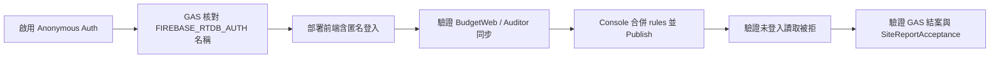

# Runbook：RTDB 敏感節點改為需登入（RTDB-READ-RULES-1 + P0）

**Cloud Agent 不執行本 runbook 內任何 Console／GAS Script Property／正式部署步驟。** 供豪哥或值班依序操作。

## 0. 目標

- `quotations/{案號}`：**未登入不可讀**（含單價、案場名稱）。
- `notifications/{UID}`：**未登入不可讀**（員工 LINE userId／即時訊息）。
- `quickRenovationQuote/**`（含 `settingsV2`／`adminPin`）：**未登入不可讀寫**。
- 寫入：不得比現行更寬；`quotations` 預設片段與讀取同為 `auth != null`（**見 §1.5**：後端未帶 auth 時勿盲目收緊寫入）。`notifications` 寫入暫維持公開（GAS `pushToFirebase` 未帶 token）。
- 前端：BudgetWeb、BudgetAuditor V2、客戶進度頁、QuickRenovationQuote 等先支援**匿名登入**再讀寫。

## 1. Firebase Console 前置（豪哥）

1. 專案 `brave-calling-391208` → **Authentication** → Sign-in method → 啟用 **Anonymous**。
2. 記錄目前 **Realtime Database → Rules** 全文：  
   - Rules 頁 → 右上角 **⋮** → 匯出／或複製整份 JSON 存檔 `rules-before-YYYYMMDD.json`。
3. **不要**在未匯出前覆寫整份 rules。
4. **禁止**對本 repo 執行 `firebase deploy`／`firebase deploy --only database`：根目錄無正式 `firebase.json`；`firebase/rtdb-rules.p0-sensitive.fragment.json`（及舊 `quotations.rules.fragment.json`）僅為片段，CLI 部署會**抹掉**其他節點規則。

### 1.5 發布規則前必做：GAS `FIREBASE_RTDB_AUTH`（僅核對名稱，禁止由本任務新增）

Cloud Agent **無法**讀取 Script Properties；以下只能由豪哥在 **Google Apps Script 編輯器**人工確認。

| 步驟 | 操作 |
|------|------|
| 1 | 開啟 **Backend_GAS** → `project-console` 對應的 GAS 專案 |
| 2 | **專案設定**（齒輪）→ **Script properties** |
| 3 | 在清單中查找屬性名稱是否**已存在**：**`FIREBASE_RTDB_AUTH`**（只核對名稱，勿在不清楚用途時新增第二個類似名稱） |
| 4 | 對照 `FirebaseBridge.js` 結案寫入 `quotations/{案號}`：依 `LOG/2026-05-23`、`SPEC/12`，**僅在已設定該屬性時**後端 REST 才會帶 auth；未設定則依當時 RTDB Rules（公開寫入時仍可寫） |

**若 `FIREBASE_RTDB_AUTH` 不存在（禁止為本 rollout 擅自新增 Script Property 時）：**

| 選項 | 說明 | 建議 |
|------|------|------|
| **甲** | **延後發布** write 收緊 | 先上線前端（#215），待豪哥自行設定既有屬性或改 Admin SDK 後，再發布含 `auth != null` 的 **write** |
| **乙** | **只收緊 read** | Console 合併時：`quotations` 的 `.read` → `auth != null`；**.write 保留匯出檔原值**（結案 GAS 無 token 時仍可寫） |
| **丙** | 豪哥**手動**在 GAS 新增 `FIREBASE_RTDB_AUTH`（值由豪哥管理，**非**本 repo／Cloud Agent 範圍）後，再發布 read+write 皆 `auth != null` | 長期與片段檔一致 |

**讀取收緊與 `SiteReportAcceptance.js`：** 依 `TOS/TOS_AUDIT_ROUND12`，後端 `fetchQuotationContextFromFirebase_(projectNo)` 讀 `quotations/{案號}`（含 `items`、`total_summary` 等）。**讀取改為 `auth != null` 後，若 GAS 未帶與 `FIREBASE_RTDB_AUTH` 相同機制之 auth，驗收加總／毛利對照可能失敗。** 本 repo 無 Backend 源碼，無法確認實作是否已讀取該屬性；發布 read 規則前請在 GAS 試跑相關 action 或看執行記錄是否 `permission_denied`。

## 2. 合併規則片段（P0：三節點，僅 Console）

Repo 片段：**`firebase/rtdb-rules.p0-sensitive.fragment.json`**（內含 `_NOTICE`／`_AUTH_NOTES`；合併時**不要**把這兩個鍵貼進 Console）。

建議合併進完整 rules 的節點（`quotations` write 依 §1.5）：

```json
"quotations": {
  ".read": "auth != null",
  "$projectNo": {
    ".write": "auth != null"
  }
},
"notifications": {
  "$uid": {
    ".read": "auth != null",
    ".write": true
  }
},
"quickRenovationQuote": {
  ".read": "auth != null",
  ".write": "auth != null"
}
```

> **BudgetAuditor 總覽**：`db.ref('quotations').once('value')` 需要**父層** `.read`；只放 `$projectNo` 子層時，已登入列整包仍會 DENIED。

### 2.1 上層規則檢查（子層收緊是否會生效）

Firebase 規則：**父節點若已有 `.read: true` 或 `.write: true`，子節點再寫 `auth != null` 通常無法收緊。**

在 `rules-before-YYYYMMDD.json` 中檢查：

1. 根 `"rules"` 或任何**父層**是否對整棵樹設 `.read: true`／`.write: true`。
2. 是否存在 `"quotations": { ".read": true, ... }`（或 `notifications`／`quickRenovationQuote`）且子路徑未覆寫。
3. 若發現上層公開讀寫：須**先拿掉根／父層公開讀**，再設上列子節點；否則發布後仍可能公開。

操作：

1. 開啟步驟 1 匯出的完整 rules。
2. 完成 §2.1 檢查後，替換／寫入 `"quotations"`、`"notifications"`、`"quickRenovationQuote"`（quotations write 依 §1.5）。
3. 其他 top-level 節點（若有上傳佇列等）**逐字保留**；若根曾 `.read: true`，改為預設拒絕（僅允許上列節點依規則讀寫）。
4. 在 Console **Publish**（不要用 CLI 部署片段檔）。
5. 本地 Emulator：`npm run test:rtdb-rules`、`npm run test:rtdb-rules-legacy`（使用 `firebase/emulator.firebase.json`，與正式 deploy 無關）。

### 2.2 發布前相容（`notifications` 讀取端）

| 客戶端 | 現況 | 發布前必做 |
|--------|------|------------|
| 添心助手 `taupdata` `client/src/firebaseService.js` | 只 `initializeApp`，**無** Firebase Auth | 先加 `signInAnonymously`（或同等），再 Publish `notifications` 讀取收緊 |
| Hub SPA | 通知走 GAS，不直連此節點 | 無 |
| GAS `pushToFirebase` | POST 無 `?auth=` | 寫入暫 `.write: true`；日後補 `FIREBASE_RTDB_AUTH` 再收緊寫入 |

## 3. 部署順序（重要）



| 步驟 | 動作 | 通過標準 |
|------|------|----------|
| 3.1 | §1.5 GAS 屬性名稱核對 | 已選甲／乙／丙並記錄 |
| 3.2 | 合併並 **先** 部署 **liff-checkin** 前端（#215） | BudgetWeb 案號檢查、Auditor 載入／同步 OK |
| 3.3 | DevTools：Firebase Auth 有 anonymous `uid` | `quotations` 無 `permission_denied`（已登入） |
| 3.4 | 確認 taupdata 已能匿名登入（§2.2） | 助手仍收到測試推播 |
| 3.5 | Console Publish **合併後** rules（§2.1 已檢查） | 見 3.6 |
| 3.6 | 未帶 auth 讀取應失敗（勿用真案號／真 UID 公開測試） | 見下方 curl 探針 |
| 3.7 | BudgetWeb、Auditor、客戶進度頁、QuickRenovationQuote；**結案同步**；驗收／毛利相關 API；助手即時通知 | 無新增 `permission_denied` |
| 3.8 | 若有 #212/#213：LayoutPlanner → BudgetWeb 雲端同步 | 寫回安全閘正常 |

### 3.6 匿名 curl 探針（Publish 後；勿帶真案號內容）

```bash
# 皆應失敗（非 200 完整 JSON；常見 401／permission denied）
curl -sS -o /dev/null -w "%{http_code}\n" \
  "https://brave-calling-391208-default-rtdb.asia-southeast1.firebasedatabase.app/.json?shallow=true"
curl -sS -o /dev/null -w "%{http_code}\n" \
  "https://brave-calling-391208-default-rtdb.asia-southeast1.firebasedatabase.app/quotations.json?shallow=true"
curl -sS -o /dev/null -w "%{http_code}\n" \
  "https://brave-calling-391208-default-rtdb.asia-southeast1.firebasedatabase.app/notifications.json?shallow=true"
curl -sS -o /dev/null -w "%{http_code}\n" \
  "https://brave-calling-391208-default-rtdb.asia-southeast1.firebasedatabase.app/quickRenovationQuote/settingsV2.json"
```

## 4. 與 PR #212 / #213 合併順序

| 順序 | PR | 原因 |
|------|-----|------|
| 1 | **#215**（RTDB 登入層 + 片段 + runbook） | 登入集中在 `shared/js/firebase-rtdb-*` |
| 2 | #212 | BudgetWeb 草稿合併 |
| 3 | #213 | 寫回安全閘 |

**衝突點**：`tools/BudgetWeb_Standalone.html` — 保留 #213 的 `runBudgetWebQuotationCloudSync`，初始化以 `TanxinFirebaseRtdb` 為準。

## 5. 回滾

1. **Rules**：Console 貼回 `rules-before-YYYYMMDD.json` → Publish。
2. **前端**：回退 liff-checkin commit（匿名登入在舊規則下仍可用）。
3. Anonymous 誤關：重新啟用即可。

## 6. 安全說明（匿名登入）

- 阻擋**未帶 Firebase Auth**的爬蟲／公開 `.json`；任何人以公開 Web apiKey 仍可 `signInAnonymously` 後讀取——**不**等於案場／員工 ACL。
- Custom Token／LIFF 綁定 claims／GAS 脫敏 API 為後續升級（本任務不做）。
- `adminPin` 硬編碼於公開前端屬另案；規則收緊後陌生人至少不能再靠 REST 直接撈 `settingsV2`。

## 7. 本機驗證指令

```bash
npm run test:rtdb-auth-merge
npm run test:rtdb-rules
npm run test:rtdb-rules-legacy
npm run test:layout-planner:ci
```

*Runbook 版本：2026-11-17（P0：quotations + notifications + quickRenovationQuote）*
